# 11주차 작업기록 — TourLink (빅데이터와 AI 2조)

## 1. 웹 추천에 실제 기상청·에어코리아 예보 연결, 몇 박 며칠 날짜별 판정 (2026-11-07)

**목표**
- 웹앱 `/app`의 날씨 판정은 지금까지 시연용 예시 날씨(`weatherPresets`)를 썼다. 이제 `tourapi/weather.py`의 실제 예보를 쓴다.
- 추천 점수 계산(`recommend.ts`)과 판정 규칙(`weatherRules.ts`)은 고치지 않는다. 웹과 weather.py의 기준값은 이미 같다(10주차 13-1).

**바꾼 파일**

| 파일 | 내용 |
|---|---|
| `web/src/lib/liveWeather.ts` (새 파일) | 지역 좌표·시도·시군구·방문일로 `/tourapi/api/weather`를 부르고 응답을 `WeatherSnapshot`으로 바꾼다. 날짜 목록(`tripDates`), 여러 날 합치기(`worstOf`) |
| `web/src/lib/liveWeather.test.ts` (새 파일) | 날짜 목록·필드 대응·합치기 테스트 7개 |
| `web/src/pages/AppPage.tsx` | `decideWeather()`에 넣는 값을 실제 예보로 바꿈. 추천 대상 지역마다 그 지역 예보로 따로 판정 |
| `web/src/components/WeatherNotice.tsx` | 실제 예보 / 불러오는 중 / 예보 확인 필요 / 시연 모드 표시, 날짜별 요약 한 줄씩, 출처·발표 시각 |
| `web/src/components/CompanionForm.tsx` | "시연 모드 (예시 날씨)" 토글(켰을 때만 예시 선택), 1박 이상이면 '1박 2일 / 2박 3일 / 3박 4일' 버튼 |
| `web/src/lib/tripPreferences.ts` | `nights: 1 \| 2 \| 3`(기본 1), `weatherDemo`, `addDaysIso` 추가 |
| `web/src/components/RecommendationList.tsx` | 추천 근거 줄의 날씨 요약을 지역별로 받음(`weatherSummaryFor`) |
| `web/src/pages/AppPage.css` | 날짜별 요약·출처·시연 모드·3칸 버튼 스타일 |
| `tourapi/weather.py` | 응답에 필드 추가: 단기예보 날짜별 `issued`, 에어코리아 `pm10Grade`·`pm25Grade`. 단기예보 끝 날짜의 잘린 하루를 빼고 중기예보를 쓰게 고침(아래 '오류와 해결') |

**응답 필드 대응표** (`/api/weather` = weather.py `fetch_weather` → 웹 `WeatherSnapshot`)

| weather.py 응답 | WeatherSnapshot | 변환 | 없을 때 |
|---|---|---|---|
| `forecast.pop` | `pop` | 그날 강수확률 최댓값(%) 그대로 | null |
| `forecast.precip` | `precipitation` | 비·빗방울 → rain, 비/눈·빗방울눈날림 → rain_snow, 눈·눈날림 → snow, 소나기 → shower. 여러 개면 더 나쁜 쪽, 빈 목록이면 none | null(예보 없음) |
| `forecast.tmin` | `minTempC` | 그대로(℃) | null |
| `forecast.tmax` | `maxTempC` | 그대로(℃) | null |
| `warnings.kinds` | `warnings` | 그 시군구에 발효 중인 특보 종류(오늘·내일만) | [] |
| `air.pm10Grade` | `pm10Grade` | 시도 측정소 중 가장 나쁜 PM10 등급(1~4, 오늘만) | null |
| `air.pm25Grade` | `pm25Grade` | 시도 측정소 중 가장 나쁜 PM2.5 등급(1~4, 오늘만) | null |
| `forecast.source`·`issued`, `air.time` | (화면 출처) | "기상청 단기예보 11월 7일 14:00 발표 · 에어코리아 11월 7일 14:00 측정" | 표시 안 함 |

- 요청 값
  - 시도: 지역 데이터의 전체 이름(충청남도·강원특별자치도 등)을 weather.py 키(충남·강원 등)로 바꿔 보낸다.
  - 시군구: 지역 이름(예: 천안시, 청주시 상당구)을 그대로 보낸다. 특보 지역 판단과 강원 영서·영동 구분에 쓰인다.
  - 방문일: `YYYYMMDD`
- `forecast`가 null이면(예보 범위 밖) 그날은 "예보 확인 필요"다. 서버에 연결하지 못해도 같다.

**판정 방식**
- 지역별: 추천 대상 지역(시범 10곳 중 고른 범위)마다 그 지역 예보로 `decideWeather` → `applyWeatherRules`를 따로 한다.
  - 날씨 하나로 모든 지역을 판정하면 강릉의 비가 천안 추천까지 막기 때문이다.
  - 날씨 안내는 보고 있는 지역(없으면 1위 추천 지역) 기준으로 보여 준다.
- 몇 박 며칠: 방문일부터 방문일 + 박 수까지 날짜별로 예보를 부른다.
  - 항목별로 가장 나쁜 값(강수확률·최고기온·미세먼지 최대, 최저기온 최소, 비·눈 중 더 나쁜 것, 특보 합집합)으로 판정한다.
  - 그래서 어느 하루라도 기준에 걸리면 실내로 판정된다.
- 예보가 없는 날은 판정에서 빼고 "예보 확인 필요"로 표시한다. 모든 날이 없으면 날씨 조건 없이 추천하고 그렇게 안내한다.
- 시연용 예시(`weatherPresets`)는 지우지 않았다. "시연 모드"를 켰을 때만 모든 지역에 같은 예시 날씨를 쓴다.
- 브라우저는 같은 지역·날짜 예보를 30분 동안 다시 부르지 않는다. 서버는 1시간 저장한다(10주차 18번).

**캡처** (2026-11-07 16시대, 천안시·연령대·동행 선호·일반 일행. 기상청 단기예보 11월 7일 14:00 발표 기준)

맑은 날 — 11월 10일: 강수확률 0%, -1~12℃ → 실내·야외 함께 추천

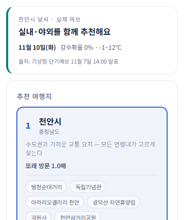

비 오는 날 — 11월 8일: 강수확률 60%, 비 → 실내 위주, 추천 근거 줄에 "강수확률 60% → 실내"

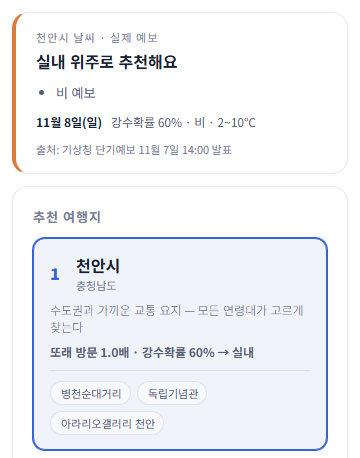

서버 꺼짐 — tourapi 서버를 끈 상태: "예보 확인 필요", 날씨 조건 없이 추천

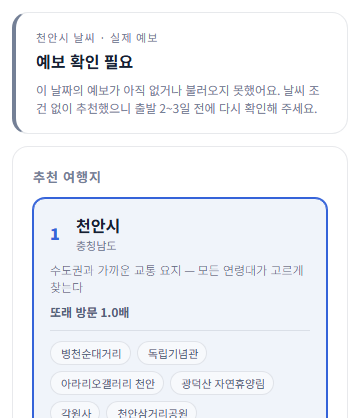

**몇 박 며칠 날짜별 판정 결과** (천안시, 출발 11월 8일)

| 일정 | 11/8(일) | 11/9(월) | 11/10(화) | 11/11(수) | 판정 |
|---|---|---|---|---|---|
| 당일치기 | 60% · 비 · 2~10℃ | | | | 실내 위주 |
| 1박 2일 | 60% · 비 · 2~10℃ | 30% · 6~12℃ | | | 실내 위주 |
| 2박 3일 | 60% · 비 · 2~10℃ | 30% · 6~12℃ | 0% · -1~12℃ | | 실내 위주 |
| 3박 4일 | 60% · 비 · 2~10℃ | 30% · 6~12℃ | 0% · -1~12℃ | 10% · 2~15℃ (중기예보) | 실내 위주 |

- 모든 일정에서 11/8 비가 가장 나쁜 값이라 실내 위주로 판정됐다. 일반 일행 기준(최저기온 -5℃ 이하만 추운 날)이라 11/10의 -1℃는 걸리지 않는다.
- 3박 4일의 출처는 "기상청 단기예보 11월 7일 14:00 발표 / 기상청 중기예보 11월 7일 06:00 발표"로 두 가지가 함께 나온다.
- 1박 2일 행은 같은 날짜별 응답으로 정리한 값이다. 2박 3일·3박 4일은 아래 화면 그대로다.

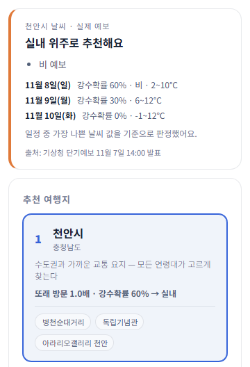

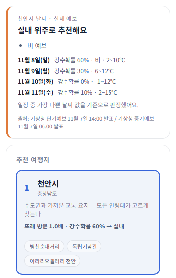

**오류와 해결**
- 문제: 처음 3박 4일을 찍었을 때 11/11이 "강수확률 0% · 3~3℃"로 나왔다.
  - 원인: 14시 발표 단기예보에는 11/11이 00시 한 시간대만 들어 있다. weather.py가 이 잘린 하루를 온전한 예보처럼 썼다.
  - 같은 날의 중기예보는 강수확률 10%, 2~15℃였다.
  - 해결: `fetch_short_days`에서 최저·최고기온(TMN·TMX)이 모두 없는 미래 날짜는 빼서, `fetch_weather`가 중기예보를 보게 했다. 오늘은 오후 시간대만 남아도 그대로 쓴다.
  - 고친 뒤 11/11은 중기예보로 나온다. `py weather.py check` 4개 중 4개 정상
- 문제: 처음 확인할 때 출처에 발표 시각이 빠졌다.
  - 원인: 8000 포트에 고치기 전 코드로 켜 둔 서버가 함께 떠 있었다(Windows는 같은 포트를 두 프로세스가 열 수 있음).
  - 해결: 시험은 따로 띄운 서버(8010)와 웹(5175)으로 했다.

**확인**
- 화면 확인은 Chrome 원격 디버깅으로 조건을 고르고 "추천받기"를 눌러서 했다(시험 서버 tourapi 8010, vite 5175).
- `npm run build` 통과, `npm test` 46개 통과(새 `liveWeather.test.ts` 7개 포함), `oxlint` 통과
- 제약
  - 미세먼지는 실시간 값이라 방문일이 오늘일 때만 판정에 쓴다.
  - 특보는 오늘·내일만 본다(weather.py 동작 그대로).
  - 시범 지역 좌표(시청·군청 부근)의 5km 격자 예보라, 같은 시군 안에서도 관광지 위치에 따라 다를 수 있다.

## 2. 연결한 API 5종을 /app 화면에 모두 보이게 하기 (2026-11-07)

**목표와 원칙**
- 단기예보·중기예보·기상특보·에어코리아·무장애 API 5종이 웹앱 `/app`에서 모두 눈에 보이게 한다.
- 추천 점수(`recommend.ts`)와 판정 규칙(`weatherRules.ts`)은 고치지 않는다.
- `AppPage.tsx`·`AttractionDetail.tsx`·`RecommendationList.tsx`는 기존 코드를 지우지 않고, 새 컴포넌트와 선택 prop만 끼워 넣었다.
  - 예외: 1차로 AppPage에 따로 붙였던 무장애 패널(10주차 22번)은 상세 패널 안으로 옮기면서 뺐다.
- 디자인은 기존 CSS 변수와 카드 모양을 그대로 쓴다. Figma 반영은 나중에 한다.
- 시작 전 `git fetch` 후 `git rebase origin/main`: 원격에 새 커밋이 없어 그대로였다.

**기능별 API → 화면 위치 → 캡처**

| 기능 | API (서버 → 응답 필드) | 화면 위치 | 캡처 |
|---|---|---|---|
| 맑은 날 추천 | 단기예보 `forecast` | 날씨 안내 "실내·야외를 함께 추천해요" | ① `b1_clear_today.png` |
| 비 예보 → 실내, 빠진 곳 | 단기예보 `forecast.pop·precip` → weatherRules | 날씨 안내 "실내 위주", 추천 근거 줄 "강수확률 60% → 실내", 목록 아래 접힌 "날씨 때문에 제외된 곳 n곳"(관광지·지역·이유) | ② `b2_rain.png` |
| 초단기실황 | 초단기실황 `now.temp·precipType·time` (방문일이 오늘일 때만) | 날씨 안내 맨 위 "지금 10.1℃ · 강수 없음", 출처에 "초단기실황 ○시 관측". 오늘이 아니면 숨김 | ① `b1_clear_today.png` |
| 몇 박 며칠 | 단기·중기예보 `forecast` (날짜별) | 날씨 안내에 날짜별 한 줄 요약, 가장 나쁜 날 기준 판정 | ⑥ `b6_2n3d.png` |
| 기상특보 | 기상특보 `warnings.active·elsewhereInSido·kinds` (오늘·내일) | 추천 목록 위 배너 "강릉시에 건조주의보 발효 중". 같은 시도 다른 시군에만 있으면 "인근 시군 특보 있음"으로 약하게. 지형 제외(호우·태풍·풍랑 → 바다·산·계곡)는 weatherRules 규칙 그대로이고, 빠진 곳은 "날씨 때문에 제외된 곳"에 "호우 특보 → 바다 제외"로 남음 | ③ `b3_warning_live.png`(실제 건조주의보), `b3_warning_demo.png`(시연 모드 호우특보) |
| 미세먼지 | 에어코리아 `air.pm10Grade·pm25Grade·time` (오늘만) | 날씨 안내 "미세먼지 보통 (PM10 보통 · PM2.5 보통) · 에어코리아 ○시 측정". 나쁨 이상이면 "실내 장소 위주로 보여 드려요. 마스크를 챙기세요."와 실내만 추천, 체크리스트에 마스크 안내 | ④ `b4_dust_demo.png`(시연 모드) |
| 무장애 — 상세 | 무장애 `/api/access/match` → `fitHave·fitMissing·available` | 관광지 상세 패널 안 "이용 편의 정보" 칸: 필요한 시설을 "있음"과 "등록 정보 없음"으로 나누고 "등록 정보 없음은 시설이 없다는 뜻이 아닙니다." 표시, 등록 정보 전체는 접어 둠 | ⑤ `b5_child_detail.png` |
| 무장애 — 카드 배지 | 무장애 `/api/access/match` (`available`이 있을 때) | 추천 카드 관광지 칩 옆 "편의 정보" 배지. 정보가 있을 때만 달고 순서는 그대로 | ①② |
| 무장애 — 체크리스트 | 무장애 `fitHave` (어르신·아이 동반일 때) | 여행 체크리스트에 "독립기념관: 수유실·장애인 화장실·유아차 대여·이용 정보 있음" | ⑤ |
| 준비물 연동 | weather.py `recommend.tips` (decide()) | 여행 체크리스트에 우산·미끄럼·방한·물·자외선 등을 문장으로. 기존 문구와 같은 주제면 하나만 | ⑤(우산·미끄럼) |
| 출처 표시 | 각 API | 날씨 안내 아래 "출처: 기상청 초단기실황 ○시 관측 / 기상청 단기예보 ○시 발표 · 에어코리아 ○시 측정", 특보 배너 "출처: 기상청 기상특보", 편의 정보 아래 "출처: 한국관광공사 무장애 여행정보" | ①③⑤ |
| 실패 처리 | 응답 `errors`(하위 API별), 서버 연결 실패 | 실패한 칸만 "○○ 정보를 불러오지 못했습니다"/"정보를 불러오지 못했습니다". 서버를 꺼도 추천은 그대로 나오고, 오류 원인은 콘솔에만 남김 | ⑦ `b7_server_down.png` |

캡처 (2026-11-07 16시대, 기상청 단기예보 11월 7일 14:00 발표, 에어코리아 16:00 측정 기준)

① 맑은 날 추천 (천안시, 오늘) — 지금 10.1℃·강수 없음, 미세먼지 보통, 칩에 "편의 정보" 배지

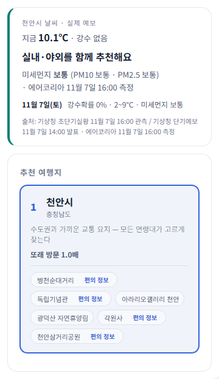

② 비 예보 (천안시, 11/8 강수확률 60%·비) — 실내 위주, 날씨 때문에 제외된 곳 3곳(광덕산 자연휴양림·각원사·천안삼거리공원: "비 예보 → 실내만 추천")

③ 특보 배너 — 실제: 강릉시 건조주의보(지형 제외 대상이 아니라 안내만) / 시연 모드: 호우특보로 바다 관광지 4곳 제외

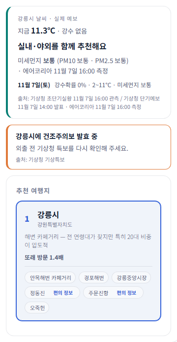

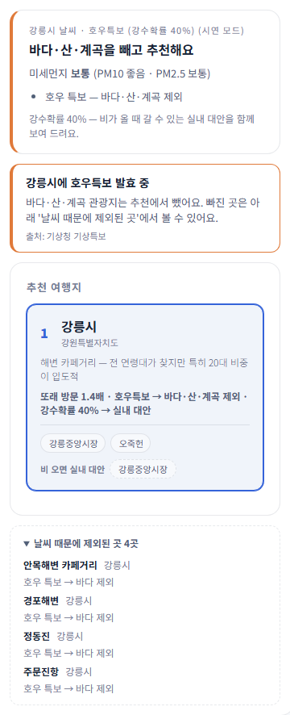

④ 미세먼지 나쁨 (시연 모드) — 실내 위주, 제외된 곳 3곳 "미세먼지 나쁨 → 실내만 추천", 체크리스트에 마스크 안내

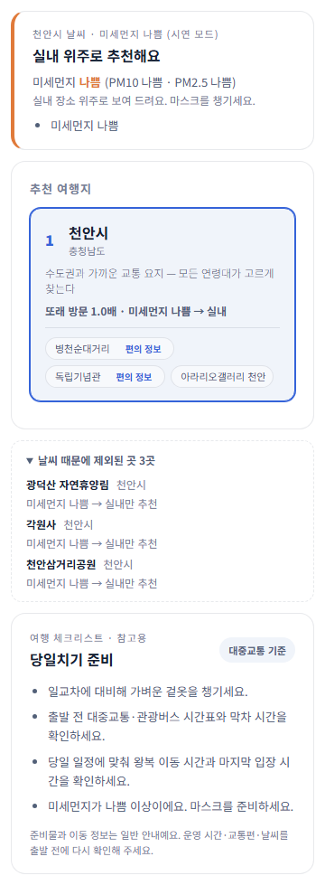

⑤ 아이 동반 상세 패널 (천안시 독립기념관, 11/8) — 있음: 수유실·장애인 화장실·유아차 대여·이용 / 등록 정보 없음: 유아용 의자. 체크리스트에 우산·미끄럼(weather.py tips)과 편의시설 한 줄

⑥ 2박 3일 날짜별 요약 (천안시, 11/8~11/10)

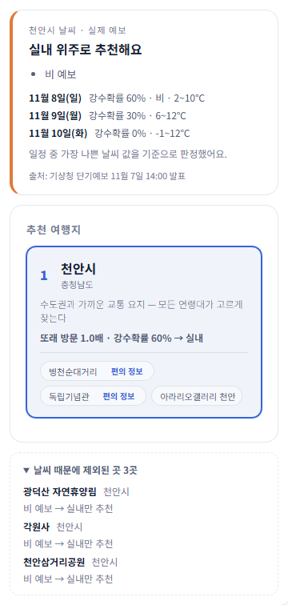

⑦ API 서버를 끈 상태 — 날씨 안내 "날씨 정보를 불러오지 못했습니다", 이용 편의 정보 "정보를 불러오지 못했습니다", 추천 목록은 그대로

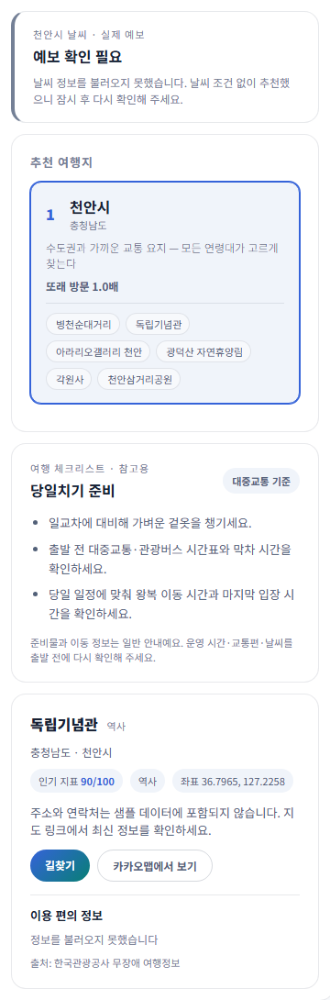

- 실제 예보: ①②③(실제)⑤⑥⑦. 시연 모드: ③(호우특보), ④(미세먼지 나쁨).
  - 캡처 시각에는 이 지역에 지형 제외 특보와 미세먼지 나쁨이 없었다. 강원 강릉·속초는 건조주의보, 미세먼지는 보통·좋음이었다.

**바꾼 파일**

| 파일 | 내용 |
|---|---|
| `web/src/lib/weatherExclusions.ts` (새 파일) | 날씨 적용 전 추천과 비교해 빠진 관광지와 이유("강수확률 70% → 실내만 추천", "호우 특보 → 바다 제외")를 만든다. 규칙은 `isAllowed` 그대로 |
| `web/src/components/WeatherExcludedList.tsx` (새 파일) | "날씨 때문에 제외된 곳" 접기 목록 |
| `web/src/components/WarningBanner.tsx` (새 파일) | 특보 배너(이 시군구) / 인근 시군 약한 표시 |
| `web/src/lib/preparationTips.ts` (새 파일) | weather.py tips → 문장, 미세먼지 마스크 안내, 같은 주제 안내 합치기 |
| `web/src/lib/liveWeather.ts` | 응답에서 `now`, `warnings.active·elsewhereInSido`, `air.time`, `recommend.tips`, `errors`(칸별 실패), 서버 연결 실패를 읽음. 요청에 일행(`with`)을 보내 tips가 어르신·아이 기준을 따르게 함 |
| `web/src/lib/liveAccess.ts` | `toAccessSummary`(있음/등록 정보 없음/배지/체크리스트 한 줄), 여러 관광지 조회 훅, 실패 문구 "정보를 불러오지 못했습니다" |
| `web/src/components/WeatherNotice.tsx` | 현재 날씨 줄, 미세먼지 줄, 칸별 실패 표시, 출처에 초단기실황 |
| `web/src/components/AccessibilityInfo.tsx` | 상세 패널 안 "이용 편의 정보" 칸으로 바꿈, 출처 표시 |
| `web/src/components/AttractionDetail.tsx` | 선택 prop `party`와 "이용 편의 정보" 칸 하나 추가 |
| `web/src/components/RecommendationList.tsx` | 선택 prop `attractionBadge`, 칩 이름 옆 배지 |
| `web/src/components/TripPreparation.tsx` | 선택 prop `extraTips`(겹치면 하나만) |
| `web/src/pages/AppPage.tsx` | 날씨 적용 전·후 추천을 나눔(결과 같음), 위 컴포넌트 끼워 넣기, 무장애 조회·체크리스트 안내 연결 |
| `web/src/pages/AppPage.css` | 새 칸 스타일(기존 변수 재사용) |

**커밋** (기능 단위, push 안 함)

| 커밋 | 기능 |
|---|---|
| `142f0b0` | 날씨 표시: 날씨 때문에 제외된 곳, 초단기실황, API별 실패 표시 |
| `87e4992` | 특보: 시군구 특보 배너, 인근 시군 약한 표시 |
| `d23ae50` | 미세먼지: 등급·측정 시각, 나쁨 이상이면 마스크 안내 |
| `a5dec29` | 무장애: 상세 패널 이용 편의 정보, 카드 배지, 동반 일행 체크리스트 안내 |
| `91a3e5a` | 준비물: weather.py tips를 체크리스트에 합치고 겹치면 하나만 |

**확인**
- `npm run build` 통과, `npm test` 64개 통과(이번에 18개 추가), `oxlint` 통과
  - liveWeather 변환: 초단기실황·칸별 실패·특보 구분·tips
  - accessInfo 변환: `toAccessSummary`
  - weatherExclusions·preparationTips 테스트
- 화면 확인은 Chrome 원격 디버깅으로 조건을 고르고 추천받기·관광지 칩을 눌러서 했다(시험 서버 tourapi 8010, vite 5175).
  - 오른쪽 칸은 스크롤 영역이라, 캡처할 때만 높이 제한을 풀었다.
- 서비스키는 출력·로그·캡처 어디에도 없다.

**남은 점**
- 추천 카드 배지를 달려고 화면의 관광지마다 무장애 조회를 한다. 처음 한 번은 관광지당 관광공사 API 2번(이름 검색 + 상세)이고, 그 뒤 6시간은 서버 저장값을 쓴다.
  - 추천 지역이 많으면 첫 조회 호출 수가 늘어나므로 활용신청 한도를 지켜봐야 한다.
- 시연 모드는 예시 날씨만 바꾼다. 준비물의 weather.py tips는 실제 예보에서만 나오고, 시연 모드에서는 미세먼지 마스크 안내만 붙는다.
- 웹앱 샘플 관광지 좌표가 실제와 수 km 다른 문제(10주차 22번)는 그대로다.

## 3. API 반영 점검표: api.py 페이지 9개 → 웹앱 /app (2026-11-07)

코드는 고치지 않고 점검만 했다. 커밋하지 않았다.

**웹앱이 /tourapi로 부르는 주소** (`web/src` 전체 검색, 테스트 제외)

| 웹앱 주소 | 부르는 곳 | api.py 함수 | 안에 든 공공데이터 API (오퍼레이션) |
|---|---|---|---|
| `/api/map/places?province=` | `lib/nationalData.ts` `loadMapPlaces` | `fetch_map_places` | 아래 5개를 묶음 |
| ┗ spots | | `fetch_all_tourspots` | 전국관광지정보표준데이터 `tn_pubr_public_trrsrt_api` |
| ┗ shelters·hospitals | | `_safety_groups` → `fetch_all_safety` | 한국문화정보원 관광지 안전정보 `conver10` (지진해일대피소, 응급의료기관만 골라 씀) |
| ┗ medical | | `_medical_places` | 한국관광공사 의료관광정보 `MdclTursmService/mdclTursmSyncList` |
| ┗ pets (시도를 고를 때만) | | `_pet_places` | 한국관광공사 반려동물 동반여행 `KorPetTourService2/areaBasedList2` |
| ┗ demand (시도를 고를 때만) | | `_latest_demand` → `fetch_demand(…, "11")` | 한국관광공사 지역별 관광자원 수요 `AreaTarResDemService` (관광서비스 수요지수) |
| `/api/pet/detail?contentId=&contentTypeId=` | `lib/nationalData.ts` `loadPetDetail` | `fetch_place_details("pet", …)` | `KorPetTourService2` `detailCommon2`·`detailIntro2`·`detailPetTour2` |
| `/api/weather?lat=&lon=&sido=&gungu=&date=&with=` | `lib/liveWeather.ts` | `weather.fetch_weather` | 기상청 단기예보 `getVilageFcst`, 초단기실황 `getUltraSrtNcst`(오늘), 중기예보 `getMidLandFcst`·`getMidTa`(4~10일 뒤), 기상특보 `getPwnStatus`(오늘·내일), 에어코리아 `getCtprvnRltmMesureDnsty`(오늘) |
| `/api/access/match?lat=&lon=&name=&with=` | `lib/liveAccess.ts` | `barrierfree.fetch_access_match` | 한국관광공사 무장애 여행정보 `KorWithService2` `searchKeyword2` + `detailWithTour2` |

- 웹앱이 부르지 않는 api.py 주소: `/api/area`, `/api/nearby`, `/api/safety`, `/api/tourspots`, `/api/demand`, `/api/pet/regions·places`, `/api/medical`, `/api/medical/detail`, `/api/weather/short·mid·warnings·air`, `/api/access/nearby·detail`
  - 이 중 상당수는 같은 원자료를 `/api/map/places`·`/api/weather`로 받아 쓴다.

**API 반영 점검표**

| api.py 페이지 | 공공데이터 API 이름 | 웹앱에서 부르는 주소 | 화면 위치(컴포넌트) | 추천 결과에 영향 | 상태 | push |
|---|---|---|---|---|---|---|
| 지역 안전 종합 (`/area`) | 관광지 안전정보 conver10 + 전국관광지 표준데이터 + 관광자원 수요 (`/api/area`·`/api/nearby`) | 없음. 같은 원자료를 `/api/map/places`로 받음 | `NationalSpotPanel`(관광지별 가까운 대피소·같은 시군 응급의료기관·혼잡 참고) | 없음 | 일부 — 시군 단위 종합 요약과 '내 위치 주변 찾기'는 없음 | 됨 (`0b257a8`) |
| 날씨 맞춤 추천 (`/weather`) | 기상청 단기예보·초단기실황·중기예보·기상특보, 에어코리아 대기오염정보 | `/api/weather` | `WeatherNotice`(판정·날짜별 요약·현재 날씨·미세먼지·출처), `WarningBanner`, `WeatherExcludedList`, `RecommendationList` 근거 줄, `TripPreparation`(tips·마스크) | **있음** — 지역별 실내만/지형 제외로 추천 관광지·지역이 걸러짐(점수는 그대로) | 반영 | **안 됨** (`917833b`, `142f0b0`, `87e4992`, `d23ae50`, `91a3e5a`) |
| 일행 맞춤 무장애 (`/access`) | 한국관광공사 무장애 여행정보 KorWithService2 | `/api/access/match` (페이지는 `/api/access/nearby`·`detail`) | `AttractionDetail` 안 `AccessibilityInfo`(이용 편의 정보), `RecommendationList` 칩 배지, `TripPreparation` 한 줄 | 없음 — 순서 그대로 | 반영 (위치기반 주변 목록 `locationBasedList2`는 안 씀) | **안 됨** (`c1f12b0`, `4f8ca3b`, `a5dec29`) |
| 관광지 안전정보 (`/safety`) | 한국문화정보원 관광지 안전정보 conver10 | `/api/map/places` (shelters·hospitals) | `NationalSpotPanel` 안전 정보, `PetBody` 안전 정보, `MapView` 대피소 마커(지도 키 있을 때) | 없음 | 일부 — 1,522건 중 지진해일대피소(629)·응급의료기관만 쓰고 '관광지' 항목(382)은 안 씀 | 됨 (`0b257a8`) |
| 전국 관광지 (`/tourspot`) | 전국관광지정보표준데이터 tn_pubr_public_trrsrt_api | `/api/map/places` (spots) | `MapView` 마커 / 지도 없을 때 목록, `NationalSpotPanel`(주소·수용인원·주차·소개·편의시설) | 없음 — 추천은 샘플 지역 데이터로 함 | 반영 | 됨 (`0b257a8`) |
| 관광 자원 수요 (`/demand`) | 한국관광공사 지역별 관광자원 수요 AreaTarResDemService | `/api/map/places` (demand) | `DemandCard`(시도를 고르면 수요 높은 시군구 순위), `NationalSpotPanel` 관광수요 순위·혼잡 참고 | 없음 | 반영 (관광서비스 수요지수 한 가지) | 됨 (`0b257a8`) |
| 반려동물 동반여행 (`/pet`) | 한국관광공사 KorPetTourService2 | `/api/map/places` (pets), `/api/pet/detail` | `MapView` 반려동물 마커, 지도 키가 없으면 목록의 '반려동물 동반' 탭 → `NationalSpotPanel`의 `PetBody`(동반 안전수칙·가까운 대피소) | 없음 | 반영 (11/7 지도 없을 때 목록 탭 추가, 5번) | 됨 (`0b257a8`) + 목록 탭은 5번 커밋 |
| 영문 관광정보 (`/eng`) | 한국관광공사 EngService2 | 없음 | 없음 | 없음 | 프로젝트 범위에서 제외(11/7 결정, 코드 삭제) | — |
| 의료 관광정보 (`/medical`) | 한국관광공사 MdclTursmService | `/api/map/places` (medical) | `MapView` 의료관광 마커, 지도 키가 없으면 목록의 '의료관광' 탭 → `NationalSpotPanel` 의료 관광 | 없음 | 반영 (11/7 지도 없을 때 목록 탭 추가, 5번) | 됨 (`0b257a8`) + 목록 탭은 5번 커밋 |

- push 기준: `origin/main`은 `ea8ce10`. 로컬 커밋 15개는 push 전이다.
  - 날씨·무장애 웹 연결은 모두 push 전이라 배포된 웹앱에는 아직 없다.
  - 배포된 tourapi(Vercel)에도 `barrierfree.py`(`c1f12b0` 이후)가 없다. push 후 tourapi·web 둘 다 다시 배포해야 한다.
- 추천 결과에 영향이 있는 것은 날씨 하나다. 추천 점수(`recommend.ts`)는 어느 API도 바꾸지 않는다.

**확인한 환경**
- tourapi: 8000 포트에 이미 떠 있던 `barrierfree.py local`(17:29 실행)을 그대로 썼다. `py api.py local`과 같은 api.py 서버다.
  - 하나를 더 켜면 Windows에서 같은 포트를 두 프로세스가 열어 요청이 섞이므로 따로 켜지 않았다.
- web: `npm run dev`(5173, 프록시 `/tourapi` → 8000)
  - 프록시 응답: `/api/map/places` 200, `/api/access/match` 200, `/api/weather` 200
- 이 PC의 웹앱에는 카카오 지도 키(`.env.local`)가 없어 지도 대신 목록이 나온다. 그래서 반려동물·의료관광 마커는 화면으로 확인하지 못했다.

**캡처** (반영된 것마다 한 장, 2026-11-07 밤)

전국 관광지 + 관광지 안전정보 + 관광 자원 수요(관광지별) — 강원 강릉시 주문진해변관광지: 수용 1,000명·주차 250대, 관광수요 18곳 중 1위, 응급의료기관 강릉시 4곳, 가장 가까운 지진해일대피소 1.0km

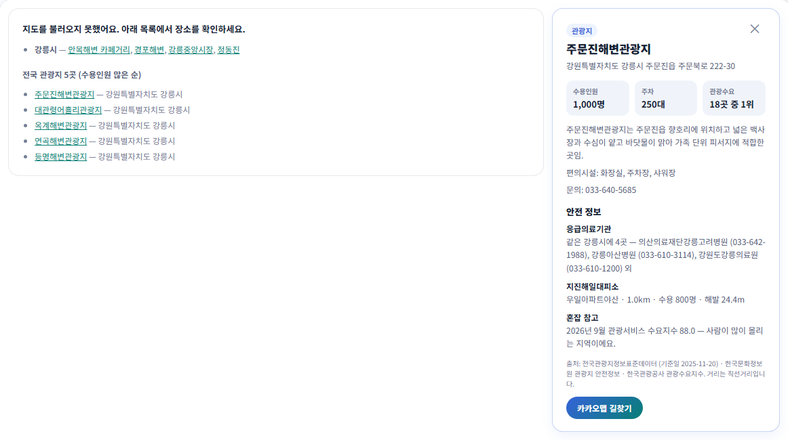

관광 자원 수요 — 강원 시군구 관광서비스 수요지수 순위(2026년 9월, 강릉시 88.0)

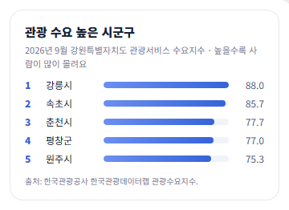

날씨 맞춤 추천 — 천안시 11/8 비 예보(강수확률 60%) → 실내 위주, 제외된 곳 표시, 기상청 단기예보 11월 7일 20:00 발표

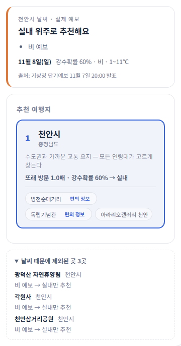

일행 맞춤 무장애 — 천안시 독립기념관, 아이 동반 이용 편의 정보

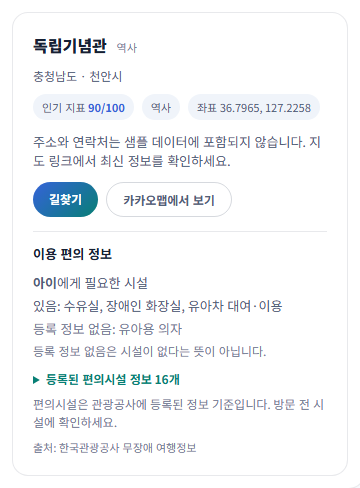

**점검하며 찾은 것** (코드는 고치지 않음)
1. 영문 관광정보(EngService2)는 웹앱에서 전혀 쓰지 않는다. → 11/7 결정으로 프로젝트 범위에서 빼고 코드를 지웠다(4번).
2. 반려동물·의료관광은 카카오 지도 마커로만 열 수 있다. 지도 키가 없는 환경(이 PC, 키 없는 배포)에서는 데이터를 받아 와도 화면에 나오지 않는다. 지도가 없을 때 나오는 목록에 이 둘도 넣을지 정해야 한다. → 11/7 목록 탭으로 넣었다(5번).
3. 지역 안전 종합의 시군 단위 요약(`/api/area`)과 내 위치 주변 찾기(`/api/nearby`)는 웹앱에 없다.
4. 관광지 안전정보의 '관광지' 항목(382건)은 웹앱에서 쓰지 않는다. 전국 관광지 표준데이터를 따로 쓰기 때문이다.
5. 날씨·무장애 연결은 push 전이라 배포 화면에는 없다.

## 4. 영문 관광정보(EngService2) 제거 (2026-11-07)

**결정**
- 영문 관광정보는 웹앱 `/app`에서 쓰지 않아(3번 점검표) 11/7에 프로젝트 범위에서 빼기로 했다. 코드를 지웠다.
- 10주차 작업기록 같은 과거 기록은 고치지 않았다(10주차 19번 접근 로그 결과에 `/eng`가 남아 있음).

**지운 것** (`tourapi/api.py`)

| 위치 | 내용 |
|---|---|
| `TOUR_SERVICES["eng"]` | `https://apis.data.go.kr/B551011/EngService2`, `EnglishTourApp`, "영문 관광정보" |
| `NAV_ITEMS` | `("/eng", "영문 관광정보")` |
| 홈 카드(`HOME_PAGE`) | "영문 관광정보 — 외국인 관광객용 영문 관광지·축제·숙박 정보" 링크 |
| `PLACE_PAGE_CONFIG["eng"]` | 영문 화면 설정(제목·검색 안내·콘텐츠 타입 76~85 등) |
| `PAGES["/eng"]` | `_place_page("eng")` |
| 라우트 반복문 | `for _service in ("eng", "pet")` → `for _service in ("pet",)`. `/api/eng/regions·places·detail`이 없어짐 |
| 주석 | API_KEY 설명의 "영문관광", 구역 제목 "영문 관광정보 (EngService2) / 반려동물…", 화면 설정 주석 "영문/반려동물 화면은…" |

**남긴 것**

| 위치 | 남긴 이유 |
|---|---|
| `fetch_medical_tourism`·`fetch_medical_details`의 `"langDivCd": "ENG"` | 의료관광(MdclTursmService) 요청 값이다. 영문 관광정보와 무관 |
| `_medical_in_area`의 영문 주소 판별(통합 코드 12: 광주·전남) | 의료관광 지역 판별 |
| `fetch_regions`·`fetch_places`·`fetch_place_details`·`_place_page`·`PLACE_SCRIPT` | 반려동물과 같이 쓰던 공용 코드. 영문 전용 분기는 설정 항목뿐이라 공용 함수는 그대로 두었다(`if service == "pet"` 등 반려동물 분기 유지) |
| `tourism_platform`의 "영문 오퍼레이션명" 주석(`data/apis/air.py`·`weather.py`) | API 오퍼레이션의 영어 이름 이야기라 영문 관광정보와 무관 |

- web/src와 README(`README.md`, `web/README.md`)에는 영문 관광정보·EngService2·`/api/eng` 언급이 없었다.
- 11주차 3번 점검표의 영문 행은 "프로젝트 범위에서 제외(11/7 결정, 코드 삭제)"로 바꿨다.

**확인**
- 8000 포트에는 직접 켜 둔 `barrierfree.py local`(지우기 전 코드)이 떠 있었다. 하나 더 켜면 Windows에서 같은 포트에 두 서버가 떠 요청이 섞인다.
  - 그래서 `py api.py local`과 같은 api.py 서버(`TourRequestHandler`)를 8010 포트로 띄워 확인했다.
  - 웹은 vite 5175, 프록시는 8010으로 썼다.

| 요청 | 결과 |
|---|---|
| `/eng`, `/api/eng/places`, `/api/eng/regions`, `/api/eng/detail` | 404 |
| `/pet` | 200, 전체 9,657건 중 12건 표시 |
| `/api/pet/places` | 200 (totalCount 9,657, 첫 항목 문수산) |
| `/api/pet/detail?contentId=2736417&contentTypeId=12` | 200 (common·intro·pet 세 구역) |
| `/medical`, `/api/medical` | 200 (totalCount 277) |
| 웹 프록시 `/tourapi/api/map/places?province=강원특별자치도` | 200, 반려동물 394곳·의료관광 2곳, errors 없음 |

- 웹앱의 반려동물·의료관광은 목록이 없고 카카오 지도 마커로만 열린다(3번 점검표). 이 PC에는 지도 키가 없어 화면 대신 위 데이터로 확인했다.
- `npm run build` 통과, `npm test` 64개 통과

캡처

홈 — 메뉴·카드에서 영문 관광정보가 빠짐

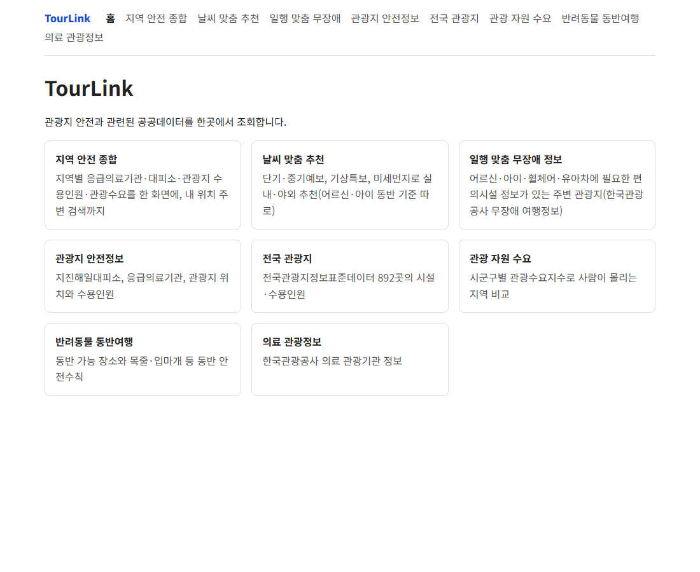

`/eng` — 404

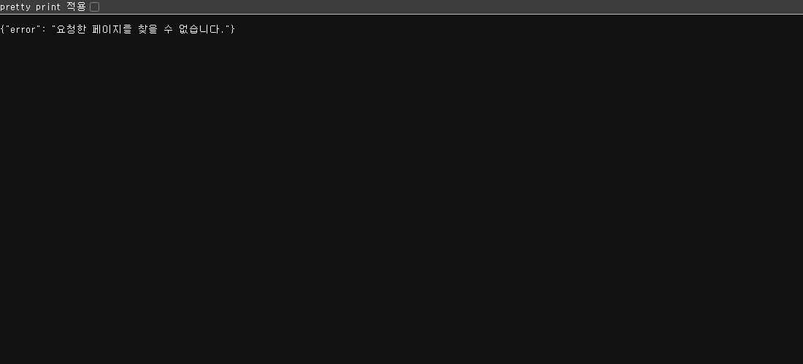

`/pet` — 반려동물 동반여행 목록 정상

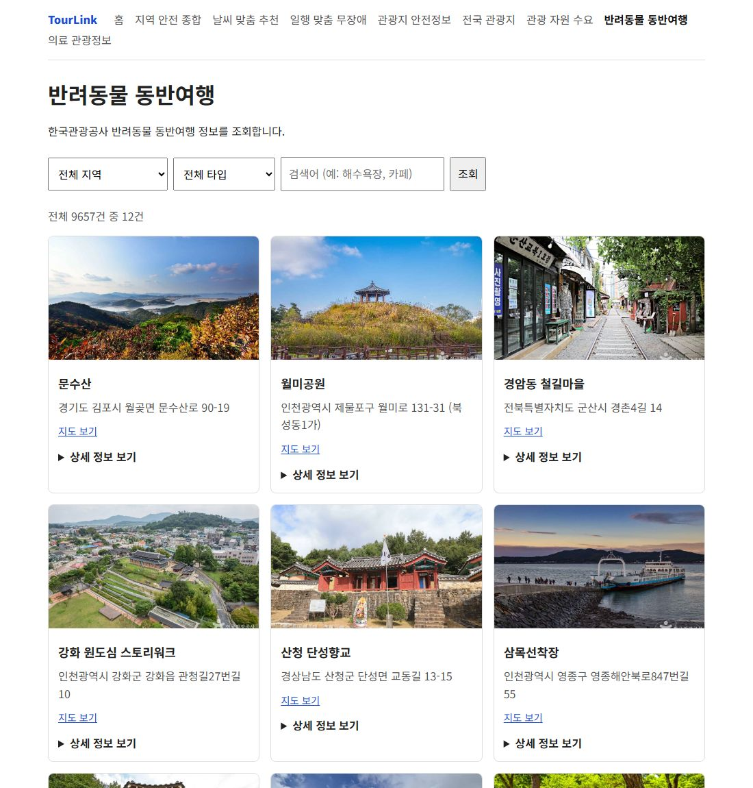

`/medical` — 의료 관광정보 정상

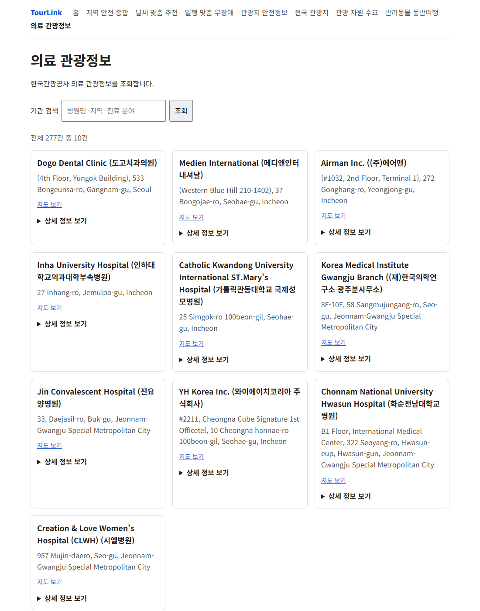

## 5. 지도 없을 때 반려동물·의료관광 목록 추가 (2026-11-07)

**한 일**
- 카카오 지도 키가 없을 때 나오는 목록(`MapView`의 지도 대신 목록)의 '전국 관광지' 부분을 '관광지 / 반려동물 동반 / 의료관광' 탭으로 나눴다(`FallbackPlaceTabs`).
  - 탭은 기존 버튼 묶음 스타일(`segmented is-three`)을, 목록은 기존 `fallback-region-list`·`fallback-attraction-link`를 그대로 쓴다.
  - 각 탭에 건수를 붙이고, 0건인 탭은 흐리게 비활성으로 둔다. 목록은 탭마다 30곳까지다.
    - 관광지: 수용인원 많은 순(기존과 같음)
    - 반려동물: 서버 순서, 종류·주소 함께 표시
    - 의료관광: 기관명·주소
  - 항목을 누르면 지도 마커와 같은 `onSelectPlace({ type: "pet" | "medical" | "spot", place })`를 불러, 같은 상세(`PetBody`, 의료관광 패널)가 열린다.
- 지도 키가 있을 때의 지도·마커 동작은 바꾸지 않았다. 바뀐 곳은 지도 대신 목록을 그리는 부분뿐이다.
- 바꾼 파일: `web/src/components/MapView.tsx`, `web/src/pages/AppPage.css`
- 3번 점검표의 반려동물·의료관광 행을 '반영'으로 고쳤다.

**확인** (지도 키 없음: `web/.env.local` 없음. 시험 서버 tourapi 8010, vite 5175, 강원 선택)
- 탭: 관광지 66 / 반려동물 동반 394 / 의료관광 2
- 반려동물 첫 항목 '원주 반계리 은행나무'를 누르면 PetBody가 열린다.
  - 동반 구분 '전구역 동반가능', 동반 가능 동물, 목줄 착용 등 안전수칙
  - 가까운 지진해일대피소 안내, 출처, 카카오맵 길찾기
- 의료관광 첫 항목 '연세대학교 원주세브란스기독병원'을 누르면 의료 관광기관 패널이 열린다(외국인 환자 유치 의료기관 안내, 119 안내, 출처).
- `npm run build` 통과, `npm test` 64개 통과, `oxlint` 통과

반려동물 동반 탭과 상세

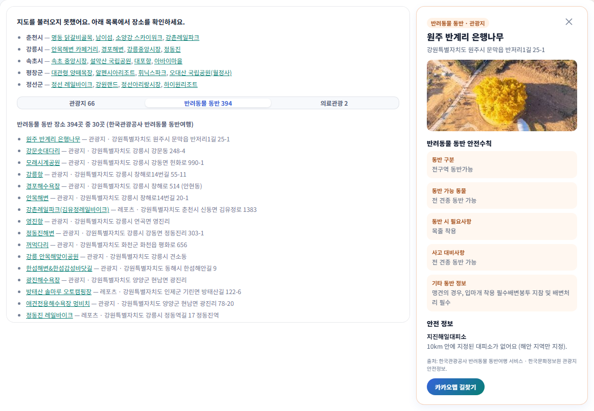

의료관광 탭과 상세

## 6. push와 tourapi 재배포 (2026-11-07, 팀장 승인)

**push**
- `git fetch` 후 `git pull --rebase`: 원격에 새 커밋이 없어 충돌 없음
- push 전 확인
  - 웹: `npm run build` 통과, `npm test` 64개 통과, `oxlint` 통과
  - 파이썬: `tourism_platform` pytest 98개 통과, `api.py` 불러오기 정상(라우트 20개)
  - 커밋 17개에 매뉴얼 파일(docx·zip)·`.env`가 없고, 서비스키처럼 보이는 값도 없음을 확인
- `git push origin main`: `ea8ce10..c477393` (커밋 17개)

**tourapi 배포 확인**
- `tourapi/vercel.json` includeFiles: `api.py`, `weather.py`, `sigungu.py`, `barrierfree.py`가 모두 들어 있다. `.vercelignore`로 `.env*`·`logs`·`fluent-bit`는 올라가지 않는다.
- Vercel 환경변수(`vercel env ls`, 값은 출력하지 않음): Production에 `API_KEY`·`KCISA_API_KEY`가 있다. `MONGO_URI`는 없어 배포는 메모리 캐시로 동작한다(10주차 18번).
- tourapi-demo는 Git 자동 배포가 아니라 CLI로 배포한다. push 뒤에도 운영은 22시간 전 배포(`r6ti2bz3s`)였다.
  - 그때 `/api/access/nearby`·`/access`는 404, 지운 `/eng`는 200이었다.
- 팀장 확인 후 `tourapi`에서 `vercel deploy --prod` → `tourapi-demo-dk1cjkwtj` Ready(Production), `https://tourapi-demo.vercel.app`에 연결

| 운영 주소 요청 | 결과 |
|---|---|
| `/api/weather?…천안시…date=20261108` | 200 — 단기예보, 강수확률 60%, 비, 11월 7일 20:00 발표, errors 없음 |
| `/api/access/nearby?lat=36.64&lon=127.49&with=senior,child` | 200 — 3곳, errors 없음 |
| `/api/access/match?…독립기념관…` | 200 |
| `/access` | 200 |
| `/eng`, `/api/eng/places` | 404 |
| `/pet`, `/api/pet/places`, `/api/medical`, `/api/map/places?province=강원특별자치도`, `/api/db/status` | 200 |

**웹 재배포**
- 필요하다. 날씨·무장애·목록 탭 등 웹 변경은 push만 되었다.
- 이 Vercel 팀(bigdata8)에는 프로젝트가 `tourapi-demo` 하나뿐이고, 웹앱(`web/`) 프로젝트는 없다. `web/.vercel` 연결 정보도 없다.
- 그래서 웹앱이 어디에 배포되는지 이 계정에서 확인하지 못했다. 웹을 배포하는 팀원이 다시 배포해야 한다.
  - 웹은 `web/vercel.json`의 rewrite로 `/tourapi`를 `https://tourapi-demo.vercel.app`으로 넘기므로, 오늘 다시 배포한 tourapi를 바로 쓴다.

## 7. 웹 확인용 배포: 내 Vercel 계정 tourlink-web-check (2026-11-07)

팀 공식 웹 주소는 박하원 계정의 기존 배포다. 이번 배포는 push한 웹 변경이 실제 배포 환경에서 보이는지 확인하는 용도다.

**한 일**
- `web`에서 `vercel link --yes --project tourlink-web-check`로 새 프로젝트를 만들었다. 기존 프로젝트에는 연결하지 않았다.
  - 범위: 내 계정 `co1d0`의 hobby 팀 `bigdata8`
  - Vite를 자동으로 알아봤다(빌드 `vite build`, 출력 `dist`).
- CLI가 GitHub 저장소 자동 연결을 시도했으나 권한이 없어 실패했다. 그래서 push로 자동 배포되지 않는다.
- CLI가 `web/.env.local`(Vercel OIDC 토큰)을 만들었다.
  - git 무시 대상(`.env*`)이고 `VITE_` 값은 없었다. 배포·커밋에 섞이지 않게 바로 지웠다. 내용은 출력하지 않았다.
- 환경변수는 넣지 않았다(카카오 키 없음 → 지도 대신 목록 화면). 서비스키를 묻는 단계는 없었다.
  - 웹은 `web/vercel.json` rewrite로 `/tourapi`를 `https://tourapi-demo.vercel.app`(6번에서 다시 배포)으로 넘긴다.
- `web/.vercel` 연결 정보는 git 무시 대상이라 커밋되지 않는다.

**배포**

| 배포 | 대상 | 주소 | 접근 |
|---|---|---|---|
| `tourlink-web-check-8ugc8dzn6` | Production (의도하지 않음) — 임시 공개 주소, 공식 웹 재배포 확인 후 삭제 예정, 보고서·공유에 쓰지 않음 | `https://tourlink-web-check.vercel.app` | 공개(200) |
| `tourlink-web-check-500b7185a` | Preview | `https://tourlink-web-check-500b7185a-bigdata8.vercel.app` | Vercel 로그인 보호(302) |

- 처음 `vercel deploy`(`--prod` 없이)를 했는데, Git 연결이 없는 새 프로젝트의 첫 배포라 Production으로 올라가 별칭이 붙었다.
  - 그래서 `vercel deploy --target preview`로 Preview를 다시 만들었다.
- Production 배포(`tourlink-web-check.vercel.app`)는 **임시 공개 주소**다.
  - 박하원 계정의 공식 웹이 다시 배포된 것을 확인하면 `vercel remove`로 지운다(11/7 결정).
  - **보고서·공유에 쓰지 않는다.**
- Preview 주소는 Vercel 기본 배포 보호(로그인)가 걸려 있어 헤드리스 브라우저로 열 수 없다.
  - 캡처는 같은 코드로 만든 공개 주소(`tourlink-web-check.vercel.app`)에서 했다.
  - 프록시 확인: `/app` 200, `/tourapi/api/weather` 200

**배포 주소 캡처** (지도 키 없음)

날씨 표시 — 천안시 11/8 비 예보(강수확률 60%) → 실내 위주, 날씨 때문에 제외된 곳, 기상청 단기예보 11월 7일 20:00 발표

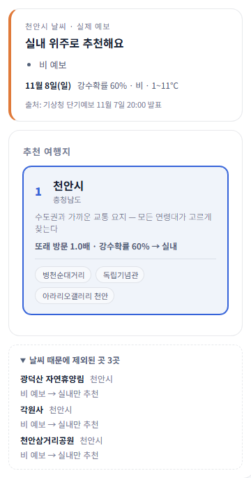

무장애 편의 정보 — 독립기념관, 아이 동반: 있음/등록 정보 없음, 체크리스트의 우산·미끄럼·편의시설 한 줄

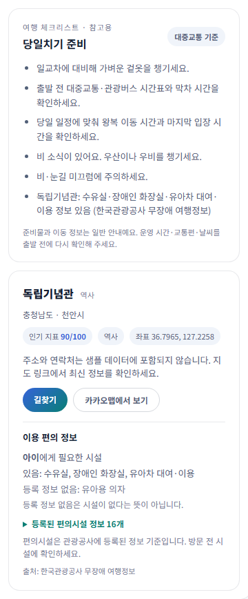

반려동물 동반 탭과 상세 — 강원(관광지 66 / 반려동물 동반 394 / 의료관광 2)

의료관광 탭과 상세 — 연세대학교 원주세브란스기독병원

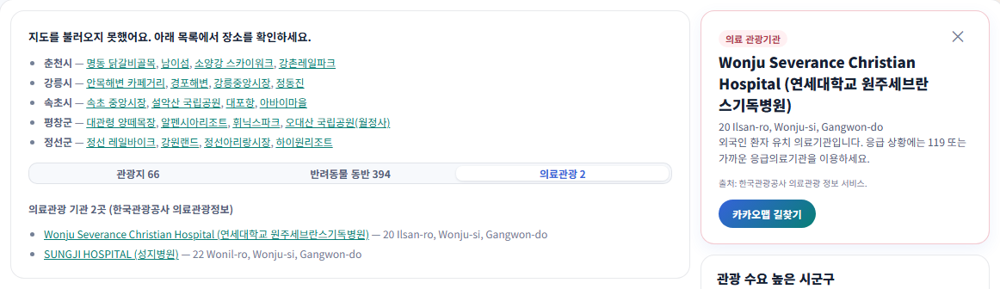

## 8. 오류 정리 (보고서용, 2026-11-08)

코드는 고치지 않았고, 이미 고친 오류를 되살리지도 않았다. 서비스키 값은 화면·캡처·기록 어디에도 넣지 않았다.
- 캡처의 원문(응답·명령 출력)에 실제 키 값이 0건임을 확인했다.
- 캡처 스크립트는 키 값이 들어 있으면 저장하지 않고 멈추게 했다.

**재현해서 캡처한 오류** (캡처: `docs/images/errors/`)

| 번호 | 상황 | 요청·명령 | 결과 | 캡처 파일 |
|---|---|---|---|---|
| 01 | 잘못된 시도 이름 | `GET /api/weather?lat=36.8&lon=127.1&sido=충청남도도` | 400 `시도 이름이 올바르지 않습니다: 충청남도도 (예: 서울, 강원, 충북, 제주)` | `err_01_weather_400.png` |
| 02 | 위도·경도 없음 | `GET /api/access/nearby` (파라미터 없음) | 400 `위도(lat)·경도(lon)가 필요합니다.` | `err_02_access_no_latlon.png` |
| 03 | 국내 범위 밖 위치 | `GET /api/access/nearby?lat=50&lon=10` | 400 `국내 위치의 위도·경도가 필요합니다.` | `err_03_access_out_of_korea.png` |
| 04 | 지운 페이지 | `GET /eng` | 404 `요청한 페이지를 찾을 수 없습니다.` | `err_04_eng_404.png` |
| 05 | 서비스키 없이 날씨 점검 | `API_KEY= py weather.py check` (이번 실행에만 빈 값) | 4개 API 모두 `[실패] … 환경변수 API_KEY에 공공데이터포털 인증키(Decoding)를 넣어 주세요.` → 4개 중 0개 정상 | `err_05_weather_no_key.png` |
| 06 | 서비스키 없이 무장애 점검 | `API_KEY= py barrierfree.py check` (이번 실행에만 빈 값) | `[실패] locationBasedList2: 환경변수 API_KEY에 공공데이터포털 인증키(Decoding)를 넣어 주세요.` | `err_06_barrierfree_no_key.png` |
| 07 | tourapi 서버 꺼짐 | 서버를 끈 상태에서 웹앱 추천받기 | 날씨 안내 "날씨 정보를 불러오지 못했습니다", 이용 편의 정보 "정보를 불러오지 못했습니다", 추천 목록은 그대로 | `../week11/b7_server_down.png` (2번에서 찍은 것) |

- 재현 서버: `py api.py local`과 같은 api.py 서버(`TourRequestHandler`)를 8010 포트로 띄웠다.
  - 8000 포트에는 직접 켜 둔 `barrierfree.py local`(영문 관광정보를 지우기 전 코드)이 떠 있어서 `/eng`가 404로 나오지 않는다.
  - 같은 포트에 하나 더 켜면 요청이 섞인다(아래 표 마지막 줄).
- 05·06: 환경변수는 그 명령 한 번에만 빈 값으로 넘겼다. 셸의 `API_KEY`는 그대로다(길이만 확인).
- 캡처는 실제 응답·출력을 그대로 옮겨 그린 화면이다. 01~04는 상태 줄·Content-Type·응답 본문, 05·06은 터미널 출력이다.

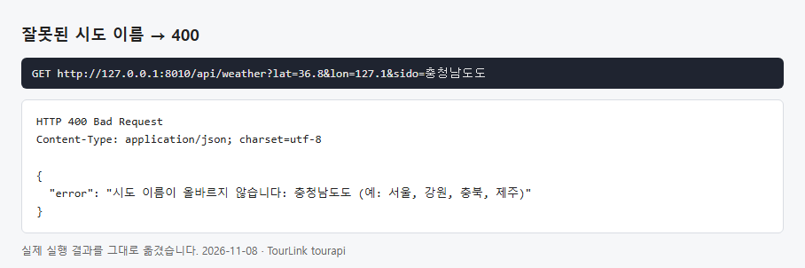
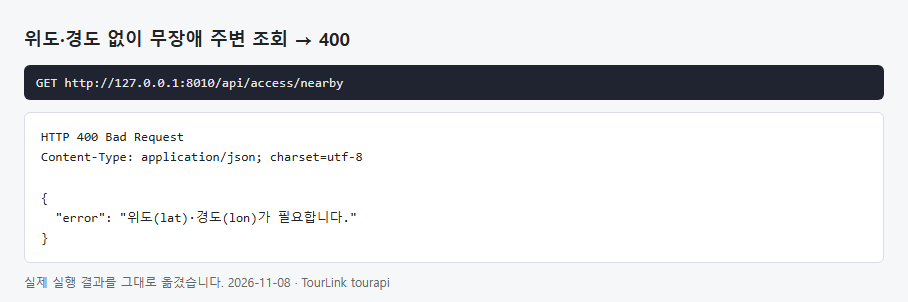
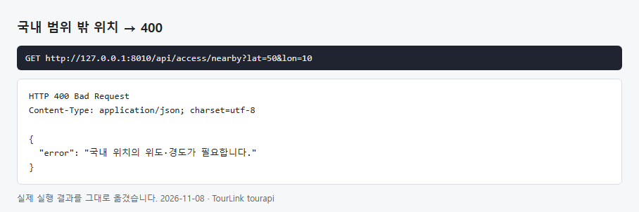
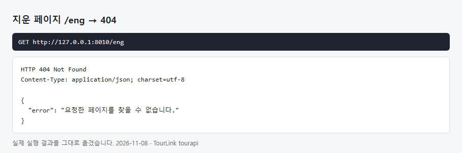
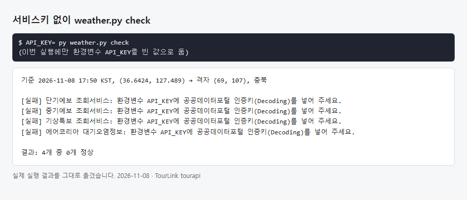
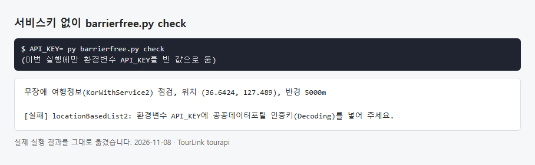

**이미 고쳐서 다시 만들 수 없는 오류** (표로만 정리, 캡처 없음)

| 주차 | 문제 | 원인 | 해결 | 작업기록 위치 | 캡처 파일 |
|---|---|---|---|---|---|
| 10 | 기상청 단기·중기예보·특보, 에어코리아, 응급의료기관 위치정보 API가 HTTP 403 | 그 API들의 활용신청이 승인되지 않은 상태(코드 문제 아님) | 공공데이터포털 활용신청·승인 후 정상 호출(단기예보도 레이크 첫 실행에서는 5곳 모두 403) | 10주차 7-b(문제 4), 8(결과 표) | 없음 |
| 10 | 무장애 여행정보 `check`가 HTTP 403 | KorWithService2 활용신청 승인 전 | 승인 후 `check` 정상(청주·서울·부산) | 10주차 16 | 없음 |
| 10 | 오류 메시지에 서비스키가 든 전체 URL이 그대로 찍힘(보안) | 요청 라이브러리의 HTTP 오류 메시지에 `serviceKey`가 포함된 URL이 담김 | `datagokr_client.fetch()`가 키를 뺀 메시지로 다시 던지고 원래 예외 연결을 끊음. 테스트 추가 | 10주차 7-b(문제 1) | 없음 (키가 보이는 화면이라 만들지 않음) |
| 10 | 데이터랩 API 오류(`INVALID_REQUEST_PARAMETER_ERROR(type)`)를 "성공"으로 표시 | ① 클라이언트가 항상 `type=json`을 붙임(데이터랩은 `_type`만 받음) ② 데이터랩은 오류를 최상위 `resultCode`로 줌 | 다른 형식 파라미터가 있으면 `type`을 붙이지 않고, 최상위 `resultCode`도 검사. 테스트 5개 추가 | 10주차 7-b(문제 2) | 없음 |
| 10 | 샘플 데이터의 속초시·평창군 지역 코드가 틀림 | 속초시가 51230(실제 삼척시), 평창군이 51830(실제 양양군)으로 들어 있었음 | 데이터랩 실데이터의 시군구 이름으로 확인해 속초시 51210, 평창군 51760으로 고침 | 10주차 7-b(문제 3) | 없음 |
| 10 | 응급의료기관까지 거리를 계산할 수 없음 | KCISA 관광지 안전정보의 응급의료기관 항목에 좌표가 없음 | 좌표가 있는 국립중앙의료원 위치정보 API를 씀(XML 응답은 `parse_xml_response()`로 변환) | 10주차 5 | 없음 |
| 10 | MongoDB `$nearSphere` explain이 0건 | 검색 반경 5km가 최근접 대피소 거리(5.7km)보다 작음 | 반경을 10km로 넓힘 | 10주차 8 | 없음 |
| 10 | README·주석이 "Encoding 키"를 쓰라고 안내 | requests가 한 번 더 인코딩하므로 Decoding 키를 써야 함(실제 호출도 Decoding 키로 성공) | 안내 문구를 Decoding 키로 고침 | 10주차 8 | 없음 |
| 11 | 3박 4일의 마지막 날(11/11)이 "강수확률 0% · 3~3℃"로 나옴 | 단기예보 끝 날짜에 00시 한 시간대만 있는 잘린 하루를 온전한 예보처럼 씀 | 최저·최고기온이 모두 없는 미래 날짜는 빼고 중기예보를 쓰게 함(11/11 → 10% · 2~15℃) | 11주차 1(오류와 해결) | 없음 (고친 뒤 캡처 `../week11/a5_3n4d.png`만 있음) |
| 11 | 출처에 발표 시각이 빠지고 예전 응답이 섞임 | 8000 포트에 고치기 전 코드 서버가 함께 떠 있었음(Windows는 같은 포트를 두 프로세스가 열 수 있음) | 시험은 다른 포트(8010·5175)로 하고, 사용자 서버는 건드리지 않음 | 11주차 1(오류와 해결), 3·4(확인 방법) | 없음 |
