# 11주차 작업기록 — TourLink (빅데이터와 AI 2조)

## 1. 웹 추천에 실제 기상청·에어코리아 예보 연결, 몇 박 며칠 날짜별 판정 (2026-11-07)

**목표**
- 웹앱 `/app`의 날씨 판정은 지금까지 시연용 예시 날씨(`weatherPresets`)를 썼다. 이제 `tourapi/weather.py`의 실제 예보를 쓴다.
- 추천 점수 계산(`recommend.ts`)과 판정 규칙(`weatherRules.ts`)은 고치지 않는다. 웹과 weather.py의 기준값은 이미 같다(10주차 13-1).

**바꾼 파일**

| 파일 | 내용 |
|---|---|
| `web/src/lib/liveWeather.ts` (새 파일) | 지역 좌표·시도·시군구·방문일로 `/tourapi/api/weather`를 부르고 응답을 `WeatherSnapshot`으로 바꾼다. 날짜 목록(`tripDates`), 여러 날 합치기(`worstOf`) |
| `web/src/lib/liveWeather.test.ts` (새 파일) | 날짜 목록·필드 대응·합치기 테스트 7개 |
| `web/src/pages/AppPage.tsx` | `decideWeather()`에 넣는 값을 실제 예보로 바꿈. 추천 대상 지역마다 그 지역 예보로 따로 판정 |
| `web/src/components/WeatherNotice.tsx` | 실제 예보 / 불러오는 중 / 예보 확인 필요 / 시연 모드 표시, 날짜별 요약 한 줄씩, 출처·발표 시각 |
| `web/src/components/CompanionForm.tsx` | "시연 모드 (예시 날씨)" 토글(켰을 때만 예시 선택), 1박 이상이면 '1박 2일 / 2박 3일 / 3박 4일' 버튼 |
| `web/src/lib/tripPreferences.ts` | `nights: 1 \| 2 \| 3`(기본 1), `weatherDemo`, `addDaysIso` 추가 |
| `web/src/components/RecommendationList.tsx` | 추천 근거 줄의 날씨 요약을 지역별로 받음(`weatherSummaryFor`) |
| `web/src/pages/AppPage.css` | 날짜별 요약·출처·시연 모드·3칸 버튼 스타일 |
| `tourapi/weather.py` | 응답에 필드 추가: 단기예보 날짜별 `issued`, 에어코리아 `pm10Grade`·`pm25Grade`. 단기예보 끝 날짜의 잘린 하루를 빼고 중기예보를 쓰게 고침(아래 '오류와 해결') |

**응답 필드 대응표** (`/api/weather` = weather.py `fetch_weather` → 웹 `WeatherSnapshot`)

| weather.py 응답 | WeatherSnapshot | 변환 | 없을 때 |
|---|---|---|---|
| `forecast.pop` | `pop` | 그날 강수확률 최댓값(%) 그대로 | null |
| `forecast.precip` | `precipitation` | 비·빗방울 → rain, 비/눈·빗방울눈날림 → rain_snow, 눈·눈날림 → snow, 소나기 → shower. 여러 개면 더 나쁜 쪽, 빈 목록이면 none | null(예보 없음) |
| `forecast.tmin` | `minTempC` | 그대로(℃) | null |
| `forecast.tmax` | `maxTempC` | 그대로(℃) | null |
| `warnings.kinds` | `warnings` | 그 시군구에 발효 중인 특보 종류(오늘·내일만) | [] |
| `air.pm10Grade` | `pm10Grade` | 시도 측정소 중 가장 나쁜 PM10 등급(1~4, 오늘만) | null |
| `air.pm25Grade` | `pm25Grade` | 시도 측정소 중 가장 나쁜 PM2.5 등급(1~4, 오늘만) | null |
| `forecast.source`·`issued`, `air.time` | (화면 출처) | "기상청 단기예보 11월 7일 14:00 발표 · 에어코리아 11월 7일 14:00 측정" | 표시 안 함 |

- 요청 값
  - 시도: 지역 데이터의 전체 이름(충청남도·강원특별자치도 등)을 weather.py 키(충남·강원 등)로 바꿔 보낸다.
  - 시군구: 지역 이름(예: 천안시, 청주시 상당구)을 그대로 보낸다. 특보 지역 판단과 강원 영서·영동 구분에 쓰인다.
  - 방문일: `YYYYMMDD`
- `forecast`가 null이면(예보 범위 밖) 그날은 "예보 확인 필요"다. 서버에 연결하지 못해도 같다.

**판정 방식**
- 지역별: 추천 대상 지역(시범 10곳 중 고른 범위)마다 그 지역 예보로 `decideWeather` → `applyWeatherRules`를 따로 한다.
  - 날씨 하나로 모든 지역을 판정하면 강릉의 비가 천안 추천까지 막기 때문이다.
  - 날씨 안내는 보고 있는 지역(없으면 1위 추천 지역) 기준으로 보여 준다.
- 몇 박 며칠: 방문일부터 방문일 + 박 수까지 날짜별로 예보를 부른다.
  - 항목별로 가장 나쁜 값(강수확률·최고기온·미세먼지 최대, 최저기온 최소, 비·눈 중 더 나쁜 것, 특보 합집합)으로 판정한다.
  - 그래서 어느 하루라도 기준에 걸리면 실내로 판정된다.
- 예보가 없는 날은 판정에서 빼고 "예보 확인 필요"로 표시한다. 모든 날이 없으면 날씨 조건 없이 추천하고 그렇게 안내한다.
- 시연용 예시(`weatherPresets`)는 지우지 않았다. "시연 모드"를 켰을 때만 모든 지역에 같은 예시 날씨를 쓴다.
- 브라우저는 같은 지역·날짜 예보를 30분 동안 다시 부르지 않는다. 서버는 1시간 저장한다(10주차 18번).

**캡처** (2026-11-07 16시대, 천안시·연령대·동행 선호·일반 일행. 기상청 단기예보 11월 7일 14:00 발표 기준)

맑은 날 — 11월 10일: 강수확률 0%, -1~12℃ → 실내·야외 함께 추천

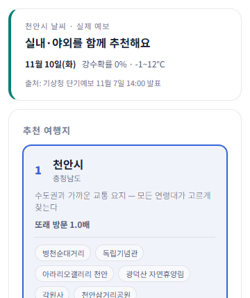

비 오는 날 — 11월 8일: 강수확률 60%, 비 → 실내 위주, 추천 근거 줄에 "강수확률 60% → 실내"

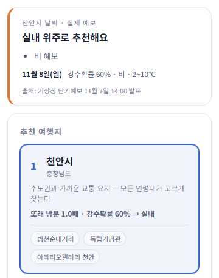

서버 꺼짐 — tourapi 서버를 끈 상태: "예보 확인 필요", 날씨 조건 없이 추천

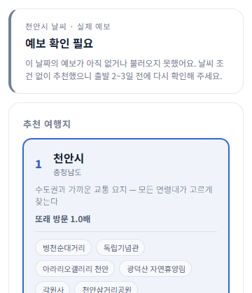

**몇 박 며칠 날짜별 판정 결과** (천안시, 출발 11월 8일)

| 일정 | 11/8(일) | 11/9(월) | 11/10(화) | 11/11(수) | 판정 |
|---|---|---|---|---|---|
| 당일치기 | 60% · 비 · 2~10℃ | | | | 실내 위주 |
| 1박 2일 | 60% · 비 · 2~10℃ | 30% · 6~12℃ | | | 실내 위주 |
| 2박 3일 | 60% · 비 · 2~10℃ | 30% · 6~12℃ | 0% · -1~12℃ | | 실내 위주 |
| 3박 4일 | 60% · 비 · 2~10℃ | 30% · 6~12℃ | 0% · -1~12℃ | 10% · 2~15℃ (중기예보) | 실내 위주 |

- 모든 일정에서 11/8 비가 가장 나쁜 값이라 실내 위주로 판정됐다. 일반 일행 기준(최저기온 -5℃ 이하만 추운 날)이라 11/10의 -1℃는 걸리지 않는다.
- 3박 4일의 출처는 "기상청 단기예보 11월 7일 14:00 발표 / 기상청 중기예보 11월 7일 06:00 발표"로 두 가지가 함께 나온다.
- 1박 2일 행은 같은 날짜별 응답으로 정리한 값이다. 2박 3일·3박 4일은 아래 화면 그대로다.

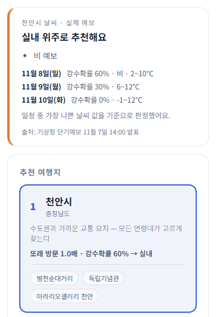

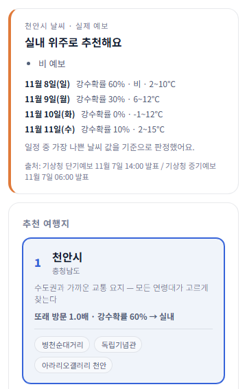

**오류와 해결**
- 문제: 처음 3박 4일을 찍었을 때 11/11이 "강수확률 0% · 3~3℃"로 나왔다.
  - 원인: 14시 발표 단기예보에는 11/11이 00시 한 시간대만 들어 있다. weather.py가 이 잘린 하루를 온전한 예보처럼 썼다.
  - 같은 날의 중기예보는 강수확률 10%, 2~15℃였다.
  - 해결: `fetch_short_days`에서 최저·최고기온(TMN·TMX)이 모두 없는 미래 날짜는 빼서, `fetch_weather`가 중기예보를 보게 했다. 오늘은 오후 시간대만 남아도 그대로 쓴다.
  - 고친 뒤 11/11은 중기예보로 나온다. `py weather.py check` 4개 중 4개 정상
- 문제: 처음 확인할 때 출처에 발표 시각이 빠졌다.
  - 원인: 8000 포트에 고치기 전 코드로 켜 둔 서버가 함께 떠 있었다(Windows는 같은 포트를 두 프로세스가 열 수 있음).
  - 해결: 시험은 따로 띄운 서버(8010)와 웹(5175)으로 했다.

**확인**
- 화면 확인은 Chrome 원격 디버깅으로 조건을 고르고 "추천받기"를 눌러서 했다(시험 서버 tourapi 8010, vite 5175).
- `npm run build` 통과, `npm test` 46개 통과(새 `liveWeather.test.ts` 7개 포함), `oxlint` 통과
- 제약
  - 미세먼지는 실시간 값이라 방문일이 오늘일 때만 판정에 쓴다.
  - 특보는 오늘·내일만 본다(weather.py 동작 그대로).
  - 시범 지역 좌표(시청·군청 부근)의 5km 격자 예보라, 같은 시군 안에서도 관광지 위치에 따라 다를 수 있다.

## 2. 연결한 API 5종을 /app 화면에 모두 보이게 하기 (2026-11-07)

**목표와 원칙**
- 단기예보·중기예보·기상특보·에어코리아·무장애 API 5종이 웹앱 `/app`에서 모두 눈에 보이게 한다.
- 추천 점수(`recommend.ts`)와 판정 규칙(`weatherRules.ts`)은 고치지 않는다.
- `AppPage.tsx`·`AttractionDetail.tsx`·`RecommendationList.tsx`는 기존 코드를 지우지 않고, 새 컴포넌트와 선택 prop만 끼워 넣었다.
  - 예외: 1차로 AppPage에 따로 붙였던 무장애 패널(10주차 22번)은 상세 패널 안으로 옮기면서 뺐다.
- 디자인은 기존 CSS 변수와 카드 모양을 그대로 쓴다. Figma 반영은 나중에 한다.
- 시작 전 `git fetch` 후 `git rebase origin/main`: 원격에 새 커밋이 없어 그대로였다.

**기능별 API → 화면 위치 → 캡처**

| 기능 | API (서버 → 응답 필드) | 화면 위치 | 캡처 |
|---|---|---|---|
| 맑은 날 추천 | 단기예보 `forecast` | 날씨 안내 "실내·야외를 함께 추천해요" | ① `b1_clear_today.png` |
| 비 예보 → 실내, 빠진 곳 | 단기예보 `forecast.pop·precip` → weatherRules | 날씨 안내 "실내 위주", 추천 근거 줄 "강수확률 60% → 실내", 목록 아래 접힌 "날씨 때문에 제외된 곳 n곳"(관광지·지역·이유) | ② `b2_rain.png` |
| 초단기실황 | 초단기실황 `now.temp·precipType·time` (방문일이 오늘일 때만) | 날씨 안내 맨 위 "지금 10.1℃ · 강수 없음", 출처에 "초단기실황 ○시 관측". 오늘이 아니면 숨김 | ① `b1_clear_today.png` |
| 몇 박 며칠 | 단기·중기예보 `forecast` (날짜별) | 날씨 안내에 날짜별 한 줄 요약, 가장 나쁜 날 기준 판정 | ⑥ `b6_2n3d.png` |
| 기상특보 | 기상특보 `warnings.active·elsewhereInSido·kinds` (오늘·내일) | 추천 목록 위 배너 "강릉시에 건조주의보 발효 중". 같은 시도 다른 시군에만 있으면 "인근 시군 특보 있음"으로 약하게. 지형 제외(호우·태풍·풍랑 → 바다·산·계곡)는 weatherRules 규칙 그대로이고, 빠진 곳은 "날씨 때문에 제외된 곳"에 "호우 특보 → 바다 제외"로 남음 | ③ `b3_warning_live.png`(실제 건조주의보), `b3_warning_demo.png`(시연 모드 호우특보) |
| 미세먼지 | 에어코리아 `air.pm10Grade·pm25Grade·time` (오늘만) | 날씨 안내 "미세먼지 보통 (PM10 보통 · PM2.5 보통) · 에어코리아 ○시 측정". 나쁨 이상이면 "실내 장소 위주로 보여 드려요. 마스크를 챙기세요."와 실내만 추천, 체크리스트에 마스크 안내 | ④ `b4_dust_demo.png`(시연 모드) |
| 무장애 — 상세 | 무장애 `/api/access/match` → `fitHave·fitMissing·available` | 관광지 상세 패널 안 "이용 편의 정보" 칸: 필요한 시설을 "있음"과 "등록 정보 없음"으로 나누고 "등록 정보 없음은 시설이 없다는 뜻이 아닙니다." 표시, 등록 정보 전체는 접어 둠 | ⑤ `b5_child_detail.png` |
| 무장애 — 카드 배지 | 무장애 `/api/access/match` (`available`이 있을 때) | 추천 카드 관광지 칩 옆 "편의 정보" 배지. 정보가 있을 때만 달고 순서는 그대로 | ①② |
| 무장애 — 체크리스트 | 무장애 `fitHave` (어르신·아이 동반일 때) | 여행 체크리스트에 "독립기념관: 수유실·장애인 화장실·유아차 대여·이용 정보 있음" | ⑤ |
| 준비물 연동 | weather.py `recommend.tips` (decide()) | 여행 체크리스트에 우산·미끄럼·방한·물·자외선 등을 문장으로. 기존 문구와 같은 주제면 하나만 | ⑤(우산·미끄럼) |
| 출처 표시 | 각 API | 날씨 안내 아래 "출처: 기상청 초단기실황 ○시 관측 / 기상청 단기예보 ○시 발표 · 에어코리아 ○시 측정", 특보 배너 "출처: 기상청 기상특보", 편의 정보 아래 "출처: 한국관광공사 무장애 여행정보" | ①③⑤ |
| 실패 처리 | 응답 `errors`(하위 API별), 서버 연결 실패 | 실패한 칸만 "○○ 정보를 불러오지 못했습니다"/"정보를 불러오지 못했습니다". 서버를 꺼도 추천은 그대로 나오고, 오류 원인은 콘솔에만 남김 | ⑦ `b7_server_down.png` |

캡처 (2026-11-07 16시대, 기상청 단기예보 11월 7일 14:00 발표, 에어코리아 16:00 측정 기준)

① 맑은 날 추천 (천안시, 오늘) — 지금 10.1℃·강수 없음, 미세먼지 보통, 칩에 "편의 정보" 배지

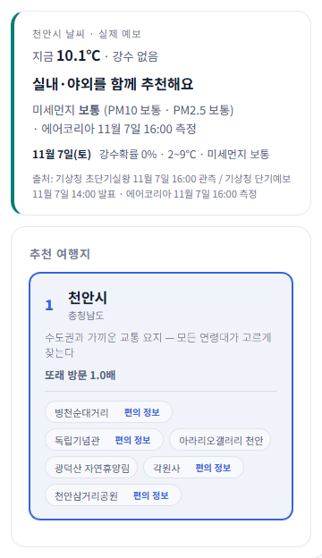

② 비 예보 (천안시, 11/8 강수확률 60%·비) — 실내 위주, 날씨 때문에 제외된 곳 3곳(광덕산 자연휴양림·각원사·천안삼거리공원: "비 예보 → 실내만 추천")


③ 특보 배너 — 실제: 강릉시 건조주의보(지형 제외 대상이 아니라 안내만) / 시연 모드: 호우특보로 바다 관광지 4곳 제외

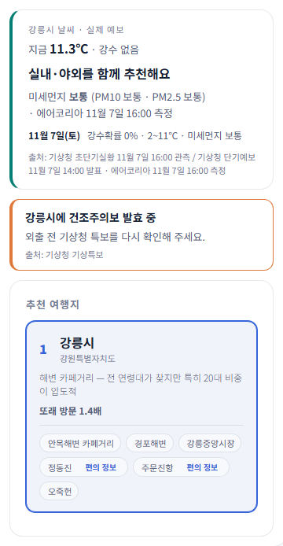

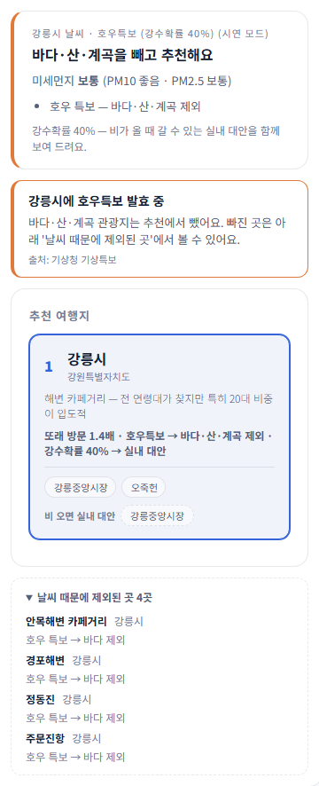

④ 미세먼지 나쁨 (시연 모드) — 실내 위주, 제외된 곳 3곳 "미세먼지 나쁨 → 실내만 추천", 체크리스트에 마스크 안내

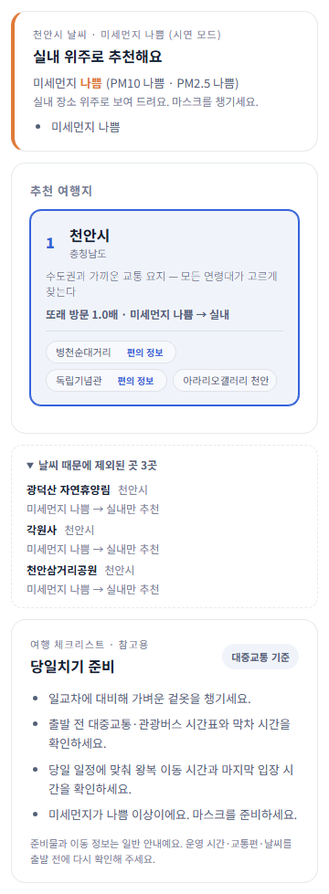

⑤ 아이 동반 상세 패널 (천안시 독립기념관, 11/8) — 있음: 수유실·장애인 화장실·유아차 대여·이용 / 등록 정보 없음: 유아용 의자. 체크리스트에 우산·미끄럼(weather.py tips)과 편의시설 한 줄

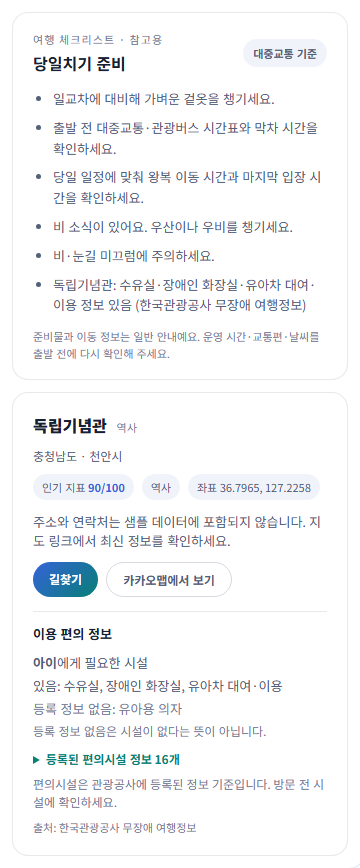

⑥ 2박 3일 날짜별 요약 (천안시, 11/8~11/10)

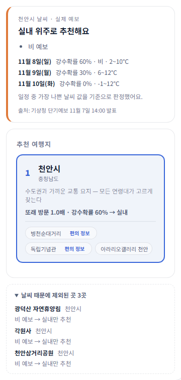

⑦ API 서버를 끈 상태 — 날씨 안내 "날씨 정보를 불러오지 못했습니다", 이용 편의 정보 "정보를 불러오지 못했습니다", 추천 목록은 그대로

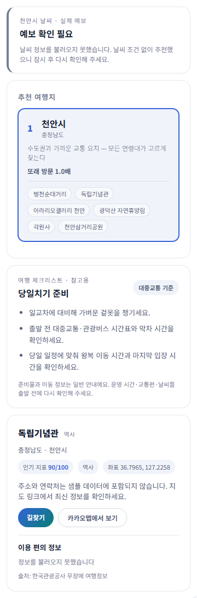

- 실제 예보: ①②③(실제)⑤⑥⑦. 시연 모드: ③(호우특보), ④(미세먼지 나쁨).
  - 캡처 시각에는 이 지역에 지형 제외 특보와 미세먼지 나쁨이 없었다. 강원 강릉·속초는 건조주의보, 미세먼지는 보통·좋음이었다.

**바꾼 파일**

| 파일 | 내용 |
|---|---|
| `web/src/lib/weatherExclusions.ts` (새 파일) | 날씨 적용 전 추천과 비교해 빠진 관광지와 이유("강수확률 70% → 실내만 추천", "호우 특보 → 바다 제외")를 만든다. 규칙은 `isAllowed` 그대로 |
| `web/src/components/WeatherExcludedList.tsx` (새 파일) | "날씨 때문에 제외된 곳" 접기 목록 |
| `web/src/components/WarningBanner.tsx` (새 파일) | 특보 배너(이 시군구) / 인근 시군 약한 표시 |
| `web/src/lib/preparationTips.ts` (새 파일) | weather.py tips → 문장, 미세먼지 마스크 안내, 같은 주제 안내 합치기 |
| `web/src/lib/liveWeather.ts` | 응답에서 `now`, `warnings.active·elsewhereInSido`, `air.time`, `recommend.tips`, `errors`(칸별 실패), 서버 연결 실패를 읽음. 요청에 일행(`with`)을 보내 tips가 어르신·아이 기준을 따르게 함 |
| `web/src/lib/liveAccess.ts` | `toAccessSummary`(있음/등록 정보 없음/배지/체크리스트 한 줄), 여러 관광지 조회 훅, 실패 문구 "정보를 불러오지 못했습니다" |
| `web/src/components/WeatherNotice.tsx` | 현재 날씨 줄, 미세먼지 줄, 칸별 실패 표시, 출처에 초단기실황 |
| `web/src/components/AccessibilityInfo.tsx` | 상세 패널 안 "이용 편의 정보" 칸으로 바꿈, 출처 표시 |
| `web/src/components/AttractionDetail.tsx` | 선택 prop `party`와 "이용 편의 정보" 칸 하나 추가 |
| `web/src/components/RecommendationList.tsx` | 선택 prop `attractionBadge`, 칩 이름 옆 배지 |
| `web/src/components/TripPreparation.tsx` | 선택 prop `extraTips`(겹치면 하나만) |
| `web/src/pages/AppPage.tsx` | 날씨 적용 전·후 추천을 나눔(결과 같음), 위 컴포넌트 끼워 넣기, 무장애 조회·체크리스트 안내 연결 |
| `web/src/pages/AppPage.css` | 새 칸 스타일(기존 변수 재사용) |

**커밋** (기능 단위, push 안 함)

| 커밋 | 기능 |
|---|---|
| `142f0b0` | 날씨 표시: 날씨 때문에 제외된 곳, 초단기실황, API별 실패 표시 |
| `87e4992` | 특보: 시군구 특보 배너, 인근 시군 약한 표시 |
| `d23ae50` | 미세먼지: 등급·측정 시각, 나쁨 이상이면 마스크 안내 |
| `a5dec29` | 무장애: 상세 패널 이용 편의 정보, 카드 배지, 동반 일행 체크리스트 안내 |
| `91a3e5a` | 준비물: weather.py tips를 체크리스트에 합치고 겹치면 하나만 |

**확인**
- `npm run build` 통과, `npm test` 64개 통과(이번에 18개 추가), `oxlint` 통과
  - liveWeather 변환: 초단기실황·칸별 실패·특보 구분·tips
  - accessInfo 변환: `toAccessSummary`
  - weatherExclusions·preparationTips 테스트
- 화면 확인은 Chrome 원격 디버깅으로 조건을 고르고 추천받기·관광지 칩을 눌러서 했다(시험 서버 tourapi 8010, vite 5175).
  - 오른쪽 칸은 스크롤 영역이라, 캡처할 때만 높이 제한을 풀었다.
- 서비스키는 출력·로그·캡처 어디에도 없다.

**남은 점**
- 추천 카드 배지를 달려고 화면의 관광지마다 무장애 조회를 한다. 처음 한 번은 관광지당 관광공사 API 2번(이름 검색 + 상세)이고, 그 뒤 6시간은 서버 저장값을 쓴다.
  - 추천 지역이 많으면 첫 조회 호출 수가 늘어나므로 활용신청 한도를 지켜봐야 한다.
- 시연 모드는 예시 날씨만 바꾼다. 준비물의 weather.py tips는 실제 예보에서만 나오고, 시연 모드에서는 미세먼지 마스크 안내만 붙는다.
- 웹앱 샘플 관광지 좌표가 실제와 수 km 다른 문제(10주차 22번)는 그대로다.

## 3. API 반영 점검표: api.py 페이지 9개 → 웹앱 /app (2026-11-07)

코드는 고치지 않고 점검만 했다. 커밋하지 않았다.

**웹앱이 /tourapi로 부르는 주소** (`web/src` 전체 검색, 테스트 제외)

| 웹앱 주소 | 부르는 곳 | api.py 함수 | 안에 든 공공데이터 API (오퍼레이션) |
|---|---|---|---|
| `/api/map/places?province=` | `lib/nationalData.ts` `loadMapPlaces` | `fetch_map_places` | 아래 5개를 묶음 |
| ┗ spots | | `fetch_all_tourspots` | 전국관광지정보표준데이터 `tn_pubr_public_trrsrt_api` |
| ┗ shelters·hospitals | | `_safety_groups` → `fetch_all_safety` | 한국문화정보원 관광지 안전정보 `conver10` (지진해일대피소, 응급의료기관만 골라 씀) |
| ┗ medical | | `_medical_places` | 한국관광공사 의료관광정보 `MdclTursmService/mdclTursmSyncList` |
| ┗ pets (시도를 고를 때만) | | `_pet_places` | 한국관광공사 반려동물 동반여행 `KorPetTourService2/areaBasedList2` |
| ┗ demand (시도를 고를 때만) | | `_latest_demand` → `fetch_demand(…, "11")` | 한국관광공사 지역별 관광자원 수요 `AreaTarResDemService` (관광서비스 수요지수) |
| `/api/pet/detail?contentId=&contentTypeId=` | `lib/nationalData.ts` `loadPetDetail` | `fetch_place_details("pet", …)` | `KorPetTourService2` `detailCommon2`·`detailIntro2`·`detailPetTour2` |
| `/api/weather?lat=&lon=&sido=&gungu=&date=&with=` | `lib/liveWeather.ts` | `weather.fetch_weather` | 기상청 단기예보 `getVilageFcst`, 초단기실황 `getUltraSrtNcst`(오늘), 중기예보 `getMidLandFcst`·`getMidTa`(4~10일 뒤), 기상특보 `getPwnStatus`(오늘·내일), 에어코리아 `getCtprvnRltmMesureDnsty`(오늘) |
| `/api/access/match?lat=&lon=&name=&with=` | `lib/liveAccess.ts` | `barrierfree.fetch_access_match` | 한국관광공사 무장애 여행정보 `KorWithService2` `searchKeyword2` + `detailWithTour2` |

- 웹앱이 부르지 않는 api.py 주소: `/api/area`, `/api/nearby`, `/api/safety`, `/api/tourspots`, `/api/demand`, `/api/pet/regions·places`, `/api/medical`, `/api/medical/detail`, `/api/weather/short·mid·warnings·air`, `/api/access/nearby·detail`
  - 이 중 상당수는 같은 원자료를 `/api/map/places`·`/api/weather`로 받아 쓴다.

**API 반영 점검표**

| api.py 페이지 | 공공데이터 API 이름 | 웹앱에서 부르는 주소 | 화면 위치(컴포넌트) | 추천 결과에 영향 | 상태 | push |
|---|---|---|---|---|---|---|
| 지역 안전 종합 (`/area`) | 관광지 안전정보 conver10 + 전국관광지 표준데이터 + 관광자원 수요 (`/api/area`·`/api/nearby`) | 없음. 같은 원자료를 `/api/map/places`로 받음 | `NationalSpotPanel`(관광지별 가까운 대피소·같은 시군 응급의료기관·혼잡 참고) | 없음 | 일부 — 시군 단위 종합 요약과 '내 위치 주변 찾기'는 없음 | 됨 (`0b257a8`) |
| 날씨 맞춤 추천 (`/weather`) | 기상청 단기예보·초단기실황·중기예보·기상특보, 에어코리아 대기오염정보 | `/api/weather` | `WeatherNotice`(판정·날짜별 요약·현재 날씨·미세먼지·출처), `WarningBanner`, `WeatherExcludedList`, `RecommendationList` 근거 줄, `TripPreparation`(tips·마스크) | **있음** — 지역별 실내만/지형 제외로 추천 관광지·지역이 걸러짐(점수는 그대로) | 반영 | **안 됨** (`917833b`, `142f0b0`, `87e4992`, `d23ae50`, `91a3e5a`) |
| 일행 맞춤 무장애 (`/access`) | 한국관광공사 무장애 여행정보 KorWithService2 | `/api/access/match` (페이지는 `/api/access/nearby`·`detail`) | `AttractionDetail` 안 `AccessibilityInfo`(이용 편의 정보), `RecommendationList` 칩 배지, `TripPreparation` 한 줄 | 없음 — 순서 그대로 | 반영 (위치기반 주변 목록 `locationBasedList2`는 안 씀) | **안 됨** (`c1f12b0`, `4f8ca3b`, `a5dec29`) |
| 관광지 안전정보 (`/safety`) | 한국문화정보원 관광지 안전정보 conver10 | `/api/map/places` (shelters·hospitals) | `NationalSpotPanel` 안전 정보, `PetBody` 안전 정보, `MapView` 대피소 마커(지도 키 있을 때) | 없음 | 일부 — 1,522건 중 지진해일대피소(629)·응급의료기관만 쓰고 '관광지' 항목(382)은 안 씀 | 됨 (`0b257a8`) |
| 전국 관광지 (`/tourspot`) | 전국관광지정보표준데이터 tn_pubr_public_trrsrt_api | `/api/map/places` (spots) | `MapView` 마커 / 지도 없을 때 목록, `NationalSpotPanel`(주소·수용인원·주차·소개·편의시설) | 없음 — 추천은 샘플 지역 데이터로 함 | 반영 | 됨 (`0b257a8`) |
| 관광 자원 수요 (`/demand`) | 한국관광공사 지역별 관광자원 수요 AreaTarResDemService | `/api/map/places` (demand) | `DemandCard`(시도를 고르면 수요 높은 시군구 순위), `NationalSpotPanel` 관광수요 순위·혼잡 참고 | 없음 | 반영 (관광서비스 수요지수 한 가지) | 됨 (`0b257a8`) |
| 반려동물 동반여행 (`/pet`) | 한국관광공사 KorPetTourService2 | `/api/map/places` (pets), `/api/pet/detail` | `MapView` 반려동물 마커, 지도 키가 없으면 목록의 '반려동물 동반' 탭 → `NationalSpotPanel`의 `PetBody`(동반 안전수칙·가까운 대피소) | 없음 | 반영 (11/7 지도 없을 때 목록 탭 추가, 5번) | 됨 (`0b257a8`) + 목록 탭은 5번 커밋 |
| 영문 관광정보 (`/eng`) | 한국관광공사 EngService2 | 없음 | 없음 | 없음 | 프로젝트 범위에서 제외(11/7 결정, 코드 삭제) | — |
| 의료 관광정보 (`/medical`) | 한국관광공사 MdclTursmService | `/api/map/places` (medical) | `MapView` 의료관광 마커, 지도 키가 없으면 목록의 '의료관광' 탭 → `NationalSpotPanel` 의료 관광 | 없음 | 반영 (11/7 지도 없을 때 목록 탭 추가, 5번) | 됨 (`0b257a8`) + 목록 탭은 5번 커밋 |

- push 기준: `origin/main`은 `ea8ce10`. 로컬 커밋 15개는 push 전이다.
  - 날씨·무장애 웹 연결은 모두 push 전이라 배포된 웹앱에는 아직 없다.
  - 배포된 tourapi(Vercel)에도 `barrierfree.py`(`c1f12b0` 이후)가 없다. push 후 tourapi·web 둘 다 다시 배포해야 한다.
- 추천 결과에 영향이 있는 것은 날씨 하나다. 추천 점수(`recommend.ts`)는 어느 API도 바꾸지 않는다.

**확인한 환경**
- tourapi: 8000 포트에 이미 떠 있던 `barrierfree.py local`(17:29 실행)을 그대로 썼다. `py api.py local`과 같은 api.py 서버다.
  - 하나를 더 켜면 Windows에서 같은 포트를 두 프로세스가 열어 요청이 섞이므로 따로 켜지 않았다.
- web: `npm run dev`(5173, 프록시 `/tourapi` → 8000)
  - 프록시 응답: `/api/map/places` 200, `/api/access/match` 200, `/api/weather` 200
- 이 PC의 웹앱에는 카카오 지도 키(`.env.local`)가 없어 지도 대신 목록이 나온다. 그래서 반려동물·의료관광 마커는 화면으로 확인하지 못했다.

**캡처** (반영된 것마다 한 장, 2026-11-07 밤)

전국 관광지 + 관광지 안전정보 + 관광 자원 수요(관광지별) — 강원 강릉시 주문진해변관광지: 수용 1,000명·주차 250대, 관광수요 18곳 중 1위, 응급의료기관 강릉시 4곳, 가장 가까운 지진해일대피소 1.0km

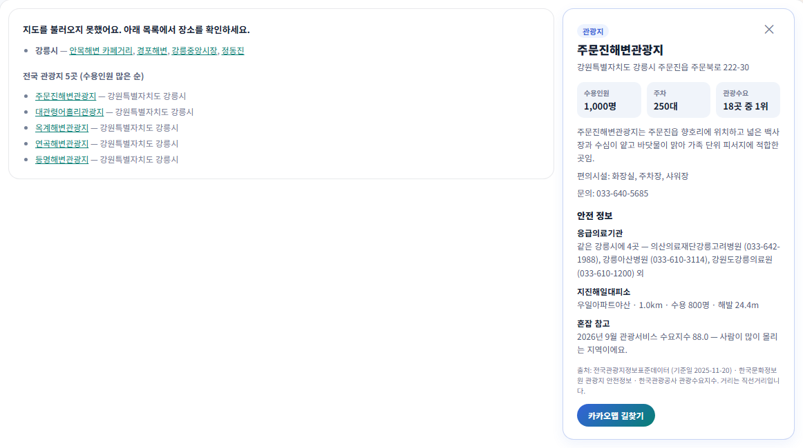

관광 자원 수요 — 강원 시군구 관광서비스 수요지수 순위(2026년 9월, 강릉시 88.0)

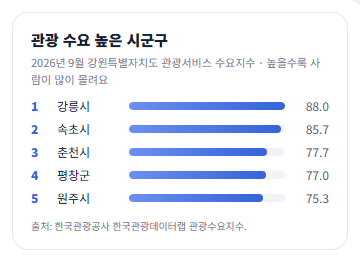

날씨 맞춤 추천 — 천안시 11/8 비 예보(강수확률 60%) → 실내 위주, 제외된 곳 표시, 기상청 단기예보 11월 7일 20:00 발표

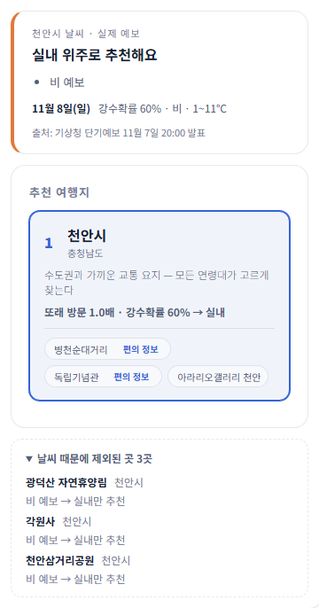

일행 맞춤 무장애 — 천안시 독립기념관, 아이 동반 이용 편의 정보

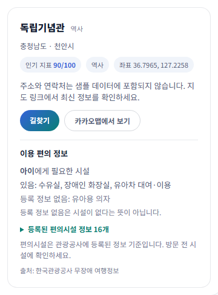

**점검하며 찾은 것** (코드는 고치지 않음)
1. 영문 관광정보(EngService2)는 웹앱에서 전혀 쓰지 않는다. → 11/7 결정으로 프로젝트 범위에서 빼고 코드를 지웠다(4번).
2. 반려동물·의료관광은 카카오 지도 마커로만 열 수 있다. 지도 키가 없는 환경(이 PC, 키 없는 배포)에서는 데이터를 받아 와도 화면에 나오지 않는다. 지도가 없을 때 나오는 목록에 이 둘도 넣을지 정해야 한다. → 11/7 목록 탭으로 넣었다(5번).
3. 지역 안전 종합의 시군 단위 요약(`/api/area`)과 내 위치 주변 찾기(`/api/nearby`)는 웹앱에 없다.
4. 관광지 안전정보의 '관광지' 항목(382건)은 웹앱에서 쓰지 않는다. 전국 관광지 표준데이터를 따로 쓰기 때문이다.
5. 날씨·무장애 연결은 push 전이라 배포 화면에는 없다.

## 4. 영문 관광정보(EngService2) 제거 (2026-11-07)

**결정**
- 영문 관광정보는 웹앱 `/app`에서 쓰지 않아(3번 점검표) 11/7에 프로젝트 범위에서 빼기로 했다. 코드를 지웠다.
- 10주차 작업기록 같은 과거 기록은 고치지 않았다(10주차 19번 접근 로그 결과에 `/eng`가 남아 있음).

**지운 것** (`tourapi/api.py`)

| 위치 | 내용 |
|---|---|
| `TOUR_SERVICES["eng"]` | `https://apis.data.go.kr/B551011/EngService2`, `EnglishTourApp`, "영문 관광정보" |
| `NAV_ITEMS` | `("/eng", "영문 관광정보")` |
| 홈 카드(`HOME_PAGE`) | "영문 관광정보 — 외국인 관광객용 영문 관광지·축제·숙박 정보" 링크 |
| `PLACE_PAGE_CONFIG["eng"]` | 영문 화면 설정(제목·검색 안내·콘텐츠 타입 76~85 등) |
| `PAGES["/eng"]` | `_place_page("eng")` |
| 라우트 반복문 | `for _service in ("eng", "pet")` → `for _service in ("pet",)`. `/api/eng/regions·places·detail`이 없어짐 |
| 주석 | API_KEY 설명의 "영문관광", 구역 제목 "영문 관광정보 (EngService2) / 반려동물…", 화면 설정 주석 "영문/반려동물 화면은…" |

**남긴 것**

| 위치 | 남긴 이유 |
|---|---|
| `fetch_medical_tourism`·`fetch_medical_details`의 `"langDivCd": "ENG"` | 의료관광(MdclTursmService) 요청 값이다. 영문 관광정보와 무관 |
| `_medical_in_area`의 영문 주소 판별(통합 코드 12: 광주·전남) | 의료관광 지역 판별 |
| `fetch_regions`·`fetch_places`·`fetch_place_details`·`_place_page`·`PLACE_SCRIPT` | 반려동물과 같이 쓰던 공용 코드. 영문 전용 분기는 설정 항목뿐이라 공용 함수는 그대로 두었다(`if service == "pet"` 등 반려동물 분기 유지) |
| `tourism_platform`의 "영문 오퍼레이션명" 주석(`data/apis/air.py`·`weather.py`) | API 오퍼레이션의 영어 이름 이야기라 영문 관광정보와 무관 |

- web/src와 README(`README.md`, `web/README.md`)에는 영문 관광정보·EngService2·`/api/eng` 언급이 없었다.
- 11주차 3번 점검표의 영문 행은 "프로젝트 범위에서 제외(11/7 결정, 코드 삭제)"로 바꿨다.

**확인**
- 8000 포트에는 직접 켜 둔 `barrierfree.py local`(지우기 전 코드)이 떠 있었다. 하나 더 켜면 Windows에서 같은 포트에 두 서버가 떠 요청이 섞인다.
  - 그래서 `py api.py local`과 같은 api.py 서버(`TourRequestHandler`)를 8010 포트로 띄워 확인했다.
  - 웹은 vite 5175, 프록시는 8010으로 썼다.

| 요청 | 결과 |
|---|---|
| `/eng`, `/api/eng/places`, `/api/eng/regions`, `/api/eng/detail` | 404 |
| `/pet` | 200, 전체 9,657건 중 12건 표시 |
| `/api/pet/places` | 200 (totalCount 9,657, 첫 항목 문수산) |
| `/api/pet/detail?contentId=2736417&contentTypeId=12` | 200 (common·intro·pet 세 구역) |
| `/medical`, `/api/medical` | 200 (totalCount 277) |
| 웹 프록시 `/tourapi/api/map/places?province=강원특별자치도` | 200, 반려동물 394곳·의료관광 2곳, errors 없음 |

- 웹앱의 반려동물·의료관광은 목록이 없고 카카오 지도 마커로만 열린다(3번 점검표). 이 PC에는 지도 키가 없어 화면 대신 위 데이터로 확인했다.
- `npm run build` 통과, `npm test` 64개 통과

캡처

홈 — 메뉴·카드에서 영문 관광정보가 빠짐

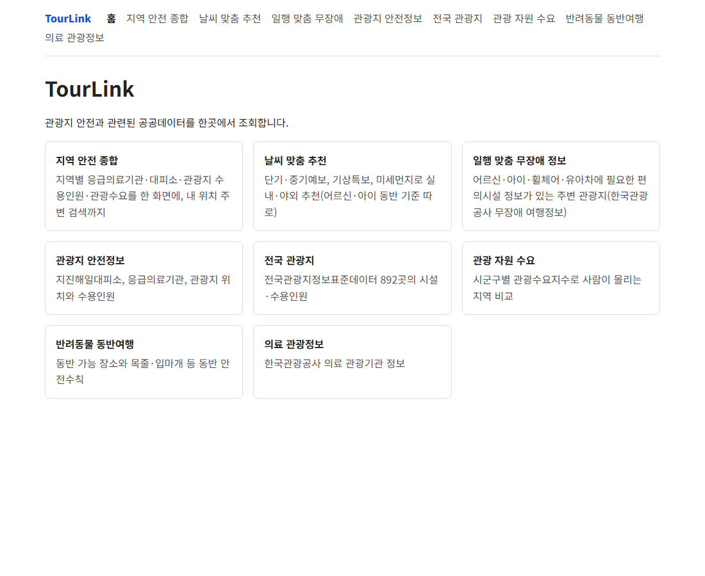

`/eng` — 404

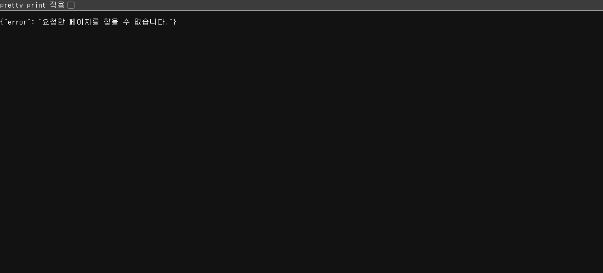

`/pet` — 반려동물 동반여행 목록 정상

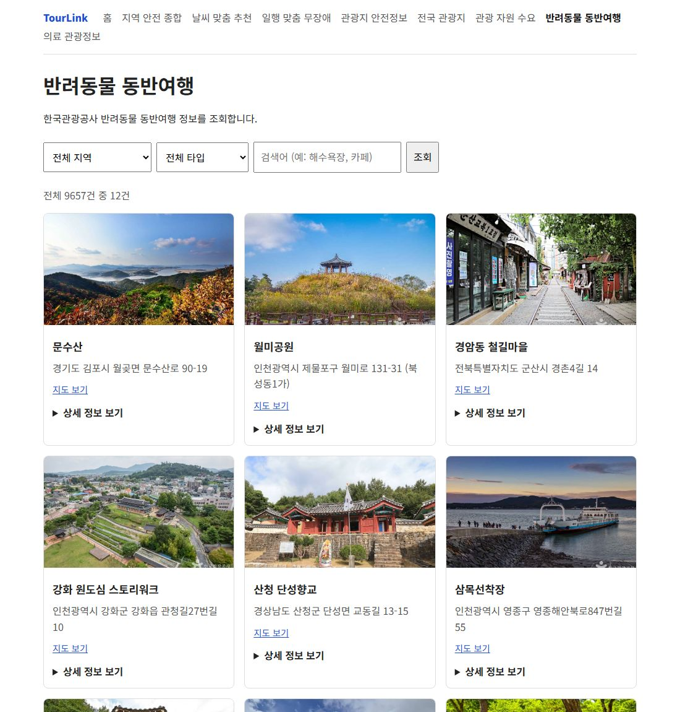

`/medical` — 의료 관광정보 정상

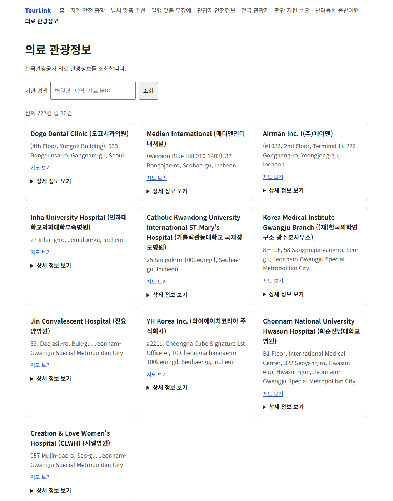

## 5. 지도 없을 때 반려동물·의료관광 목록 추가 (2026-11-07)

**한 일**
- 카카오 지도 키가 없을 때 나오는 목록(`MapView`의 지도 대신 목록)의 '전국 관광지' 부분을 '관광지 / 반려동물 동반 / 의료관광' 탭으로 나눴다(`FallbackPlaceTabs`).
  - 탭은 기존 버튼 묶음 스타일(`segmented is-three`)을, 목록은 기존 `fallback-region-list`·`fallback-attraction-link`를 그대로 쓴다.
  - 각 탭에 건수를 붙이고, 0건인 탭은 흐리게 비활성으로 둔다. 목록은 탭마다 30곳까지다.
    - 관광지: 수용인원 많은 순(기존과 같음)
    - 반려동물: 서버 순서, 종류·주소 함께 표시
    - 의료관광: 기관명·주소
  - 항목을 누르면 지도 마커와 같은 `onSelectPlace({ type: "pet" | "medical" | "spot", place })`를 불러, 같은 상세(`PetBody`, 의료관광 패널)가 열린다.
- 지도 키가 있을 때의 지도·마커 동작은 바꾸지 않았다. 바뀐 곳은 지도 대신 목록을 그리는 부분뿐이다.
- 바꾼 파일: `web/src/components/MapView.tsx`, `web/src/pages/AppPage.css`
- 3번 점검표의 반려동물·의료관광 행을 '반영'으로 고쳤다.

**확인** (지도 키 없음: `web/.env.local` 없음. 시험 서버 tourapi 8010, vite 5175, 강원 선택)
- 탭: 관광지 66 / 반려동물 동반 394 / 의료관광 2
- 반려동물 첫 항목 '원주 반계리 은행나무'를 누르면 PetBody가 열린다.
  - 동반 구분 '전구역 동반가능', 동반 가능 동물, 목줄 착용 등 안전수칙
  - 가까운 지진해일대피소 안내, 출처, 카카오맵 길찾기
- 의료관광 첫 항목 '연세대학교 원주세브란스기독병원'을 누르면 의료 관광기관 패널이 열린다(외국인 환자 유치 의료기관 안내, 119 안내, 출처).
- `npm run build` 통과, `npm test` 64개 통과, `oxlint` 통과

반려동물 동반 탭과 상세

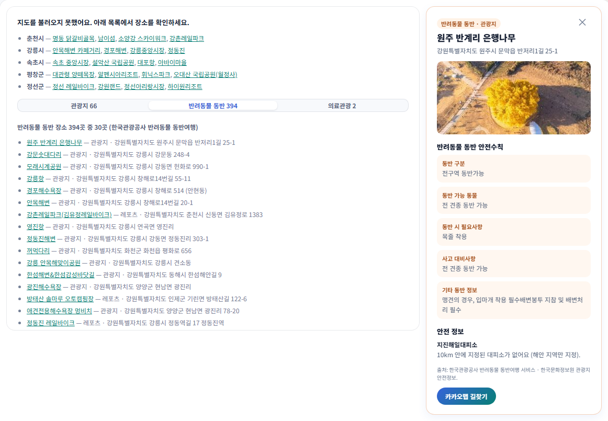

의료관광 탭과 상세

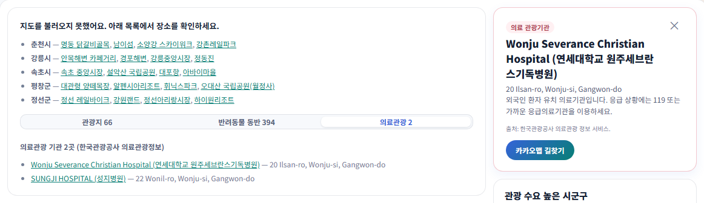

## 6. push와 tourapi 재배포 (2026-11-07, 팀장 승인)

**push**
- `git fetch` 후 `git pull --rebase`: 원격에 새 커밋이 없어 충돌 없음
- push 전 확인
  - 웹: `npm run build` 통과, `npm test` 64개 통과, `oxlint` 통과
  - 파이썬: `tourism_platform` pytest 98개 통과, `api.py` 불러오기 정상(라우트 20개)
  - 커밋 17개에 매뉴얼 파일(docx·zip)·`.env`가 없고, 서비스키처럼 보이는 값도 없음을 확인
- `git push origin main`: `ea8ce10..c477393` (커밋 17개)

**tourapi 배포 확인**
- `tourapi/vercel.json` includeFiles: `api.py`, `weather.py`, `sigungu.py`, `barrierfree.py`가 모두 들어 있다. `.vercelignore`로 `.env*`·`logs`·`fluent-bit`는 올라가지 않는다.
- Vercel 환경변수(`vercel env ls`, 값은 출력하지 않음): Production에 `API_KEY`·`KCISA_API_KEY`가 있다. `MONGO_URI`는 없어 배포는 메모리 캐시로 동작한다(10주차 18번).
- tourapi-demo는 Git 자동 배포가 아니라 CLI로 배포한다. push 뒤에도 운영은 22시간 전 배포(`r6ti2bz3s`)였다.
  - 그때 `/api/access/nearby`·`/access`는 404, 지운 `/eng`는 200이었다.
- 팀장 확인 후 `tourapi`에서 `vercel deploy --prod` → `tourapi-demo-dk1cjkwtj` Ready(Production), `https://tourapi-demo.vercel.app`에 연결

| 운영 주소 요청 | 결과 |
|---|---|
| `/api/weather?…천안시…date=20261108` | 200 — 단기예보, 강수확률 60%, 비, 11월 7일 20:00 발표, errors 없음 |
| `/api/access/nearby?lat=36.64&lon=127.49&with=senior,child` | 200 — 3곳, errors 없음 |
| `/api/access/match?…독립기념관…` | 200 |
| `/access` | 200 |
| `/eng`, `/api/eng/places` | 404 |
| `/pet`, `/api/pet/places`, `/api/medical`, `/api/map/places?province=강원특별자치도`, `/api/db/status` | 200 |

**웹 재배포**
- 필요하다. 날씨·무장애·목록 탭 등 웹 변경은 push만 되었다.
- 이 Vercel 팀(bigdata8)에는 프로젝트가 `tourapi-demo` 하나뿐이고, 웹앱(`web/`) 프로젝트는 없다. `web/.vercel` 연결 정보도 없다.
- 그래서 웹앱이 어디에 배포되는지 이 계정에서 확인하지 못했다. 웹을 배포하는 팀원이 다시 배포해야 한다.
  - 웹은 `web/vercel.json`의 rewrite로 `/tourapi`를 `https://tourapi-demo.vercel.app`으로 넘기므로, 오늘 다시 배포한 tourapi를 바로 쓴다.

## 7. 웹 확인용 배포: 내 Vercel 계정 tourlink-web-check (2026-11-07)

팀 공식 웹 주소는 박하원 계정의 기존 배포다. 이번 배포는 push한 웹 변경이 실제 배포 환경에서 보이는지 확인하는 용도다.

**한 일**
- `web`에서 `vercel link --yes --project tourlink-web-check`로 새 프로젝트를 만들었다. 기존 프로젝트에는 연결하지 않았다.
  - 범위: 내 계정 `co1d0`의 hobby 팀 `bigdata8`
  - Vite를 자동으로 알아봤다(빌드 `vite build`, 출력 `dist`).
- CLI가 GitHub 저장소 자동 연결을 시도했으나 권한이 없어 실패했다. 그래서 push로 자동 배포되지 않는다.
- CLI가 `web/.env.local`(Vercel OIDC 토큰)을 만들었다.
  - git 무시 대상(`.env*`)이고 `VITE_` 값은 없었다. 배포·커밋에 섞이지 않게 바로 지웠다. 내용은 출력하지 않았다.
- 환경변수는 넣지 않았다(카카오 키 없음 → 지도 대신 목록 화면). 서비스키를 묻는 단계는 없었다.
  - 웹은 `web/vercel.json` rewrite로 `/tourapi`를 `https://tourapi-demo.vercel.app`(6번에서 다시 배포)으로 넘긴다.
- `web/.vercel` 연결 정보는 git 무시 대상이라 커밋되지 않는다.

**배포**

| 배포 | 대상 | 주소 | 접근 |
|---|---|---|---|
| `tourlink-web-check-8ugc8dzn6` | Production (의도하지 않음) — 임시 공개 주소, 공식 웹 재배포 확인 후 삭제 예정, 보고서·공유에 쓰지 않음 | `https://tourlink-web-check.vercel.app` | 공개(200) |
| `tourlink-web-check-500b7185a` | Preview | `https://tourlink-web-check-500b7185a-bigdata8.vercel.app` | Vercel 로그인 보호(302) |

- 처음 `vercel deploy`(`--prod` 없이)를 했는데, Git 연결이 없는 새 프로젝트의 첫 배포라 Production으로 올라가 별칭이 붙었다.
  - 그래서 `vercel deploy --target preview`로 Preview를 다시 만들었다.
- Production 배포(`tourlink-web-check.vercel.app`)는 **임시 공개 주소**다.
  - 박하원 계정의 공식 웹이 다시 배포된 것을 확인하면 `vercel remove`로 지운다(11/7 결정).
  - **보고서·공유에 쓰지 않는다.**
- Preview 주소는 Vercel 기본 배포 보호(로그인)가 걸려 있어 헤드리스 브라우저로 열 수 없다.
  - 캡처는 같은 코드로 만든 공개 주소(`tourlink-web-check.vercel.app`)에서 했다.
  - 프록시 확인: `/app` 200, `/tourapi/api/weather` 200

**배포 주소 캡처** (지도 키 없음)

날씨 표시 — 천안시 11/8 비 예보(강수확률 60%) → 실내 위주, 날씨 때문에 제외된 곳, 기상청 단기예보 11월 7일 20:00 발표

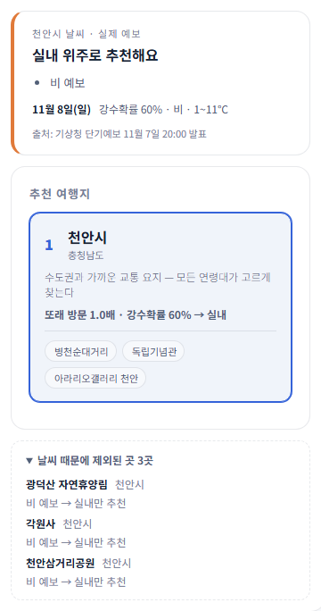

무장애 편의 정보 — 독립기념관, 아이 동반: 있음/등록 정보 없음, 체크리스트의 우산·미끄럼·편의시설 한 줄


반려동물 동반 탭과 상세 — 강원(관광지 66 / 반려동물 동반 394 / 의료관광 2)


의료관광 탭과 상세 — 연세대학교 원주세브란스기독병원


## 8. 오류 정리 (보고서용, 2026-11-08)

코드는 고치지 않았고, 이미 고친 오류를 되살리지도 않았다. 서비스키 값은 화면·캡처·기록 어디에도 넣지 않았다.
- 캡처의 원문(응답·명령 출력)에 실제 키 값이 0건임을 확인했다.
- 캡처 스크립트는 키 값이 들어 있으면 저장하지 않고 멈추게 했다.

**재현해서 캡처한 오류** (캡처: `docs/images/errors/`)

| 번호 | 상황 | 요청·명령 | 결과 | 캡처 파일 |
|---|---|---|---|---|
| 01 | 잘못된 시도 이름 | `GET /api/weather?lat=36.8&lon=127.1&sido=충청남도도` | 400 `시도 이름이 올바르지 않습니다: 충청남도도 (예: 서울, 강원, 충북, 제주)` | `err_01_weather_400.png` |
| 02 | 위도·경도 없음 | `GET /api/access/nearby` (파라미터 없음) | 400 `위도(lat)·경도(lon)가 필요합니다.` | `err_02_access_no_latlon.png` |
| 03 | 국내 범위 밖 위치 | `GET /api/access/nearby?lat=50&lon=10` | 400 `국내 위치의 위도·경도가 필요합니다.` | `err_03_access_out_of_korea.png` |
| 04 | 지운 페이지 | `GET /eng` | 404 `요청한 페이지를 찾을 수 없습니다.` | `err_04_eng_404.png` |
| 05 | 서비스키 없이 날씨 점검 | `API_KEY= py weather.py check` (이번 실행에만 빈 값) | 4개 API 모두 `[실패] … 환경변수 API_KEY에 공공데이터포털 인증키(Decoding)를 넣어 주세요.` → 4개 중 0개 정상 | `err_05_weather_no_key.png` |
| 06 | 서비스키 없이 무장애 점검 | `API_KEY= py barrierfree.py check` (이번 실행에만 빈 값) | `[실패] locationBasedList2: 환경변수 API_KEY에 공공데이터포털 인증키(Decoding)를 넣어 주세요.` | `err_06_barrierfree_no_key.png` |
| 07 | tourapi 서버 꺼짐 | 서버를 끈 상태에서 웹앱 추천받기 | 날씨 안내 "날씨 정보를 불러오지 못했습니다", 이용 편의 정보 "정보를 불러오지 못했습니다", 추천 목록은 그대로 | `../week11/b7_server_down.png` (2번에서 찍은 것) |

- 재현 서버: `py api.py local`과 같은 api.py 서버(`TourRequestHandler`)를 8010 포트로 띄웠다.
  - 8000 포트에는 직접 켜 둔 `barrierfree.py local`(영문 관광정보를 지우기 전 코드)이 떠 있어서 `/eng`가 404로 나오지 않는다.
  - 같은 포트에 하나 더 켜면 요청이 섞인다(아래 표 마지막 줄).
- 05·06: 환경변수는 그 명령 한 번에만 빈 값으로 넘겼다. 셸의 `API_KEY`는 그대로다(길이만 확인).
- 캡처는 실제 응답·출력을 그대로 옮겨 그린 화면이다. 01~04는 상태 줄·Content-Type·응답 본문, 05·06은 터미널 출력이다.

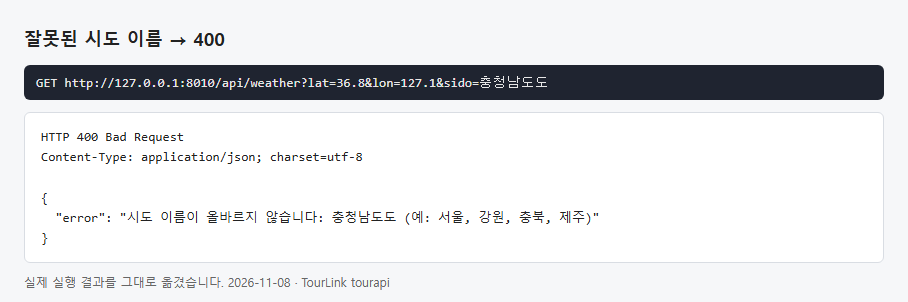
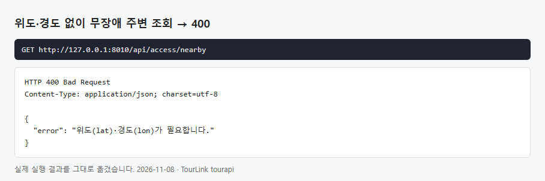
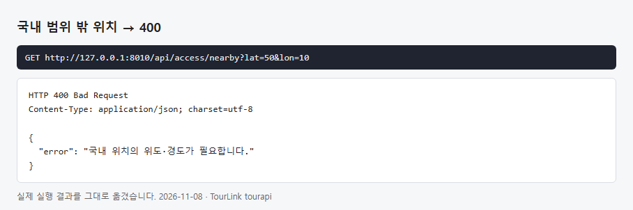
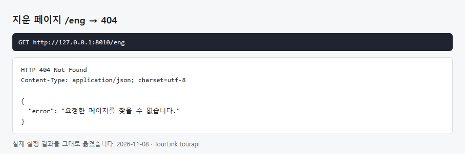
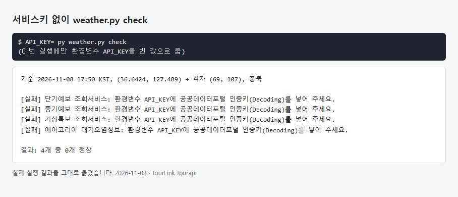
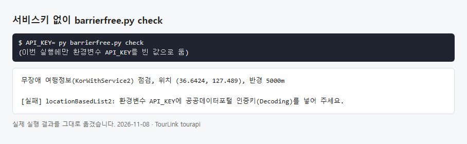

**이미 고쳐서 다시 만들 수 없는 오류** (표로만 정리, 캡처 없음)

| 주차 | 문제 | 원인 | 해결 | 작업기록 위치 | 캡처 파일 |
|---|---|---|---|---|---|
| 10 | 기상청 단기·중기예보·특보, 에어코리아, 응급의료기관 위치정보 API가 HTTP 403 | 그 API들의 활용신청이 승인되지 않은 상태(코드 문제 아님) | 공공데이터포털 활용신청·승인 후 정상 호출(단기예보도 레이크 첫 실행에서는 5곳 모두 403) | 10주차 7-b(문제 4), 8(결과 표) | 없음 |
| 10 | 무장애 여행정보 `check`가 HTTP 403 | KorWithService2 활용신청 승인 전 | 승인 후 `check` 정상(청주·서울·부산) | 10주차 16 | 없음 |
| 10 | 오류 메시지에 서비스키가 든 전체 URL이 그대로 찍힘(보안) | 요청 라이브러리의 HTTP 오류 메시지에 `serviceKey`가 포함된 URL이 담김 | `datagokr_client.fetch()`가 키를 뺀 메시지로 다시 던지고 원래 예외 연결을 끊음. 테스트 추가 | 10주차 7-b(문제 1) | 없음 (키가 보이는 화면이라 만들지 않음) |
| 10 | 데이터랩 API 오류(`INVALID_REQUEST_PARAMETER_ERROR(type)`)를 "성공"으로 표시 | ① 클라이언트가 항상 `type=json`을 붙임(데이터랩은 `_type`만 받음) ② 데이터랩은 오류를 최상위 `resultCode`로 줌 | 다른 형식 파라미터가 있으면 `type`을 붙이지 않고, 최상위 `resultCode`도 검사. 테스트 5개 추가 | 10주차 7-b(문제 2) | 없음 |
| 10 | 샘플 데이터의 속초시·평창군 지역 코드가 틀림 | 속초시가 51230(실제 삼척시), 평창군이 51830(실제 양양군)으로 들어 있었음 | 데이터랩 실데이터의 시군구 이름으로 확인해 속초시 51210, 평창군 51760으로 고침 | 10주차 7-b(문제 3) | 없음 |
| 10 | 응급의료기관까지 거리를 계산할 수 없음 | KCISA 관광지 안전정보의 응급의료기관 항목에 좌표가 없음 | 좌표가 있는 국립중앙의료원 위치정보 API를 씀(XML 응답은 `parse_xml_response()`로 변환) | 10주차 5 | 없음 |
| 10 | MongoDB `$nearSphere` explain이 0건 | 검색 반경 5km가 최근접 대피소 거리(5.7km)보다 작음 | 반경을 10km로 넓힘 | 10주차 8 | 없음 |
| 10 | README·주석이 "Encoding 키"를 쓰라고 안내 | requests가 한 번 더 인코딩하므로 Decoding 키를 써야 함(실제 호출도 Decoding 키로 성공) | 안내 문구를 Decoding 키로 고침 | 10주차 8 | 없음 |
| 11 | 3박 4일의 마지막 날(11/11)이 "강수확률 0% · 3~3℃"로 나옴 | 단기예보 끝 날짜에 00시 한 시간대만 있는 잘린 하루를 온전한 예보처럼 씀 | 최저·최고기온이 모두 없는 미래 날짜는 빼고 중기예보를 쓰게 함(11/11 → 10% · 2~15℃) | 11주차 1(오류와 해결) | 없음 (고친 뒤 캡처 `../week11/a5_3n4d.png`만 있음) |
| 11 | 출처에 발표 시각이 빠지고 예전 응답이 섞임 | 8000 포트에 고치기 전 코드 서버가 함께 떠 있었음(Windows는 같은 포트를 두 프로세스가 열 수 있음) | 시험은 다른 포트(8010·5175)로 하고, 사용자 서버는 건드리지 않음 | 11주차 1(오류와 해결), 3·4(확인 방법) | 없음 |

## 9. 쓰지 않는 보행자 사고·화재 데이터셋 설정 제거 (2026-11-08)

`tourism_platform`에 API를 연결한 적 없는 "미설정" 항목 두 개(도로교통공단 보행자 사고, 소방청 화재)가 남아 있어 지웠다. 응급의료기관 설정은 그대로 두었다.

**지운 것·고친 것**

| 파일 | 줄(고치기 전) | 내용 |
|---|---|---|
| `tourism_platform/src/tourism_platform/data/apis/safety.py` | 12–18 | `"pedestrian_accidents"`: 도로교통공단 - 보행자 사고 통계 (endpoint·operation 없음) — 삭제 |
| 같은 파일 | 19–25 | `"fire_incidents"`: 소방청 - 화재 발생 통계 (endpoint·operation 없음) — 삭제 |
| 같은 파일 | 3–5 (모듈 설명) | "보행자 사고·화재 설정도 지웠다(2026-11-08)" 한 줄 추가 |

- 데이터셋 목록(`data/datasets.py`의 `DATASETS`)은 `SAFETY_DATASETS`를 그대로 펼쳐 쓰므로 따로 고칠 곳이 없었다.
- 이 둘만 참조하는 함수·테스트는 없었다. `README.md`, `docs/근거자료.md`, `tourism_platform/data/raw/README.md`에도 이 두 데이터셋 항목은 없었다.

**남긴 것** (데이터셋 설정이 아니라서 그대로 둠)

| 위치 | 이유 |
|---|---|
| `apis/safety.py`의 `emergency_facilities`, `kcisa_tour_safety` | 대비 정보로 쓰는 응급의료기관·관광지 안전정보 |
| `validation/validate_rank_uncertainty.py`의 하위 지표 설명(보행자 사고율·화재 발생률 등 4개) | 순위 불확실성 시뮬레이션의 가상 지표 개수(`N_SUBINDICATORS = 4`)다. 바꾸면 검증 수치(128.5위 등)가 달라진다 |
| `web/src/data/sampleRegions.ts`·`lib/safetyPriority.ts`·`lib/types.ts`의 `pedestrianAccidentRate`·`fireRate` | 웹 샘플 지역의 안전 하위 지표 값. 화면에서는 숨겨져 있다(`SHOW_REGION_SAFETY_SCORE`) |
| `docs/근거자료.md` 5절의 "도로교통공단·소방청" | 옛 소개 페이지 문장을 그대로 옮긴 인용 |

**확인**
- `fetch_live` 요약: 실제 API를 부르지 않게, 이번 실행에만 서비스키 환경변수를 비우고 돌렸다.

| | 데이터셋 | 미설정 | 설정됨 |
|---|---|---|---|
| 지우기 전 | 14개 | 3개 (visitor_by_gender_age, pedestrian_accidents, fire_incidents) | 11/14 |
| 지운 뒤 | 12개 | 1개 (visitor_by_gender_age = 성·연령 방문자) | 11/12 |

- 파이썬 `pytest` 98개 통과, 웹 `npm run build` 통과, `npm test` 64개 통과

## 10. 준비물 체크리스트에 관광지 종류별 안내 추가 (2026-11-08)

새 화면은 만들지 않고, 기존 여행 체크리스트(`TripPreparation`)에 안내를 더했다.

**한 일**
- 분류: 추천 결과(날씨 규칙 적용 뒤 남은 관광지)를 `attractionSetting.ts`의 `classifyAttraction`으로 바다·산·계곡으로 나눈다. 분류 규칙은 고치지 않았다.
- 문구(`web/src/lib/preparationTips.ts`의 `terrainTips`, 팀 안내 문구):

| 종류 | 안내 |
|---|---|
| 산 | 등산화를 신으세요 / 물과 간식을 챙기세요 / 바람막이를 챙기세요 / 해 지기 전에 하산하세요 / 보조배터리를 챙기세요 |
| 바다 | 자외선 차단제를 챙기세요 / 여벌 옷과 수건을 챙기세요 / 물때를 확인하세요 / 갯바위에서는 미끄럼에 주의하세요 |
| 계곡 | 미끄럼 방지 신발을 신으세요 / 여벌 옷을 챙기세요 / 비 온 뒤에는 불어나는 물에 주의하세요 |
| 어르신 동반 + 산 | 등산 스틱을 챙기고 쉬운 코스를 고르세요 |
| 아이 동반 + 바다·계곡 | 아이는 물가에서 구명조끼를 입히세요 |

- 표시
  - 추천 결과에 그 종류가 있을 때만 보이고, 관광지 이름과 종류를 앞에 붙인다(예: "정동진(바다): 물때를 확인하세요.").
  - 관광지가 셋 이상이면 "경포해변·안목해변 카페거리 외 2곳(바다): …"처럼 두 곳 이름과 나머지 수를 붙인다.
- 겹침
  - 체크리스트 순서는 기존 문구 → 날씨(weather.py tips) → 미세먼지 → 관광지 종류 → 편의시설이다.
  - `mergeTips`로 같은 주제(자외선·미끄럼·물·여벌 옷 등)는 먼저 나온 하나만 남긴다. 그래서 날씨 안내와 겹치면 날씨 안내가 남는다.
  - 주제 낱말에 등산화·간식·바람막이·하산·보조배터리·물때·여벌 옷·구명조끼·불어나는 물·등산 스틱을 더했다.
- 바꾼 파일: `web/src/lib/preparationTips.ts`, `web/src/lib/preparationTips.test.ts`, `web/src/pages/AppPage.tsx`

**확인**
- 테스트 5개 추가(`preparationTips.test.ts`)
  - 바다·산·계곡이 추천되면 안내가 나옴, 없으면 없음
  - 아이 동반이면 바다·계곡에만 구명조끼, 어르신 동반이면 산에 등산 스틱·쉬운 코스
  - 셋 이상이면 "외 n곳"
  - 날씨 안내(자외선·미끄럼)와 겹치면 날씨 안내 하나만 남음
- `npm test` 69개 통과, `npm run build` 통과, `oxlint` 통과
- 샘플 데이터에는 '계곡·폭포' 관광지가 없다. 단양도 산(단양 패러글라이딩 활공장)만 분류된다. 그래서 계곡 안내는 테스트로만 확인했다. 데이터와 분류 규칙은 고치지 않았다.

**캡처** (시험 서버 tourapi 8010, vite 5175, 실제 예보, 방문일 11/10)

강릉시(바다), 아이 동반 — 바다 관광지 4곳에 대한 안내 5줄(구명조끼 포함). 날씨 안내 "우산"과 겹치지 않음

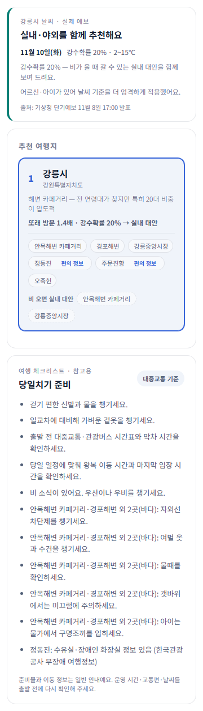

단양군(산) — 단양 패러글라이딩 활공장(산): 등산화·물과 간식·바람막이·하산·보조배터리

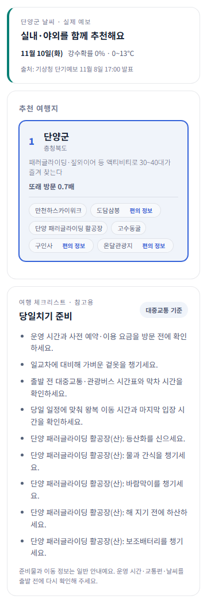

## 11. 로컬 실행 명령 통합과 화면 정리 (2026-11-09)

추천 점수 계산과 판정 규칙은 바꾸지 않았다.

**한 일**

1. 명령 하나로 로컬 실행
   - `web/package.json`에 `dev:all`을 추가했다. `tourapi` 폴더의 `py api.py local`(8000)과 `vite --strictPort`(5173)를 `concurrently --kill-others`로 함께 실행한다.
   - 5173이 사용 중이면 다른 포트로 옮겨 가지 않고 둘 다 멈추도록 `--strictPort`를 넣었다.
   - `api.py`에 브라우저를 여는 옵션이 없어서 환경변수 `TOURAPI_NO_BROWSER`를 추가했다. `dev:all`에서 켠다. 환경변수는 `cross-env`로 설정한다.
   - 서비스키는 지금처럼 환경변수 `API_KEY`에서 읽는다.
   - `README.md`, `web/README.md` 실행 방법에 `npm run dev:all`을 추가했다.
2. 준비물 반복 정리
   - 관광지 종류별로 한 줄로 묶었다. 형식: `산(상당산성 외 2곳): 등산화, 물·간식, 바람막이, 해 지기 전 하산, 보조배터리`
   - 한 줄로 묶으면 기존 겹침 정리가 줄 전체를 지우게 되어 `mergeTips`를 고쳤다. 날씨 등 앞선 안내와 겹치는 항목만 줄에서 뺀다.
   - 종류별 줄끼리는 겹침을 따지지 않는다. 바다와 계곡이 함께 추천돼도 계곡 줄의 "여벌 옷"이 사라지지 않는다.
   - "물·간식"은 기본 문구의 물 안내와 겹쳐도 남긴다(간식 안내까지 사라지지 않게).
3. 반려동물 0곳 안내: 지도 없는 목록에서 도가 '전국'이고 반려동물 동반이 0곳이면 탭 아래에 "도를 고르면 반려동물 동반 장소가 보여요"를 띄운다.
4. 시연 모드 숨기기: 체크박스를 없앴다. `weatherPresets`는 그대로 두고, 주소에 `?demo=weather`가 있을 때만 '예시 날씨' 선택이 나타나고 적용된다.
5. 지도 대신 목록 정리
   - 도를 고르면 그 도의 관광지만 보여 주고 제목도 "충청북도 관광지 30곳"처럼 나온다.
   - '전국'이면 추천된 지역의 관광지를 먼저, 각각 수용인원 많은 순으로 보여 준다(`splitRecommendedSpots`). 도까지 맞춰서 강원 고성군과 경남 고성군을 구분한다.

**실행 명령**

```powershell
cd web
npm run dev:all
npm test
npm run build
npx oxlint
```

**확인** (Windows PowerShell, 방문일 11/9, 실제 예보, 지도 키 없는 환경)

| 항목 | 결과 |
|---|---|
| `npm run dev:all` 한 번으로 실행 | 5173/app 200, 8000 200 |
| api 프로세스 종료 | vite(5173)도 종료, 두 포트 모두 해제 |
| vite 프로세스 종료 | api(8000)도 종료, 두 포트 모두 해제 |
| 브라우저 자동 열기 (`webbrowser.open`을 가짜 함수로 바꿔 확인) | `cross-env`→`concurrently` 경로: 안 열림 / 환경변수 없을 때: 열림 |
| 날씨 (`/app`, 강릉시) | "실제 예보", `/api/weather` 10회 모두 200 |
| 무장애 (`/app`, 아이 동반) | '편의 정보' 배지 17개, `/api/access/match` 36회 모두 200 |
| 체크리스트 | 산·바다 각 1줄 (캡처 참고) |
| 전국 목록 (추천 전) | 897곳, 1위 을숙도 생태공원(부산), 반려동물 0곳 안내 표시 |
| 전국 목록 (추천 후) | 추천 지역 18곳 먼저, 1위 아우라지 관광지(정선군) |
| 도 선택 (충청북도) | 충북 30곳만, 반려동물 동반 119곳, 0곳 안내 없음 |
| 기본 주소 입력 폼 | "시연 모드"·"예시 날씨" 문구 없음 |
| `?demo=weather` | 예시 날씨 선택 표시, "(시연 모드)" 안내, `/api/weather` 호출 0회 |
| 서버 로그의 서비스키 | 0건 |
| `npm test` | 78개 통과 (69개 → 78개) |
| `npm run build` / `oxlint` | 통과 / 경고 없음 |

**오류와 해결**

| 오류 | 원인 | 해결 |
|---|---|---|
| 8000·5173 포트가 이미 사용 중 | 앞서 켜 둔 `api.py local`과 vite | 사용자 확인 후 두 프로세스를 끄고 확인 |
| `BROWSER` 환경변수로 브라우저 열림을 재려던 대조군이 동작하지 않음 | `%s`까지 한 프로그램 이름으로 처리됨 | `webbrowser.open`을 가짜 함수로 바꿔 환경변수 있을 때와 없을 때를 비교 |
| 서버 로그의 `ConnectionAbortedError(10053)` 3건 | 브라우저가 응답을 받기 전에 페이지를 옮겨 연결을 끊음 | 화면 결과에는 영향 없음(API 응답은 모두 200). 코드는 고치지 않음 |

- `npm audit`의 high 2건은 기존 `vite`·`source-map-js`에서 나오며 이번에 넣은 패키지와는 무관하다. 이번 작업 범위 밖이라 고치지 않았다.

**캡처**

날씨(실제 예보)

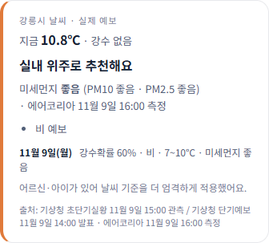

무장애('편의 정보' 배지)

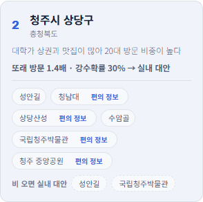

체크리스트 — 관광지 종류별 한 줄

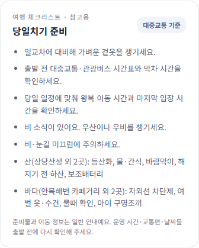

전국 목록 — 반려동물 0곳 안내, 추천 지역 먼저

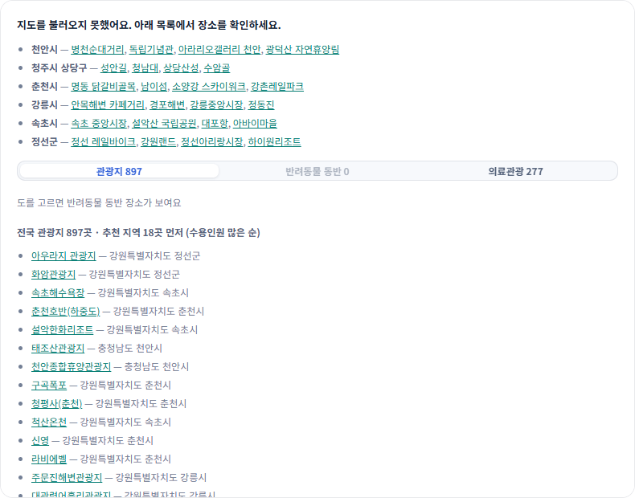

도 선택(충청북도) — 그 도의 관광지만

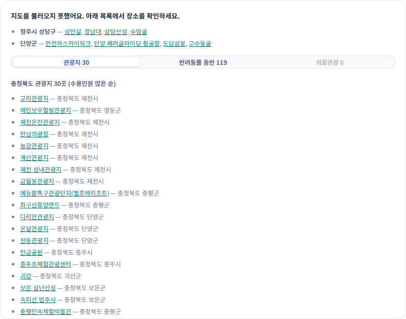

시연 모드가 사라진 입력 폼

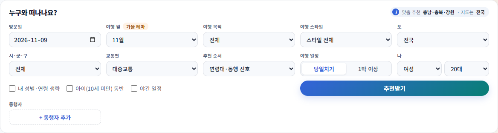

`?demo=weather`로 연 예시 날씨(비 예보) 화면

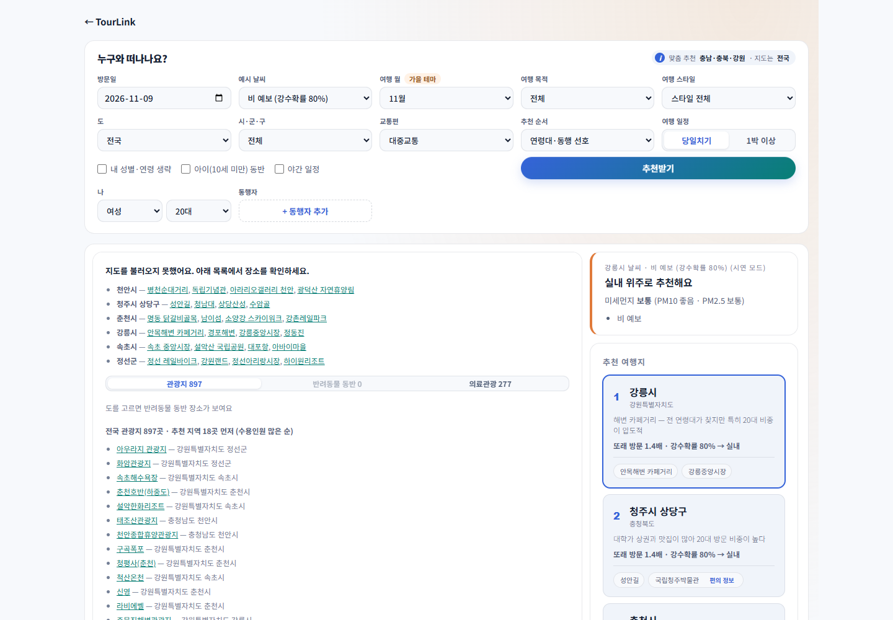

## 12. 수업 도구 연계표 (2026-11-10)

중간 발표 피드백 ③(수업 도구 연계)에 대한 정리다. 코드는 고치지 않았다.

**한 일**
- `docs/근거자료.md`에 "6. 수업 도구 → 프로젝트 적용" 절을 추가했다. 표 열은 주차, 수업 도구, 프로젝트에서 쓴 곳(파일·함수), 확인 방법, 결과다.
- 파일·함수 이름은 코드를 열어 확인했다. 작업기록에 없던 무장애 저장 이름 `access_search_<대상>`(`barrierfree.py`)과 `api.py`가 직접 저장하는 항목의 유지 시간도 코드에서 찾아 적었다.
- `lake/` 파일을 모두 확인했다.
  - `api_log_report.py`: `datagokr_client.fetch`가 남긴 API 호출 로그를 pandas로 집계한다(API별 호출 수·성공률·평균/중앙값/p95/최대 응답시간, 오류 유형별 건수). 수업의 로그 분석·pandas와 관련 있어 행을 추가했다.
  - `run.py`: raw → processed → gold → MongoDB 실습 → 호출 리포트를 한 번에 실행한다. 데이터 레이크 행에 넣었다.
  - `__init__.py`: 설명 한 줄뿐이라 행을 만들지 않았다.
- Jupyter·pandas 행은 4주차 노트북과 `mongo_lab.py`를 나눠 적었다. 데이터와 확인 방법이 서로 달라서다.
- 표는 9행이다: Fluent Bit, MongoDB 접근 로그, 로그 분석(pandas), MongoDB 캐시, MongoDB 실습 구조, 데이터 레이크, Jupyter·pandas 2행(노트북·`mongo_lab`), Orange.
- 수식 교차 테스트(`test_ts_parity`)와 몬테카를로(`rec_avg`) 행은 수업 도구가 아니라서 처음 11행에서 뺐다. 10주차 알고리즘 검증 근거로만 쓴다. 표 아래에 이 내용을 한 줄로 적었다.
- 4주차 노트북 행을 `C:\logslab\04_logs_mongo.ipynb`의 실제 결과로 바꿨다. 노트북은 수정하지 않았다(읽기 전후 md5 같음).

**실행 명령** (`tourism_platform` 폴더, 코드 커밋 `ce4fd77`, Python 3.13.12, numpy 2.5.4, scipy 1.18.1, pandas 3.1.1, node 24.21.0, MongoDB 켜짐)

```bash
.venv/Scripts/python -m tourism_platform.validation.rec_avg
.venv/Scripts/python -m pytest -q tests/test_ts_parity.py
.venv/Scripts/python -m pytest -q tests/test_lake.py
.venv/Scripts/python -m tourism_platform.lake.api_log_report
```

- 최대 오차, `aggregate_vs_pandas`, `access_logs` 상태는 임시 스크립트로 쟀다(저장소 밖, 커밋 안 함). MongoDB에는 읽기만 했다. `test_lake.py`는 별도 DB `tourlink_lab_test`를 쓰고 끝나면 지운다. 실행 뒤 `tourlink_lab` 문서 수는 그대로다.
- 아래의 `rec_avg`, `test_ts_parity` 결과는 연계표에는 넣지 않는다. 재실행 기록으로만 남긴다.

**결과 수치**

`rec_avg` 출력 전체:

```
=== 추천 precision@10, 가상 세계 100개 평균 (seed 42) ===
무작위 기준: 10/250 = 0.040

[k=50]
결합   평균 0.392, 표준편차 0.044
인기순 평균 0.183, 표준편차 0.032
결합/인기순 평균 비율 2.14배
결합이 이긴 횟수 100/100 (동률 0, 진 횟수 0)

[k별 평균]
k=0: 결합 0.492, 인기순 0.183, 특화지수만 0.133
k=50: 결합 0.392, 인기순 0.183, 특화지수만 0.021
k=1000: 결합 0.000, 인기순 0.183, 특화지수만 0.000
```

그 밖의 재실행 결과:

```
tests/test_ts_parity.py: 4 passed
비교한 값 600개, 1e-12 이하 600개, 비트까지 같은 값 592개
최대 상대오차 3.85e-16
tests/test_lake.py: 12 passed
tourlink_lab 문서 수 {'spots': 861, 'shelters': 629, 'weather': 0}
2026-11-05.jsonl 관광지 861 시도 16 aggregate=pandas: True
access_logs 문서 62
인덱스 level_ts [('level', 1), ('ts', -1)], ts_ttl_30d [('ts', 1)] expireAfterSeconds 2592000
api_log_report: 호출 7건 (conver10 100% 1344ms, tn_pubr_public_trrsrt_api 100% 1044ms, getVilageFcst 0% 765ms, HTTP 403 5건)
```

| 표의 수치 | 출처 | 2026-11-10 재현 |
|---|---|---|
| Fluent Bit in 62 = out 62, 6,789바이트 | 10주차 19번 | 다시 돌리지 않음 |
| `level_ts` explain(키 12·문서 12, COLLSCAN 문서 62) | 10주차 19번 | 다시 돌리지 않음 (문서 수·인덱스만 조회) |
| 캐시 재호출 시간, `_meta` | 10주차 18번 | 다시 돌리지 않음 (이름·유지 시간은 코드 확인) |
| 레이크 건수, ESR·2dsphere explain | 10주차 8번 | 다시 돌리지 않음 (서비스키로 공공데이터를 다시 받아야 함) |
| aggregate = pandas 16개 시도 | 10주차 8번 | 같음 |
| API 호출 리포트 7건 | 10주차 8번 | 같음 |
| 4주차 노트북 TTL·explain·aggregate | `C:\logslab\04_logs_mongo.ipynb`에 저장된 출력 | 다시 실행하지 않음 |

**확인했는데 요청 내용과 다른 점**

| 항목 | 요청 | 실제 | 처리 |
|---|---|---|---|
| Fluent Bit 실행 결과 위치 | 11주차 작업기록·10주차 19번 | 실행 결과는 10주차 19번에만 있다. 11주차에는 배포 제외 설정 등 언급뿐이다 | 10주차 19번만 근거로 적음 |
| 4주차 노트북의 aggregate ↔ pandas 대조 | 결과 같음 | `C:\logslab\04_logs_mongo.ipynb`에 있다. 전체 레벨별 건수가 aggregate와 pandas로 같다. 최근 1시간 건수는 aggregate로만 계산했다 | 전체 건수만 "결과 같음"으로 적음 |
| `data/raw/api/` 위치 | `data/raw/api/` | 저장소 맨 위 `data/`가 아니라 `tourism_platform/data/raw/api/`다 | 실제 경로로 적음 |
| Bronze → Silver → Gold | 단계 이름 | 코드·폴더 이름은 raw → processed → gold다 | 표에 대응 관계를 적음 |
| 레이크 날씨 데이터 | — | 2026-11-05 실행에서 5곳 모두 HTTP 403이라 0건이다 | 결과 칸에 그대로 적음 |

`04_logs_mongo.ipynb`에 저장된 출력 (MongoDB 8.3.8):

```
읽은 줄: 3000 / 적재: 3000 / 컬렉션 문서 수: 3000
level_ts [('level', 1), ('ts', -1)] expireAfterSeconds=-
ts_ttl_30d [('ts', 1)] expireAfterSeconds=2592000
인덱스 사용: {'단계': 'FETCH → IXSCAN', '결과 수': 168, '읽은 문서': 168, '읽은 키': 168}
인덱스 무시: {'단계': 'SORT → COLLSCAN', '결과 수': 168, '읽은 문서': 3000, '읽은 키': 0}
전체: [{'_id': 'INFO', 'n': 2627}, {'_id': 'WARN', 'n': 205}, {'_id': 'ERROR', 'n': 168}]
최근 1시간: [{'_id': 'INFO', 'n': 315}, {'_id': 'WARN', 'n': 27}, {'_id': 'ERROR', 'n': 22}]
pandas 전체: {'INFO': 2627, 'WARN': 205, 'ERROR': 168}
```

- 참고: 인덱스 이름 `level_ts`·`ts_ttl_30d`는 `access_log.py`와 같다. 노트북 마지막 "발견한 점" 셀은 비어 있다.

**오류와 해결**
- 처음에는 `C:\Users\wjdck\logslab`만 찾아 4주차 노트북 행을 "미확인"으로 적었다. 그 폴더의 `01`~`04` 노트북은 0바이트 빈 파일이다(2026-09-29). 실제 노트북은 `C:\logslab`에 있어 그 파일로 고쳤다.
- 코드는 고치지 않았고 서비스키는 출력하지 않았다.

## 13. 별점·기록 제외, 성별 삭제, 접속 주소 가림 (2026-11-10)

팀 결정(11/10): 별점·사용자 기록 기능은 넣지 않고, 성별은 뺀다(연령대만 남김). `git pull`로 `fbf5639`(#11 병합)까지 받은 뒤 작업했다.

| 커밋 | 내용 |
|---|---|
| A `683cb5d` fix(tourapi): db status·로그에서 MongoDB 접속 주소 비밀번호 가림 | |
| B `36056f2` refactor: 별점·사용자 기록 기능 제외 (#11 이전 추천으로 되돌림) | |
| C (이 기록과 함께) refactor: 성별 입력·추천 제거, 연령대만 사용 | |

- 같은 날 먼저 "기록 기능은 두고 성별만 빼는" 커밋(`d9b99ad`)을 만들었으나, 기록 기능도 빼기로 해서 `main`에서 내리고 브랜치 `backup/gender-only-d9b99ad`에 남겼다(push 안 함). C는 그 커밋 가운데 기록 기능과 관계없는 부분을 다시 가져왔다.

### A. MongoDB 접속 주소 비밀번호 가리기

**한 일**
- `tourapi/api.py`에 `_mask_uri()`를 추가했다. 아이디·비밀번호를 `***`로 바꾸고 호스트만 남긴다(경로·옵션도 뺀다). `://`가 없는 형식은 통째로 `***`.
  - 예: `mongodb+srv://user:pw@cluster0.xxxx.mongodb.net/?retryWrites=true` → `mongodb+srv://***@cluster0.xxxx.mongodb.net`
- `fetch_db_status()` 응답 두 곳(연결됨·연결 안 됨): `"uri": MONGO_URI` → `"host": _mask_uri(MONGO_URI)`
- 연결 로그 `[MongoDB] … 에 연결했습니다`도 `_mask_uri`로 바꿨다.
- 저장소 전체에서 `MONGO_URI`를 찾았다. 출력하거나 응답에 넣는 곳은 위 세 곳뿐이다. `tourism_platform`의 `access_log.py`·`api_call_log.py`·`mongo_lab.py`와 테스트는 접속에만 쓴다. `/api/db/status`의 `uri`를 읽는 화면 코드도 없다.
- 테스트 `tourism_platform/tests/test_mask_uri.py` 8개: 비밀번호 있는 주소, localhost(2), srv 주소, 여러 호스트, 형식 오류, 빈 값, `fetch_db_status()` 응답(연결 안 됨·연결됨 모두 `uri` 없음, 비밀번호 없음)

### B. 별점·사용자 기록 기능 빼기

**지운 파일 (16개)**

| 위치 | 파일 |
|---|---|
| web | `src/components/UsageConsent.tsx`, `src/components/RatingBox.tsx`, `src/lib/usageApi.ts`, `src/lib/usageApi.test.ts`, `src/lib/usageAdjust.ts`, `src/lib/usageAdjust.test.ts`, `scripts/usage_cli.ts` |
| tourapi | `usage_events.py` |
| tourism_platform | `src/tourism_platform/usage/` (`__init__.py`, `affinity.py`, `aggregate.py`, `events.py`, `region.py`), `tests/test_usage.py`, `tests/test_usage_api.py`, `tests/test_usage_ts_parity.py` |

**되돌린·고친 파일**
- 웹 `AppPage.tsx`, `AppPage.css`, `AttractionDetail.tsx`, `recommend.ts`, `attractionAffinity.ts`: #11이 이 파일들에서 바꾼 것은 기록 기능뿐이라 `68002da` 상태로 그대로 되돌렸다(`git checkout 68002da -- …`). B 커밋 직후 다섯 파일은 `68002da`와 같다.
- `tourapi/api.py`: `import usage_events`, `fetch_usage_summary`·`USAGE_SUMMARY_SECONDS`, `/api/usage/summary` 경로, `do_POST`(#11이 `POST /api/usage` 때문에 새로 만든 것)를 지웠다. Redis 단계 등 #11의 나머지는 그대로다.
- `tourapi/vercel.json`: `includeFiles`에서 `usage_events.py`를 뺐다.
- 문서: `methodology.md` 9절을 "넣지 않음"으로 줄였다(설계는 `fbf5639`에 남음). 종합보고서 9절·8절, 주차별보고서 현황표·다음 계획도 고쳤다.
- 그대로 둔 #11: Redis 캐시(`rediscache.py`), Fluent Bit 설정, pandas 정제 리포트·노트북, `api_call_log`, Orange 비교 준비

**추천 결과가 #11 이전과 같은지 확인**
- 저장소 밖 임시 폴더에 `68002da`를 따로 꺼내(`git worktree`), 같은 비교 테스트를 두 트리에서 실행했다(임시 파일, 커밋 안 함).
- 동행 조합 72개: 1명 12개(성별 2 × 연령대 6) + 2~4명 무작위 60개
- 비교 항목: `getRecommendations`(10개 지역 전부의 점수·근거 문장·상위 관광지와 매치 점수), `getExploreRecommendations`, `rankAttractions`
- 결과: 두 출력 파일의 해시가 같다. 72개 조합 모두 결과가 완전히 같다.

### C. 성별 빼기 (연령대만 남김)

**바뀐 파일**

| 파일 | 바뀐 점 |
|---|---|
| `web/src/lib/types.ts` | `Gender` 삭제, `Person`은 `ageGroup`만, `GroupKey = AgeGroup`, `groupKey()`는 연령대 |
| `web/src/data/sampleRegions.ts` | 10개 지역의 12개 값(남·녀 × 연령대)을 같은 연령대끼리 더해 6개로. 지역별 합계는 그대로(예: 천안시 1,620) |
| `web/src/components/CompanionForm.tsx`, `AppPage.css` | 성별 선택 삭제, "내 성별·연령 생략" → "내 연령 생략", 연령대 칸 너비 92px |
| `web/src/lib/recommend.ts` | 근거 문구 "20대 여성 방문 비중…" → "20대 방문 비중…", 오류 문구 "최소 1명의 연령대" |
| `web/src/pages/AppPage.tsx` | 주변 장소 캐시 키를 연령대만으로 |
| `web/src/lib/indices.ts`, `web/scripts/indices_cli.ts` | 주석 |
| `tourism_platform/src/tourism_platform/data/apis/tourism.py`, `data/raw/README.md` | `visitor_by_gender_age` → `visitor_by_age`. 엔드포인트가 없는 설정(`endpoint=None`)이라 이 데이터로 계산하는 코드는 없다. 성별·연령대 자료를 찾으면 같은 연령대의 남녀 값을 더해 쓴다고 적었다 |
| `tourism_platform/tests/test_ts_parity.py`, `web/src/lib/evidence.test.ts` | 그룹 키를 연령대로. 동행자 조합에 같은 연령대 두 명(`["20s", "20s"]`) 포함 |
| 문서 | `methodology.md` 1절, `web/README.md`, 종합보고서(주요 기능·수식 한계·한계), 주차별보고서 현황표 |

- 바꾸지 않은 것: `validation/`(몬테카를로·run_all, `simulate_regions.py`의 성별×연령대 12개 집단). `methodology.md` 1절에 "검증 수치는 12개 집단 시뮬레이션 결과이며 다시 계산하지 않았다"고 적었다. 지난 주차의 보고서 내용과 작업기록은 그대로 둔다.
- `test_ts_parity` 4개가 통과했다. 웹 샘플 10개 지역의 6개 집단 LQ·특화점수·동행자 점수와 무작위 200건이 파이썬과 상대오차 1e-12 안에서 다시 일치한다.
- 추천 결과는 #11 이전과 달라질 수 있다. 특화지수를 12개가 아닌 6개 집단으로 계산하기 때문이다(같은 연령대의 남녀를 합친 값이라 연령대별 쏠림은 유지된다).

### 테스트 수

| 시점 | 웹 `npm test` | 파이썬 `pytest` |
|---|---|---|
| `fbf5639` 받은 직후 | 100 | 154 통과, 7 건너뜀 (mongomock이 없어 `test_usage_api.py` 통째로 건너뜀) |
| 〃 (로컬 `.venv`에 mongomock 설치 후) | 100 | 177 통과, 5 건너뜀 |
| A 뒤 | 100 | 185 통과, 5 건너뜀 (+8 `test_mask_uri.py`) |
| B 뒤 | 78 (−22: usageAdjust·usageApi 테스트) | 124 통과, 5 건너뜀 (−61: test_usage·test_usage_api·test_usage_ts_parity) |
| C 뒤 | 78 | 124 통과, 5 건너뜀 |

- 건너뛴 5개는 `test_redis_cache.py`다(redis 패키지·서버 없음).
- 웹 78개는 #11 이전과 같은 수다. `npm run build` 통과, `oxlint` 오류 없음.

### 화면에서 바뀐 점 (`npm run dev:all`, 헤드리스 Chrome)
- 입력 폼: 사람마다 연령대 선택 하나만 있다(성별 선택 없음). "내 연령 생략"
- 입력 폼 위의 "더 잘 맞는 추천을 위한 익명 기록" 동의 안내가 없어졌다.
- 관광지 상세의 별점 칸("다녀왔다면 평가해 주세요")이 없어졌다. 길찾기를 눌러도 기록 요청을 보내지 않는다(`/api/usage` 요청 0건).
- 추천 카드 근거: "또래 방문 0.8배"(연령대 기준). 화면 전체에 "여성"·"남성" 문구가 없다.

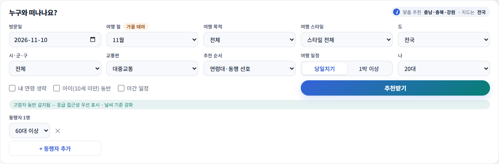

**오류와 해결**
- 추천 결과를 비교하려고 `68002da` 작업 폴더에 `node_modules`를 연결할 때, Git Bash에서 `mklink` 경로가 깨져 첫 비교가 제대로 돌지 않았다. PowerShell의 `New-Item -ItemType Junction`으로 다시 해서 비교했다. 임시 폴더와 비교 테스트 파일은 지웠다.
- B를 처음 커밋할 때 `git add`에 이미 지운 경로를 함께 넘겨 명령 전체가 실패했다. 그래서 `api.py`·`vercel.json`·문서 3개가 빠졌다. push 전이라 같은 커밋에 넣어 고쳤다(`36056f2`).
- 로컬 MongoDB `tourlink.usage_events`는 문서 0건이다(읽기만 함). 지울 기록은 없다.

## 14. 여행 월 삭제, 체크리스트 안내, 출발지·현재 위치, 지역 선택 이동 (2026-11-14)

팀 의견(11/14) 네 가지를 웹에 반영했다. `git pull`로 `f1829d9`(#13 병합)까지 받은 뒤 작업했다. 웹은 박하원 담당이라 push하지 않았다.

| 커밋 | 내용 |
|---|---|
| `7b3745b` refactor(web): 여행 월 입력 삭제, 계절은 방문일에서 계산 | [1] |
| `617895b` feat(web): 관광지 선택 전 준비물 안내 표시 | [2] |
| `b4b22cd` feat(web): 출발지·현재 위치로 거리 표시, 도보·자전거는 가까운 곳만 추천 | [3] |
| (이 기록과 함께) refactor(web): 도·시군구를 추천 입력에서 지도 필터로 옮김 | [4] |

### [1] 여행 월 입력 삭제

- `CompanionForm.tsx`: '여행 월' 선택(`id="travel-month"`)과 라벨을 지웠다. '가을 테마' 같은 계절 표시는 방문일 라벨 옆으로 옮겼다.
- `tripPreferences.ts`: `TripPreferences.month`를 없앴다. 월은 `tripMonth()`, 계절은 `tripSeason()`으로 항상 방문일(`visitDate`)에서 계산한다. 월만 따로 바꾸는 경로가 없다.
  - 계절 추천(`filterRecommendations`의 SEASON_TAGS 가점), 준비물의 계절 안내(`getPreparationTips`), 계절 사진(`SeasonalDiscovery`에 `tripMonth()` 전달), 화면 계절색(`data-season`)이 모두 방문일 기준이다.
- 바뀐 파일: `CompanionForm.tsx`, `tripPreferences.ts`, `AppPage.tsx`, 새 테스트 `tripPreferences.test.ts`(5개)
  - 2026-07-15 → 7월·여름, 2026-11-14 → 11월·가을
  - 여행 조건에 `month` 키가 없음
  - 계절 사진 목록이 방문일의 계절(여름·가을) 목록
  - 계절 가점: 여름이면 체험(activity), 가을이면 역사(history) 관광지에 +3
  - 준비물: 7/15 자외선·물, 11/14 일교차, 12/24 방한

### [2] 준비물 체크리스트를 찾기 쉽게

- 추천받기 직후 관광지를 아직 안 골랐으면 체크리스트 자리에 "관광지를 누르면 그곳에 맞춘 준비물이 나와요"를 보여 준다(`TripPreparationHint`, 점선 테두리).
- 보일지 말지는 `preparationTips.ts`의 `checklistView()`가 정한다: 추천 전·결과 없음 → 숨김, 추천 받음·관광지 미선택 → 안내, 관광지 선택 → 체크리스트(교통편과 무관).
- 체크리스트의 교통편 칩을 `TRANSPORT_OPTIONS`의 이름으로 바꿨다(새 교통편이 생겨도 자동으로 맞는다).
- 바뀐 파일: `preparationTips.ts`, `TripPreparation.tsx`, `AppPage.tsx`, `AppPage.css`, 테스트 `preparationTips.test.ts`(+7개: 숨김·안내·결과 없음, 교통편 4종(3번 이후 5종) 모두 체크리스트와 교통편 안내가 나옴)

### [3] 출발지와 현재 위치 (추천 순위 계산은 그대로)

- 입력에 '출발지(선택)'를 추가했다(`OriginPicker.tsx`): 시·도 → 시·군·구 선택, '현재 위치' 버튼(브라우저 위치 권한), 지우기(×).
  - 위치 권한 거부·실패·위치 기능 없음이면 "출발지를 직접 골라 주세요"를 보이고 시·도 선택 칸으로 포커스를 옮긴다.
- 출발지 좌표
  - 현재 위치: 브라우저 좌표
  - 시·군·구: 저장소의 시군구 좌표. `tourapi/sigungu.py`(전국 17개 시·도, 229개 시군구)를 스크립트로 `web/src/data/sigungu.ts`에 그대로 옮겼다(키만 시·도 전체 이름).
  - 좌표표에 없으면 카카오 지도 SDK 주소 검색(Geocoder, `lib/kakaoMapSdk.ts`의 `geocodeWithKakao`)으로 구한다. 지도 SDK 로더를 MapView에서 이 파일로 옮기고 `services` 라이브러리를 함께 불러오게 했다.
  - 좌표는 서버로 보내거나 저장(localStorage 포함)하지 않는다.
- 거리: 하버사인 직선거리(`lib/origin.ts`). 추천 카드는 지역 중심, 관광지 상세는 관광지까지 "출발지에서 약 12km"(10km 미만은 소수 한 자리).
- 도보·자전거: 기준은 `src/config/travelDistance.ts` 한 곳(도보 5km, 자전거 15km, 잠정값)
  - 기준보다 먼 관광지는 빼고, 남는 관광지가 없는 지역은 추천에서 뺀다. 순서: 날씨 규칙 → 거리 → 상위 5개
  - 빠진 곳은 "거리 때문에 제외된 곳 N곳"으로 날씨 제외 목록과 같은 모양으로 보여 준다(원래 상위 5개 지역 범위).
  - 남는 곳이 없으면 "출발지 근처에 추천할 곳이 없어요. 교통편을 바꿔 보세요"
  - 출발지가 없으면 거르지 않고 "도보·자전거는 출발지를 정해야 가까운 곳을 추천할 수 있어요"(입력 폼과 추천 목록 위)
  - 대중교통·관광버스·자가용은 거리 표시만 한다.
- 교통편 '도보·자전거'를 '도보'와 '자전거'로 나눴다(기준 거리가 달라서). 준비물도 도보 "도보 이동 구간과 쉴 곳을 미리 확인하세요.", 자전거 "자전거 이동 구간과 대여 운영 여부를 미리 확인하세요."로 나눴다.
- 바뀐 파일: 새 `OriginPicker.tsx`, `DistanceExcludedList.tsx`, `config/travelDistance.ts`, `data/sigungu.ts`, `lib/origin.ts`, `lib/kakaoMapSdk.ts`, 수정 `CompanionForm.tsx`, `RecommendationList.tsx`, `AttractionDetail.tsx`, `MapView.tsx`, `tripPreferences.ts`, `AppPage.tsx`, `AppPage.css`
- 테스트 `origin.test.ts`(16개): 하버사인(0km, 서울↔부산 약 325km, 위도 1도 약 111km), 거리 문구, 기준값 한 곳, 도보 5km 거르기, 자전거가 도보보다 많이 남음, 대중교통·관광버스·자가용은 거르지 않음, 출발지 없음, 근처에 없음(제주 출발), 시군구 좌표표 사용, 좌표표에 없을 때 주소 검색, 현재 위치 성공·거부·위치 기능 없음

### [4] 도·시·군·구를 추천 입력에서 빼고 지도 쪽으로

- 추천 입력에서 '도'·'시·군·구' 칸을 지웠다. `TripPreferences`에서 `province`·`regionCode`도 없앴다. 추천은 항상 시범 10개 지역 전체에서 고른다(예전 '전국'·'전체'와 같은 동작). 날씨도 10개 지역을 모두 불러온다.
- 지도 바로 위에 "지도에서 볼 지역"(`MapAreaPicker.tsx`, 도 → 시·군·구, 기본값 '전국')을 새로 두었다. 이 선택은 지도 관광지·대피소·관광 수요 순위·지도 범위에만 쓴다(`lib/mapArea.ts`의 `mapLayers`).
  - 전국이면 대피소·관광 수요를 보이지 않고, 도를 고르면 보인다(예전 동작과 같다). 시·군·구까지 고르면 관광지·대피소를 그 시군구로 좁힌다.
- 추천 카드(지역)를 누르면 지도 선택도 그 도·시군구로 바뀐다(`mapAreaForRegion`, 예: 청주시 상당구 → 충청북도·청주시).
- 오른쪽 위 안내를 "맞춤 추천은 시범 10개 지역에서 골라요"로 고쳤다(마우스를 올리면 10개 지역 이름).
- 빈 추천 문구에서 '지역 범위' 이야기를 뺐다(이제 지역 범위를 고르지 않으므로). "이 지역은 맞춤 추천 시범 데이터가 없어요"도 나올 일이 없어 지웠다.
- `web/README.md`의 여행 월·도/시군구·체크리스트 설명도 고쳤다.
- 바뀐 파일: 새 `MapAreaPicker.tsx`, `lib/mapArea.ts`, 수정 `CompanionForm.tsx`, `tripPreferences.ts`, `AppPage.tsx`, `AppPage.css`, `web/README.md`
- 테스트 `mapArea.test.ts`(19개): 여행 조건에 province·regionCode 없음, 시범 10개 지역 카드 → 지도 지역, 구까지 있는 이름, 좌표표에 없는 이름, 전국이면 대피소 없음, 도를 고르면 대피소 보임, 시군구로 좁히기, 관광 수요 표시 조건, 시군구 이름 맞추기, 시·도 목록 17개

### 테스트 수

| 시점 | 웹 `npm test` | `npm run build` |
|---|---|---|
| `f1829d9` 받은 직후 | 78 | 통과 |
| [1] 뒤 | 83 (+5) | 통과 |
| [2] 뒤 | 90 (+7) | 통과 |
| [3] 뒤 | 107 (+17: origin 16, 교통편 '자전거' 추가로 체크리스트 테스트 +1) | 통과 |
| [4] 뒤 | 126 (+19) | 통과 |

- `oxlint`는 매 단계 오류 없음. 파이썬 코드는 바꾸지 않았다.
- 화면 동작(컴포넌트)은 판단 함수를 테스트하고, 실제 화면은 아래처럼 헤드리스 Chrome으로 확인했다. 웹에는 React 컴포넌트 테스트 도구(jsdom 등)가 없다.

### 화면 확인 (`npm run dev:all`, 헤드리스 Chrome, 방문일 11/14, 지도 키 없음)

| 확인 | 결과 |
|---|---|
| 입력 폼 | '여행 월'·'도'·'시·군·구' 칸 없음. 방문일 옆 '가을 테마', 출발지(선택) 칸, 안내 "맞춤 추천은 시범 10개 지역에서 골라요" |
| 현재 위치 거부 | "출발지를 직접 골라 주세요" |
| 현재 위치 허용(강릉 좌표 지정) | "출발지: 현재 위치" |
| 출발지 천안·대중교통 | 추천 7개 지역 카드에 "출발지에서 약 187km" 등 거리 표시, 거르지 않음 |
| 추천 직후 | 체크리스트 자리에 "관광지를 누르면 그곳에 맞춘 준비물이 나와요" |
| 도보(천안 출발) | 천안시만 남음, "거리 때문에 제외된 곳 10곳", 체크리스트 칩 "도보 기준" |
| 출발지 지우기(도보) | "도보·자전거는 출발지를 정해야 가까운 곳을 추천할 수 있어요" |
| 제주 출발·자전거 | "출발지 근처에 추천할 곳이 없어요. 교통편을 바꿔 보세요" |
| 지도 지역을 강원·강릉 → 서울 → 전국으로 바꿈 | 추천 7개 지역의 관광지·근거·거리·편의 정보 배지가 세 번 모두 같음 |
| 추천 카드 '강릉시' 클릭 | 지도 지역이 "강원특별자치도 · 강릉시"로 바뀜, 지도 대신 목록은 "강원특별자치도 관광지 5곳" |
| 도(강원)를 골랐을 때 | 서버 응답 대피소 186곳(전국 응답은 지도에서 숨김), 관광 수요 카드 표시 |

- 대피소는 지도 마커로만 그리므로, 지도 키가 없는 이 환경에서는 화면에서 볼 수 없다. 서버 응답(강원 186곳)과 `mapLayers` 테스트로 확인했다.
- 첫 비교에서 "추천이 다름"으로 나왔는데, 관광지 칩 글자에 나중에 붙는 '편의 정보' 배지 때문이었다. 배지가 다 붙은 뒤 지역·관광지·근거·거리·배지 수를 비교하니 같았다.
- 카카오 주소 검색 대체 경로는 지도 키가 없어 실제 호출을 확인하지 못했다. 시군구 좌표표가 229곳을 모두 갖고 있어 선택 칸으로 고른 곳은 이 경로를 타지 않는다(테스트는 가짜 주소 검색으로 했다).

**캡처** (`docs/images/week11/`)

입력 칸 (방문일 옆 계절, 출발지, 안내 문구)

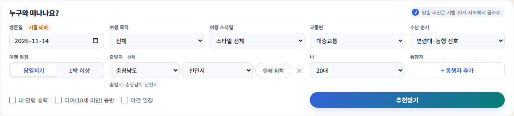

추천 카드 거리 표시

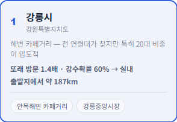

관광지 상세 거리 표시

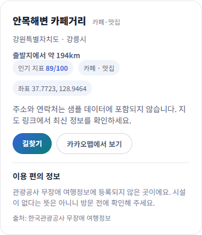

체크리스트 안내


거리 제외 목록 (도보, 천안 출발)

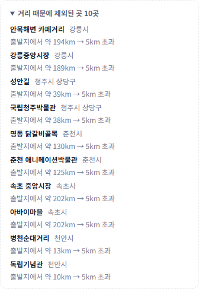

지도에서 볼 지역 (추천 카드 '강릉시' 클릭 뒤)

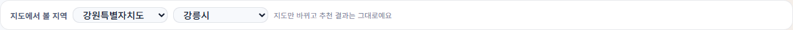

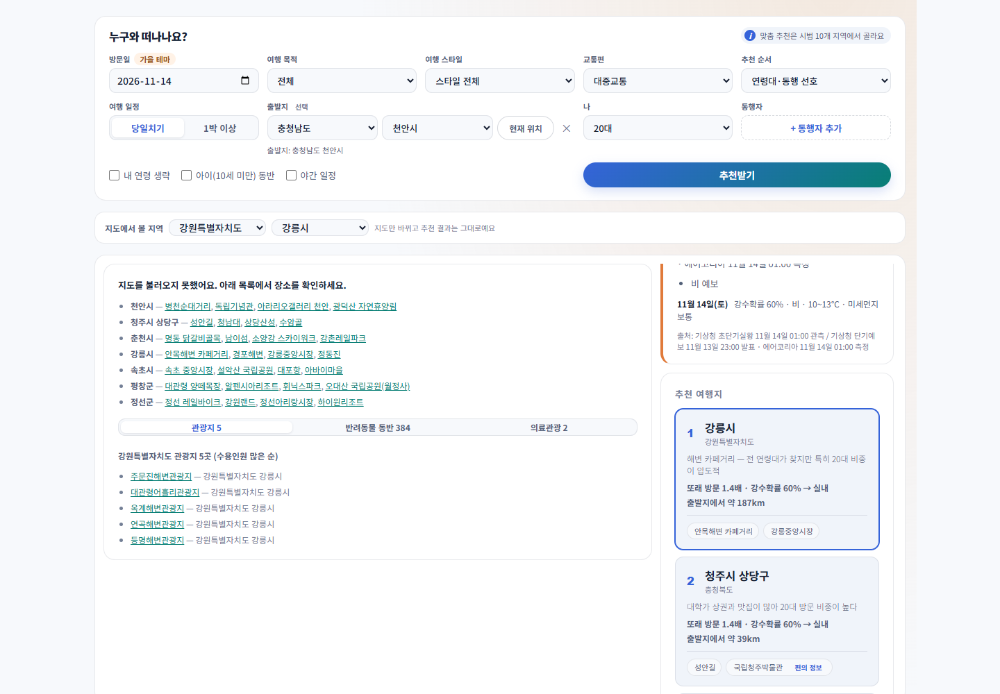

**오류와 해결**
- 도보 준비물 문구를 처음에 "걷는 구간과 쉴 곳을…"으로 넣었더니 교통편 안내 테스트(교통편 단어 포함)가 실패했다. "도보 이동 구간과 쉴 곳을…"으로 고쳤다.
- `oxlint`가 출발지 입력의 `useCurrentPosition` 함수 이름을 React Hook으로 보고 오류를 냈다(use로 시작). `locateNow`로 이름을 바꿨다.
- "지도에서 볼 지역" 선택 칸이 브라우저 기본 모양으로 보여 입력 폼과 같은 스타일을 입혔다.

### 14-1. 준비물 체크리스트를 공통·지역·관광지 3단계로 (2026-11-14)

[2]에서 넣은 "관광지를 누르면…" 안내 대신, 추천받기 직후부터 체크리스트를 보여 주고 누를 때마다 줄을 더한다. push하지 않았다.

**단계**

| 단계 | 언제 | 더하는 줄 | 제목 옆 |
|---|---|---|---|
| 1. 공통 | 추천받기 직후(아무것도 안 누름) | 계절(방문일), 교통편(5가지), 일정(당일치기·1박 이상), 동행자(아이·어르신), 추천 지역 중 가장 나쁜 날씨 한 줄 | 없음. 아래에 "지역이나 관광지를 누르면 그곳에 맞는 준비물이 더 나와요" |
| 2. 지역 | 추천 카드(예: 강릉시)를 누름 | 그 지역 날씨·미세먼지(일정 중 가장 나쁜 값) 한 줄, weather.py 준비물(우산 등), 미세먼지 마스크, 그 카드 관광지들의 지형별 준비물(바다·산·계곡) | "강릉시 기준" |
| 3. 관광지 | 카드 안 관광지 버튼(예: 안목해변 카페거리)을 누름 | 그 관광지의 지형·실내외 한 줄, 관광지 성격 준비물(자연→신발·물, 체험→운영 시간), 무장애 편의 요약(어르신·아이 동반 시) | "안목해변 카페거리 기준" |

- 지역 카드를 누르면 지금처럼 지도 지역도 그 도·시군구로 바뀐다.
- 관광지 버튼은 관광지만 고른다(관광지 상세를 연다). 지역 카드 클릭으로 같이 처리하지 않도록 칩의 `onSelect(item.region)` 호출을 뺐고, 카드의 Enter·Space 처리도 카드 자체에서 누른 것만 받는다. 그래서 관광지 버튼을 눌러도 지도 지역은 바뀌지 않는다.
- 앞 단계와 같은 주제의 안내는 하나만 남긴다(`mergeTips`, 예: 우산·미끄럼).
- 지역 단계가 없는 관광지(계절 사진 등)는 그 관광지의 지형별 준비물을 관광지 줄에 넣는다.

**날씨·지형 규칙**
- 비가 오거나(강수 형태 비·소나기·눈 등) 강수확률이 높은 날(실내 위주 추천과 같은 기준: 일반 60%, 어르신·아이 동반 40%)에는 자외선 차단제를 뺀다.
  - 여름 계절 안내 "자외선 차단제와 휴대용 물을 준비하세요." → "휴대용 물을 준비하세요."
  - 바다 준비물의 "자외선 차단제" 항목도 뺀다.
  - 공통 단계는 추천 지역 중 가장 나쁜 날씨, 지역·관광지 단계는 그 지역 날씨로 판단한다.
- 바다 준비물 가운데 "물때 확인"·"갯바위 미끄럼 주의"는 바깥(야외) 바다 관광지가 있을 때만 넣는다.
  - "안목해변 카페거리"는 이름에 '해변'이 있어 바다로 분류되지만 분류(카테고리 "카페·맛집")상 실내다. 그래서 물때·갯바위는 넣지 않는다.
  - 지형 분류(`attractionSetting.ts`)는 날씨 판정(특보 시 바다 제외)에도 쓰여서 바꾸지 않았다.

**바뀐 파일**
- 새 `web/src/lib/checklist.ts`(`buildChecklist`, `isRainyDay`, `weatherLine`), `web/src/lib/checklist.test.ts`
- `tripPreferences.ts`: `getPreparationTips`를 `attractionTagTips`(관광지 성격)와 `commonPreparationTips`(일정·교통편·계절)로 나눴다. 합친 결과는 예전과 같다.
- `preparationTips.ts`: 물때·갯바위 조건. [2]의 `checklistView`·안내 문구는 지웠다.
- `TripPreparation.tsx`: 단계별 구간(공통·지역·관광지)과 제목 옆 "○○ 기준", 안내 문구를 그린다. `TripPreparationHint`는 지웠다.
- `RecommendationList.tsx`(관광지 버튼 클릭 분리), `AppPage.tsx`(단계 정하기, 날씨 모으기), `AppPage.css`(제목 옆 표시, 구간 제목)

**테스트** `checklist.test.ts` 15개 (웹 전체 126 → 133개: +15, [2]의 안내 테스트 8개 삭제)
- 공통: 일정·교통편·계절·날씨 한 줄과 안내 문구, 1박 이상·아이·어르신, 교통편 5가지 모두 나옴
- 지역: 공통 줄은 그대로이고 지역 날씨·미세먼지·지형 줄이 더해짐, 다른 지역(단양군)을 누르면 지역 줄이 바뀜(바다 → 산)
- 관광지: 공통 → 지역 → 관광지 순서로 줄이 더해짐(지역 줄은 지역 단계와 같음), 지역 없는 관광지
- 비 오는 날 자외선 차단제 빠짐(공통·지역 모두), 강수확률 기준(60%·40%), 안목해변 카페거리에 물때 없음·경포해변은 있음
- `npm test` 133개 통과, `npm run build` 통과, `oxlint` 오류 없음

**화면 확인** (`npm run dev:all`, 헤드리스 Chrome, 방문일 11/14, 실제 예보: 추천 지역에 비·강수확률 60%)

| 확인 | 결과 |
|---|---|
| 추천받기 직후 | 공통 4줄(일교차, 대중교통 시간표, 당일 일정, "날씨(추천 지역 중 가장 나쁜 값): 강수확률 60% · 비 · 8~15℃ · 미세먼지 나쁨") + 안내 문구 |
| 강릉시 카드 | "강릉시 기준", 지도 지역 강원·강릉, 지역 줄 4개(강릉시 날씨, 우산, 미끄럼, "바다(안목해변 카페거리): 여벌 옷·수건") |
| 청주시 상당구 카드 | "청주시 상당구 기준", 지역 줄이 청주시 상당구 날씨·우산·미끄럼으로 바뀜 |
| 지도를 서울로 둔 뒤 안목해변 카페거리 버튼 | "안목해변 카페거리 기준", 관광지 상세 열림, 지도 지역은 서울 그대로(지역 카드로 처리되지 않음), 관광지 줄 "안목해변 카페거리: 바다 · 실내 관광지예요." |
| 물때 확인 | 없음(실내 바다). 비 예보라 자외선 차단제도 없음 |
| 교통편 5가지 | 모두 체크리스트가 보이고 칩이 "대중교통/관광버스/자가용/도보/자전거 기준" |

- 비 예보 때문에 강릉시 카드에는 실내 관광지만 남았다(날씨 규칙). 그래서 지역 줄의 지형 준비물도 실내 바다 관광지 기준(여벌 옷·수건만)이다.
- [2]의 캡처 `k4_checklist_hint.png`는 그때의 안내("관광지를 누르면…")이고, 지금은 아래 캡처처럼 바뀌었다.

**캡처**

공통 (추천받기 직후)

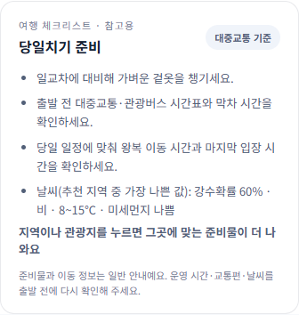

지역 (강릉시 카드)

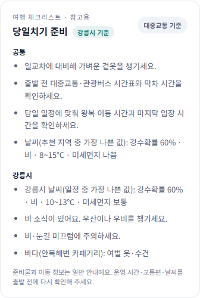

관광지 (안목해변 카페거리)

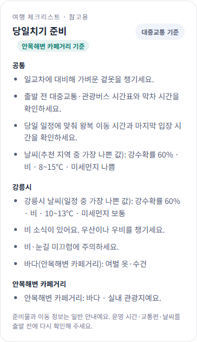

**오류와 해결**
- 비 오는 날 자외선 항목을 빼는 함수에서 `flatMap`의 반환 타입이 섞여 타입 검사가 실패했다. 반환 타입(`string | TipGroup`)을 명시했다.
- 좁은 칸에서 제목 옆 "안목해변 카페거리 기준"과 교통편 칩이 중간에 줄이 바뀌어, 두 표시가 통째로 다음 줄로 내려가게 했다.

### 14-2. 관광지 선택·실내 준비물·카드 카테고리·관광지 분류·지도 목록 범위 (2026-11-14)

`git pull`(새 커밋 없음) 뒤 이어서 고쳤다. push하지 않았다.

| 커밋 | 내용 | 웹 테스트 |
|---|---|---|
| (시작 `cfff2fe`) | | 133 |
| `9d32352` fix(web): 관광지 선택 시 지도 지역도 이동 | [A] | 137 (+4) |
| `e5b614b` fix(web): 실내 관광지에는 지형별 준비물을 붙이지 않음 | [B] | 137 (1개 바꿈) |
| `64b652a` feat(web): 추천 카드에 지역 관광지 카테고리 칩과 실내·야외 표시, 샘플 소개 문구 삭제 | [C] | 145 (+8) |
| `c2bc6dc` fix(web): 강원랜드·아바이마을 분류, 바다·호수 판정, 목적 관광지가 없는 지역 처리 | [D] | 153 (+8) |
| (이 기록과 함께) fix(web): 지도 지역과 관광지·반려동물·의료관광 목록 범위 맞춤 | [E] | 158 (+5) |

- `npm test` 158개 통과, `npm run build` 통과, `oxlint` 오류 없음. 파이썬 `pytest` 133개 통과(6개 건너뜀: redis 등), Orange 비교 테스트 `test_setting_compare.py` 6개 통과.

#### [A] 관광지 버튼 → 지도도 이동
- 관광지를 고르는 공통 함수(`handleSelectAttraction`)가 그 관광지가 속한 시범 지역을 찾아 지도 지역을 그 도·시군구로 바꾼다(`lib/mapArea.ts`의 `selectionForAttraction`). 카드 안 관광지 버튼, 지도 목록의 관광지 이름 모두 같다.
- 관광지 버튼은 그대로 `stopPropagation`으로 지역 카드 클릭과 겹치지 않는다. 체크리스트는 그 관광지의 지역 줄 + 관광지 줄이 함께 나온다(공통 → 지역 → 관광지).
- 시범 지역에 없는 관광지(카카오 주변 장소)는 지도 지역을 바꾸지 않는다.

#### [B] 실내 관광지에는 지형 준비물을 붙이지 않음
- 지형 준비물(바다 여벌 옷·수건·물때, 산 등산화 등)은 야외 관광지만 센다(`terrainTips`). 실내 관광지는 지역·관광지 단계 모두에서 지형 줄이 없고, 관광지 줄은 "○○: 실내 관광지예요." 한 줄이다.
- 14-1에서 넣은 "실내 바다면 물때·갯바위만 뺀다" 예외는 필요 없어 지웠다.

#### [C] 추천 카드
- 샘플로 지은 지역 소개 문구(`highlight`, 10개 지역)를 데이터·타입·화면에서 지웠다.
- 카드에 그 지역 추천 후보 관광지(목적·스타일에 맞는 곳, 날씨로 빠진 곳 포함)의 카테고리를 많은 순 최대 3개 칩으로 보여 준다(`lib/cardInfo.ts`의 `categoryChips`). "역사·문화"처럼 묶인 값은 나눠서 세고, 같은 수면 먼저 나온 순서.
- 관광지 버튼마다 "카테고리 · 실내/야외"를 작게 붙인다(예: "제민천 카페거리 맛집·카페 · 실내").
- 날씨 때문에 빠진 그 지역 관광지는 카드 안에 흐리게(취소선·점선) "비 예보로 제외"처럼 보여 준다. 사유는 비·눈 예보, 추위, 더위, 미세먼지, ○○특보로 나눈다. 누르면 상세가 열린다.
- '또래 방문 ○배' 문구는 바꾸지 않았다(팀 결정 대기).

#### [D] 관광지 분류와 목적 판정
- 강원랜드: tags `["casino"]`, category "카지노·리조트". casino는 체험·액티비티 목적, 활동적인·가족 여행 스타일, 계절 태그 어디에도 없어 목적 '전체'·스타일 '전체'일 때만 후보다. 아이 동반이거나 동행자에 10대가 있으면 후보에서 뺀다(`allowedForParty`). 상세에 "카지노는 만 19세 이상 입장".
- 아바이마을: `OVERRIDES`에 `setting: "outdoor"`(이유 주석: 분류가 "문화·맛집"이라 키워드로는 실내지만 바닷가 마을을 걷고 갯배를 타는 야외 관광지).
- 지형에 '호수'(lake)를 더했다: 이름이 '호수'를 담거나 '호'로 끝나면 호수(58곳 중 영랑호). 준비물은 "여벌 옷, 물가 미끄럼 주의". 기상특보 때 빼는 지형(바다·산·계곡)은 그대로 두었다(날씨 판정 규칙은 바꾸지 않음).
- '바다·호수' 목적은 이름 정규식 대신 지형 분류(바다·호수)로, '산행' 목적은 nature 태그 대신 지형 분류(산)로 판정한다(`matchesPurpose`).
- 날씨 때문에 목적에 맞는 관광지가 지역에서 모두 빠지면(원래 상위 5개 지역 중), 목적과 상관없는 관광지로 채우지 않고 순위 맨 아래에 "비 예보로 체험할 곳이 없어요"처럼 안내 카드로 둔다(`regionsWithoutPurposeMatches`, 목적 '전체'는 제외). 빠진 관광지는 그 카드에 흐리게 보인다.
- Orange 비교 CSV(`tourism_platform/data/orange/attractions.csv`)를 `web/scripts/attraction_setting_cli.ts`로 다시 만들었다. 바뀐 줄은 3개(아바이마을 rule_setting indoor→outdoor, 영랑호 rule_terrains lake, 강원랜드 category·tags). label 칸은 비어 있는 그대로(0개)다.

**58곳 점검 표** (목적: 산행·체험·축제문화·바다호수·산책휴식, 실내/야외)

| 관광지 | 문제 | 바꾼 값 | 이유 |
|---|---|---|---|
| 강원랜드 | resort 태그라 '체험·액티비티' 후보가 되고, 비 오는 날 실내라서 정선군을 1위로 올림. 아이 동반에도 후보 | tags `["casino"]`, category "카지노·리조트", 목적 '전체'만, 아이·10대 동반이면 제외, 상세에 만 19세 안내 | 카지노는 체험 목적·가족 여행에 맞지 않고 미성년자 입장 불가 |
| 아바이마을 | "문화·맛집" 키워드로 실내 판정 → 비 예보에 실내 대안으로 추천 | setting outdoor | 바닷가 마을·갯배(야외) |
| 영랑호 | '바다·호수' 목적에서 빠짐(이름 정규식에 '호'로 끝나는 호수 없음) | 지형 lake(호수) | 석호(호수) |
| 정동진 | '바다·호수' 목적에서 빠짐(이름에 바다 낱말 없음) | 판정을 지형 분류로(정동진은 이미 바다 지형) | 해변 관광지 |
| 남이섬 | 예전 정규식은 '섬'으로 '바다·호수'에 넣었음 | 지형 분류로 바꾸며 빠졌다가, 팀 결정으로 호수 지형(아래) | — |
| 경포해변·정동진·주문진항·대포항·속초해수욕장·영랑호·남이섬·도담삼봉·고수동굴·화암동굴·궁남지·허브나라농원·대관령 양떼목장·청주 중앙공원·부여 서동공원 (15곳) | '산행' 목적이 nature 태그로 판정돼 해변·항구·동굴·섬·연못·공원이 산행 후보 | '산행'을 산 지형으로 판정 → 이 15곳은 산행에서 빠짐 | 산행과 맞지 않음 |
| 공산성·부소산성·단양 패러글라이딩 활공장 | 산 지형이라 산행에 새로 들어옴 | — (활공장은 팀 결정으로 산행 제외, 아래) | 산성은 산책 수준 오르막, 활공장은 산 정상 |
| 안목해변 카페거리 | 이름에 '해변'이 있어 바다 지형 → '바다·호수' 목적 후보. 실내 카페거리 | **팀 결정(11/14): 바다·호수 포함**(값 그대로) | 해변 앞 카페거리 |
| 남이섬 | '바다·호수'에서 빠짐. 북한강(청평호) 위 섬 | **팀 결정: 바다·호수 포함** → 지형 lake(OVERRIDES) | 청평호 위 섬 |
| 궁남지 | 연못. 호수로 분류하지 않음 | **팀 결정: 바다·호수 제외, 산책·휴식 포함**(PURPOSE_OVERRIDES에 명시) | 연못 |
| 단양 패러글라이딩 활공장 | 산 지형이라 '산행' 후보 | **팀 결정: 산행 제외(체험만)** → PURPOSE_OVERRIDES hiking false | 산행보다 체험 |
| 성안길 | "쇼핑·맛집" 키워드로 실내 | **팀 결정: outdoor** | 걷는 상점가 |
| 강릉중앙시장·속초 중앙시장 | '시장' 키워드로 실내 | **팀 결정: indoor 유지** | 지붕 있는 시장 |
| 정선아리랑시장 | '시장' 키워드로 실내 | **팀 결정: outdoor** | 야외 장터 |
| 알펜시아리조트·휘닉스파크·하이원리조트 | 야외(키워드 없음) | **팀 결정: outdoor 유지** | 스키·야외 활동 중심 |
| 설악산·민둥산·계룡산·오대산 등 국립공원 | nature 태그라 '산책·휴식' 후보 | **팀 결정: 산책·휴식 제외(산행만)** → PURPOSE_OVERRIDES stroll false | 산행 코스 |

- 확인 필요였던 항목은 11/14 팀 결정으로 정했다(14-3, 커밋 `fix(web): 관광지 목적·실내외 분류 팀 결정 반영`). 실내/야외는 `attractionSetting.ts`의 OVERRIDES, 목적은 `tripPreferences.ts`의 PURPOSE_OVERRIDES에 관광지 이름별로 적었다. Orange CSV도 다시 만들었다(성안길·정선아리랑시장 outdoor, 남이섬 lake, label 그대로). '산행' 판정 변경은 정동진·영랑호(바다·호수)와 같은 방식(이름·태그 대신 지형 분류)이라 함께 고쳤다.
- 바다·호수 목적 관광지: 예전 6곳(남이섬, 경포해변, 안목해변 카페거리, 주문진항, 대포항, 속초해수욕장) → 지금 8곳(경포해변, 안목해변 카페거리, 정동진, 주문진항, 대포항, 영랑호, 속초해수욕장, 남이섬)
- 산행 목적 관광지: 예전 21곳(nature 태그) → 지금 8곳(광덕산 자연휴양림, 상당산성, 공산성, 계룡산, 부소산성, 설악산, 오대산, 민둥산)

#### [E] 지도에서 볼 지역과 지도 목록 범위
- 지도 목록 맨 위 추천 줄은 지도에서 고른 지역 안에 있는 추천 지역만 보여 주고, 없으면 줄 자체를 숨긴다(`regionInArea`). 예: 지도 지역 충청북도·청주시, 추천 1위 부여군 → 추천 줄 없음.
- 청주시 관광지 0곳: 이름 비교 문제가 아니라 데이터 문제다.
  - 지도 관광지 데이터(전국관광지정보표준데이터 897곳)에 충북 청주 관광지가 한 건도 없다. 주소·이름에 '청주'가 들어간 곳도 0곳이다(서버 응답 확인).
  - 시군구 값은 "천안시"처럼 시 단위다. "청주시"를 고르면 "청주시 상당구"처럼 구까지 있는 값도 잡히게 비교한다(테스트). 천안시는 2곳(태조산관광지, 천안종합휴양관광지)이 나온다.
  - 0곳이면 "청주시는 전국관광지정보표준데이터에 등록된 관광지가 없어요"를 보여 준다.
- 반려동물 동반은 주소의 시군구 이름으로 거른다(`addressInDistrict`). 청주시를 고르면 72곳만 남고 충주·괴산·제천 등은 섞이지 않는다.
- 의료관광은 주소가 영어(예: "Gangnam-gu, Seoul")라 이름으로 가를 수 없다. 좌표가 가장 가까운 시군구 대표점으로 나눈다(`nearestDistrict`, 근사치. 목록 제목에 "좌표로 시군구 구분"을 적었다). 천안시를 고르면 1곳.
- 목록 제목에 범위를 적는다: "청주시 반려동물 동반 72곳 중 30곳", "충청남도 천안시 관광지 2곳", "청주시 의료관광 기관 ○곳".

#### 화면 확인 (`npm run dev:all`, 헤드리스 Chrome, 지도 키 없음, 비 예보는 `?demo=weather` "비 예보(강수확률 80%)")

| 확인 | 결과 |
|---|---|
| 카드 소개 문구 | 없음. 공주시 카드 칩 [역사][맛집][카페], "제민천 카페거리 맛집·카페 · 실내", 흐리게 "공산성 비 예보로 제외" 등 4곳 |
| 강릉시 카드 안 '안목해변 카페거리' | 상세 열림, 지도 지역 강원특별자치도·강릉시, 체크리스트 공통 → 강릉시(날씨 한 줄, 지형 줄 없음) → "안목해변 카페거리: 실내 관광지예요." |
| 50대·체험·액티비티·비 예보 | 강원랜드 없음, 정선군 등 5개 지역이 "비 예보로 체험할 곳이 없어요" 카드(맨 아래), 각 카드에 빠진 체험 관광지가 흐리게 |
| 바다·호수(맑음) | 대포항, 속초해수욕장, 영랑호, 경포해변, 안목해변 카페거리, 정동진, 주문진항 |
| 목적 전체·맑음 | 강원랜드 칩 있음, 상세 "카지노는 만 19세 이상 입장" |
| 아이(10세 미만) 동반 | 강원랜드 없음 |
| 지도 충청북도·청주시(추천 1위 부여군) | 맨 위 추천 줄 없음, 탭 "관광지 0 · 반려동물 동반 72 · 의료관광 0", 관광지 없음 안내, 반려동물 72곳 모두 청주 주소 |
| 지도 충청남도·천안시 | 맨 위 추천 줄 "천안시 — 독립기념관, …"(추천 지역), 탭 "관광지 2 · 반려동물 동반 48 · 의료관광 1", 제목 "충청남도 천안시 관광지 2곳" |

**캡처** (`docs/images/week11/`)

추천 카드: 카테고리 칩·실내/야외·날씨 제외

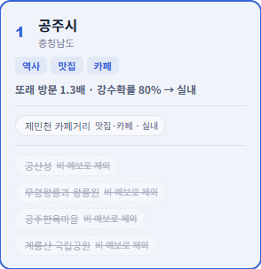

관광지 버튼(안목해변 카페거리) 뒤 체크리스트 — 실내라 지형 줄 없음

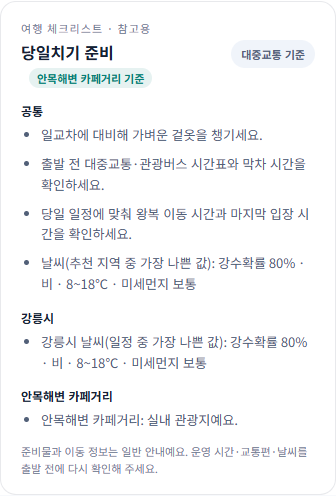

체험·액티비티 + 비 예보 — 맨 아래 안내 카드(정선군)


강원랜드 상세 — 만 19세 이상 안내


지도 지역 충청북도·청주시 — 추천 줄 숨김, 관광지 없음 안내, 청주시 반려동물만


지도 지역 충청남도·천안시


**오류와 해결**
- 실내 관광지 테스트를 셸로 넣으면서 정규식의 `\(`가 사라져 타입 검사가 실패했다. 파일에서 직접 고쳤다.
- 카테고리 칩 테스트의 기대값을 처음에 잘못 적었다(강릉시는 자연 3·맛집 3으로 같고 먼저 나온 자연이 앞). 기대값을 고쳤다.
- 지도 목록에서 `scope` 변수를 선언 전에 써서 타입 검사가 실패했다. 선언 위치를 앞으로 옮겼다.
- 첫 `m3` 캡처가 스크롤 때문에 잘려 안내 카드 하나만 다시 찍었다.
- Orange CSV를 만드는 node 명령이 처음 두 번 알 수 없는 종료 코드(107, 66)로 멈췄다. 다시 실행하니 정상이었다(같은 명령, 원인 미상).

### 14-3. 실내 다시 추천, 팀 결정 반영, 가까운 순·관광지별 거리, 카지노·날씨 제외·칩·지도 목록 (2026-11-14)

`git pull` 없이 로컬 `main`에서 이어서 고쳤다. push하지 않았다.

| 커밋 | 내용 | 웹 테스트 |
|---|---|---|
| (시작 `a0b7abe`) | | 158 |
| `11a8e1e` feat(web): 비 예보로 목적 관광지가 없을 때 실내 추천 버튼 | [F] | 160 (+2) |
| `935fca2` fix(web): 관광지 목적·실내외 분류 팀 결정 반영 | [G] (14-2 표 갱신 포함) | 165 (+5) |
| `78bc1af` feat(web): 출발지 기준 가까운 순 정렬과 관광지별 거리 | [H] 1·2 | 169 (+4) |
| (이 기록과 함께) fix(web): 아이 동반 시 카지노 전 화면 제외, 날씨 제외 개수, 카테고리 칩 묶기, 지도 목록 거리순 | [H] 3~6 | 175 (+6) |

- `npm test` 175개 통과, `npm run build` 통과, `oxlint` 오류·경고 없음. `pytest` 133개 통과(6개 건너뜀: redis 등).

#### [F] 실내 관광지로 다시 추천받기
- 상위 지역이 모두 "비 예보로 ○○할 곳이 없어요" 카드가 되면(추천 목록이 비고 안내 카드만 있을 때) 위쪽 안내 아래에 "실내 관광지로 다시 추천받기" 버튼을 둔다.
- 누르면 목적을 '전체'로 바꾸고(입력 폼의 목적도 '전체'로 보인다) 실내 관광지만으로 다시 추천한다(`keepIndoorOnly`: 지역마다 실내만 남기고 실내가 없는 지역은 뺀다). 목록 위에 "실내 관광지만으로 다시 추천했어요. 여행 조건을 바꾸면 원래대로 추천해요."
- 여행 조건을 바꾸면 실내만 거르기는 꺼진다.

#### [G] 58곳 '확인 필요' 팀 결정
- 14-2 표를 갱신했다. 실내/야외는 `attractionSetting.ts`의 OVERRIDES, 목적은 `tripPreferences.ts`의 `PURPOSE_OVERRIDES`(관광지 이름별)에 적었다.
  - 안목해변 카페거리: 바다·호수 포함(이미 바다 지형이라 값 그대로)
  - 남이섬: 바다·호수 포함 → 지형 lake
  - 궁남지: 바다·호수 제외, 산책·휴식 포함
  - 단양 패러글라이딩 활공장: 산행 제외(체험만)
  - 성안길, 정선아리랑시장: outdoor
  - 강릉중앙시장·속초 중앙시장 indoor 유지, 알펜시아·휘닉스파크·하이원리조트 outdoor 유지
  - 설악산·계룡산·오대산 국립공원, 민둥산: 산책·휴식 제외(산행만)
- Orange CSV를 다시 만들었다: 성안길·정선아리랑시장 rule_setting outdoor, 남이섬 rule_terrains lake. label은 비어 있는 그대로다. `test_setting_compare.py` 6개 통과.

#### [H] 출발지 천안 기준 점검에서 나온 문제
1. **가까운 순:** '추천 순서'에 "가까운 순"을 추가했다. 지역 안 추천 관광지(목적·날씨·거리로 걸러진 것) 중 가장 가까운 곳의 거리로 정렬한다(`sortByNearest`). 점수 계산은 그대로다.
   - 출발지가 있고 당일치기면 기본값이 "가까운 순"이다. 사용자가 순서를 직접 바꾸면 그대로 둔다(`effectiveRanking`: 바꿨는지 여부와 출발지·일정으로 매번 계산).
   - 출발지가 없으면 "가까운 순"을 고를 수 없게 하고 "가까운 순은 출발지를 정하면 쓸 수 있어요"를 보여 준다.
2. **관광지별 거리:** 거리를 관광지 좌표로 계산해 관광지 버튼마다 "약 ○km"를 붙이고, 카드 위 거리는 "가장 가까운 관광지까지 약 ○km"로 바꿨다. 관광지 상세는 "출발지에서 약 ○km" 그대로다.
3. **아이·10대 동반이면 카지노 전 화면 제외**
   - 지도 목록 맨 위 추천 요약 줄과 지도 지역 마커는 추천 카드와 같은 결과(목적·날씨·거리·동행자로 걸러진 것)를 쓴다(`regionSummaryAttractions`). 추천 결과가 없는 지역은 동행자 기준 상위 관광지에서 카지노 같은 곳을 뺀다.
   - 펜 던지기(랜덤 여행) 후보에서도 뺀다(`buildCandidatePool`에 아이 동반 전달).
   - 탐색 추천은 [D]에서 이미 같은 거르기를 쓴다(테스트로 확인).
4. **날씨 제외 개수:** "날씨 때문에 제외된 곳", 카드 안 흐린 제외 표시, 목적 없음 카드는 도보·자전거 거리 안 관광지만 센다(거리로 이미 빠진 곳은 세지 않는다).
5. **카테고리 칩 묶기:** 문화예술 → 문화로 묶는다(`CATEGORY_ALIASES`). 맛집·카페의 카페는 그대로. 같은 카드에 [문화]와 [문화예술]이 함께 나오지 않는다.
6. **지도 목록 거리순:** 지도 지역이 '전국'이고 출발지가 있으면 지도 관광지 목록을 출발지에서 가까운 순으로 정렬하고 제목에 "(출발지에서 가까운 순)"을 적는다(`sortSpotsByDistance`).

**테스트** (추가 15개)
- [F] 체험·비 예보로 모두 비면 목적 '전체' + 실내만으로 실내 관광지가 나옴, 실내 없는 지역은 빠짐
- [G] 안목해변 카페거리·남이섬 바다·호수, 궁남지 산책·휴식, 활공장 산행 제외·체험 유지, 성안길·정선아리랑시장 야외, 시장·리조트 유지, 국립공원·민둥산 산책 제외
- [H1·H2] 천안 출발·당일치기 가까운 순에서 천안·청주가 강릉보다 먼저(1·2위), 정렬 기준이 관광지 거리이고 점수는 그대로, 관광지별 거리(독립기념관 약 10km), 기본 순서 규칙 6가지
- [H3] 아이 동반·10대면 펜 던지기 후보·지도 요약·탐색 추천에 강원랜드 없음
- [H4] 천안 출발·도보·비 예보: 날씨 제외는 모두 5km 안 관광지이고 거리 제외 전보다 적음
- [H5] 문화예술·문화가 한 칩, 천안시 칩 중복 없음
- [H6] 출발지에서 가까운 순 정렬
- [C] 칩 집계 테스트 하나의 기대값을 바꿨다(문화예술이 문화로 묶여 [역사, 문화, 자연]).

**화면 확인** (`npm run dev:all`, 헤드리스 Chrome, 지도 키 없음. 비 예보는 `?demo=weather` "비 예보")

| 확인 | 결과 |
|---|---|
| [F] 50대·체험·비 예보 | 위쪽 안내 아래 "실내 관광지로 다시 추천받기" 버튼 → 누르면 목적 선택값 '전체', 안내 문구, 공주시(제민천 카페거리)·정선군(강원랜드·화암동굴)·단양군(고수동굴)·천안시·평창군, 관광지가 모두 실내 |
| [H1] 출발지 없음 | '가까운 순' 선택 불가, "가까운 순은 출발지를 정하면 쓸 수 있어요" |
| [H1] 출발지 천안·당일치기 | 추천 순서가 자동으로 '가까운 순', 천안시 > 청주시 상당구 > 공주시 > 부여군 > 단양군 > 평창군 > 정선군. 사용자가 '전체 인기 순'으로 바꾸면 그대로 |
| [H2] 천안시 카드 | "가장 가까운 관광지까지 약 2.4km", 관광지마다 "약 13km/10km/3.1km/11km/2.6km/2.4km" |
| [H5] 천안시 칩 | [문화][역사][맛집] (문화예술 따로 없음) |
| [H6] 지도 전국 + 출발지 천안 | "전국 관광지 897곳 (출발지에서 가까운 순)", 태조산관광지·천안종합휴양관광지·아산온천관광지 순 |
| [H3] 아이 동반 | 지도 요약 줄 7개 지역·추천 카드에 강원랜드 없음, 펜 던지기 후보 58 → 57곳 |
| [H4] 천안·도보·비 예보 | "날씨 때문에 제외된 곳 2곳"(각원사, 천안삼거리공원 — 모두 5km 안), "거리 때문에 제외된 곳 8곳" |

- 카드 안 관광지 버튼 순서는 매치 점수 순 그대로다(가까운 순은 지역 순서에만 쓴다).

**캡처** (`docs/images/week11/`)

[F] 실내 관광지로 다시 추천받기 버튼


[F] 다시 추천한 결과(1위 카드, 실내만)


[H1] 출발지 천안 → 추천 순서 '가까운 순'


[H2] 관광지별 거리


[H6] 지도 목록 출발지에서 가까운 순


[H4] 도보·비 예보 날씨 제외 목록(거리 안 2곳)


**오류와 해결**
- 카테고리 칩 묶기 뒤 기존 칩 집계 테스트가 실패했다. 문화예술이 문화로 묶여 순서가 바뀐 것이라 기대값을 고쳤다.
- `oxlint`가 의존성 누락 경고 2개를 냈다(지도 마커 effect의 새 prop, 탐색 추천 useMemo의 `safetyFilters`). 지도에 넘기는 값을 `useMemo`·`useCallback`으로 고정해 매 렌더마다 마커를 다시 그리지 않게 하고 의존성을 채웠다.

#### [I] 예상 이동 시간과 최대 이동 시간 (기본은 거르지 않음)

같은 요청이 [F]~[H]와 함께 다시 와서, [F]~[H]는 위 커밋 그대로 두고 [I]만 다섯 번째 커밋으로 더했다.

| 커밋 | 내용 | 웹 테스트 |
|---|---|---|
| (이 기록과 함께) feat(web): 예상 이동 시간 표시와 최대 이동 시간 선택(60대 이상·아이 동반 안내) | [I] | 186 (+11) |

- `npm test` 186개 통과, `npm run build` 통과, `oxlint` 오류·경고 없음. `pytest` 133개 통과(6개 건너뜀).
- **기준값**(`web/src/config/travelTime.ts` 한 곳): 직선거리 기준 환산 속도 자가용·관광버스 60km/h, 대중교통 45km/h, 자전거 15km/h, 도보 4km/h. 당일치기 먼 곳·휴식 안내·어르신·아이 권장 기준은 편도 2시간.
  - 환산 속도와 2시간 기준은 사업용 차량 2시간 운전 후 15분 휴식 규정을 참고해 팀이 정한 값이다. 실제 도로·노선 시간이 아니라 직선거리 기준 어림값이다.
1. **예상 이동 시간 표시:** 출발지가 있으면 관광지별 직선거리로 예상 편도 시간을 계산한다(`lib/travelTime.ts`).
   - 카드 위: "가장 가까운 관광지까지 약 113km · 대중교통 약 2시간 30분 · 직선거리 기준 어림값"
   - 관광지 버튼: "약 10km · 대중교통 약 10분"
   - 관광지 상세: "출발지에서 약 113km · 대중교통 약 2시간 30분"
   - 시간은 10분 단위로 반올림한다(최소 10분).
2. **최대 이동 시간:** 입력에 '최대 이동 시간'(상관없음·1시간·2시간·3시간)을 추가했다.
   - 기본값은 '상관없음'이고 거르지 않는다. 고르면 그 시간을 넘는 관광지를 빼고(`applyTravelTimeLimit`) "이동 시간 때문에 제외된 곳 N곳"으로 보여 준다.
   - 추천 카드와 탐색 추천 모두 같은 거르기를 쓴다. 출발지가 없으면 칸을 비활성화하고 "최대 이동 시간은 출발지를 정하면 쓸 수 있어요"를 보여 준다.
3. **60대 이상·아이 동반 안내:** 나 또는 동행자에 60대 이상이 있거나 '아이(10세 미만) 동반'을 체크하면, 이 칸 아래에 "어르신·아이와 함께라면 편도 2시간 이내를 권해요"를 보여 준다(`travelHintState`).
   - 값이 '상관없음'이고 출발지가 있을 때만 [2시간 이내로 보기] 버튼을 둔다. 누르면 '2시간'으로 바뀐다.
   - 자동으로 바꾸지 않고, 다른 값을 골랐으면 안내만 보인다.
4. **당일치기로는 먼 곳:** 당일치기인데 카드의 가장 가까운 추천 관광지까지 편도 2시간을 넘으면 빼지 않고 "당일치기로는 먼 곳"만 붙인다. 1박 이상이면 붙이지 않는다.
5. **휴식 안내:** 편도 2시간을 넘는 지역·관광지를 고르면 체크리스트의 그 단계에 "2시간마다 15분씩 쉬어 가세요."를 더한다. 60대 이상·아이 동반이면 "어르신·아이와 함께라면 휴게소에서 자주 쉬어 가세요."도 더한다.
6. 도보 5km·자전거 15km 거리 제한은 그대로다(거리 제한 → 최대 이동 시간 순으로 적용).

- 바뀐 파일: 새 `config/travelTime.ts`, `lib/travelTime.ts`, `lib/travelTime.test.ts`, `components/TravelTimeExcludedList.tsx`, 수정 `tripPreferences.ts`(`maxTravelHours`), `CompanionForm.tsx`, `RecommendationList.tsx`, `checklist.ts`, `AppPage.tsx`, `AppPage.css`
- 테스트 `travelTime.test.ts` 11개
  - 속도 상수, 시간 환산·표시
  - 기본 '상관없음'은 거르지 않음, 출발지 없음, 1시간 거르기(강릉 빠짐)
  - 60대 이상·아이 동반일 때만 안내, 버튼 조건(상관없음·출발지 있음), 자동으로 바꾸지 않음
  - 당일치기 먼 곳 표시·1박 이상 미표시, 휴식 안내(지역 단계, 공통 단계는 없음)

**화면 확인** (`npm run dev:all`, 헤드리스 Chrome, 출발지 천안, 대중교통, 당일치기)

| 확인 | 결과 |
|---|---|
| 출발지 없음 | '최대 이동 시간' 비활성, "출발지를 정하면 쓸 수 있어요" |
| 20대 혼자 | 2시간 권장 안내 없음 |
| 60대(나) | "어르신·아이와 함께라면 편도 2시간 이내를 권해요" + [2시간 이내로 보기]. 누르기 전 값 '상관없음' 그대로 |
| 카드 | 천안시 "약 3.1km · 대중교통 약 10분", 청주시 상당구 "약 38km · 약 50분", 단양군 "약 113km · 약 2시간 30분 · 당일치기로는 먼 곳", 춘천·정선·속초도 먼 곳 표시 |
| 단양군 관광지(고수동굴) 선택 | 체크리스트에 "2시간마다 15분씩 쉬어 가세요.", "어르신·아이와 함께라면 휴게소에서 자주 쉬어 가세요." |
| [2시간 이내로 보기] 클릭 | 값 '2시간', "이동 시간 때문에 제외된 곳 4곳", 카드 천안시·청주시 상당구·공주시만, 버튼은 사라지고 안내만 |
| 1박 이상 | "당일치기로는 먼 곳" 표시 0개 |

**캡처** (`docs/images/week11/`)

최대 이동 시간과 60대 이상 안내


먼 곳 카드(단양군) — 이동 시간, 직선거리 기준 어림값, 당일치기로는 먼 곳


가까운 곳 카드(천안시)


이동 시간 때문에 제외된 곳(2시간)


먼 곳 선택 시 휴식 안내


**오류와 해결**
- 처음에는 탐색 추천에 최대 이동 시간 거르기를 빠뜨려, 2시간을 고른 뒤에도 정선군·속초시(탐색 추천)가 남았다. 탐색 추천에도 같은 거르기를 넣고 다시 확인했다(천안·청주·공주만 남음).
- 관광지 버튼에 이동 시간이 붙으며 좁은 카드에서 이름이 중간에 끊겼다. 버튼 안 이름·분류·시간을 각각 한 덩어리로 줄바꿈하게 고쳤다.
- 두 번째 `npm run dev:all`이 바로 끝났는데, 앞서 띄운 서버가 8000·5173을 쓰고 있어 `--strictPort`로 멈춘 것이었다. 남은 서버를 정리했다.

## 15. 모바일 기능 이전 (2026-11-23)

PC 화면에만 있던 기능 6개를 모바일 화면(폭 640px 이하, `web/src/mobile`)으로 옮겼다. API 서버(tourapi)와 추천 계산은 바꾸지 않고, 기존 컴포넌트에 선택 속성만 더해 재사용했다. 브랜치는 `feat/mobile-features`.

**1) 옮긴 기능 6개 (`7d08c75`)**

1. **펜 던지기:** 추천 결과 위에 펜 던지기 카드(`RandomTripPicker`)를 두고, 뽑힌 관광지를 누르면 장소 상세로 간다. 모션 줄이기 설정이면 애니메이션 없이 결과만 보인다.
2. **계절 사진:** 사진 목록을 `lib/heroSlides.ts`로 빼서 PC 랜딩과 모바일 홈이 같이 쓴다. 모바일 홈은 이번 달 사진부터 6초마다 넘기고, 멈춤 버튼과 사진 출처를 둔다.
3. **기상특보 배너:** 결과 맨 위에 지역별 기상특보(`WarningBanner`, 인근 시군 특보 포함)를 보여 준다.
4. **날씨 한 줄:** 결과 카드와 장소 상세에 하늘·최저/최고 기온·강수확률·미세먼지를 한 줄로 보여 준다(`lib/weatherBrief.ts`). 날씨를 못 받으면 안내 한 줄만 보인다.
5. **날씨 때문에 제외된 곳:** `WeatherExcludedList`를 모바일 카드 모양으로 보여 준다.
6. **무장애 편의 정보:** 결과 카드에 배지, 장소 상세에 '이용 편의 정보'(정보가 없으면 숨김), 체크리스트에 준비물 한 줄(60대 이상·아이 동반)을 넣었다.

**2) 펜 지도 위치 수정 (`363e71a`)**

- 증상: 펜 던지기 지도에서 핀과 펜이 실제 위치와 어긋났다.
- 원인 1: `projectToKoreaMap`이 한반도 전체(위도 33~39.5°, 경도 124.5~132°) 기준 계산식이었는데, 지도 그림(`korea-map.svg`, 800x1200)은 남한만 그린 그림이라 비율과 기준점이 맞지 않았다.
- 원인 2: 펜 그림을 가운데 기준으로 배치해서, 펜 끝이 아니라 펜 중간이 좌표에 왔다.
- 수정 1: 제주도·동해안 끝의 실제 좌표로 맞춘 식으로 바꿨다.
  - x% = (111 + 174 × (경도 − 126.16)) / 8
  - y% = (21 + 212.5 × (38.61 − 위도)) / 12
- 수정 2: `.rt-pen-marker`를 `margin: -48px 0 0 -9px; transform-origin: 50% 100%;`로 바꿔 펜 끝이 좌표에 오게 했다.
- 테스트 `randomTrip.test.ts` 7개를 추가했다.
  - 서울·속초·부산·목포·제주가 지도 위 제자리에서 2px 안쪽에 오는지 확인한다.
  - 기준점이 맞는지, 동쪽은 오른쪽·남쪽은 아래로 가는지도 확인한다.

**3) 펜 잘림 수정 (`2bb4eea`)**

- 증상: 펜 끝을 좌표에 맞추자 펜 몸통(48px)이 위로 올라가서, 속초처럼 지도 맨 위 관광지가 뽑히면 펜 윗부분이 지도 상자에 잘렸다.
- 수정: `.rt-board`에 `padding-top: 36px`을 주어 지도 위쪽에 여백을 만들었다.
- 핀과 펜은 지도 그림 기준 퍼센트로 놓이므로 위치는 그대로 맞는다(`randomTrip.test.ts` 통과).

**build·테스트 결과**

| 확인 | 결과 |
|---|---|
| `npm run build` | 통과 |
| `npx vitest run` | 16개 파일, 201개 통과 (기능 이전 때 194개, 펜 위치 테스트 7개 추가) |
| 390px 화면 | 홈 사진 넘김·멈춤, 기상특보, 날씨 한 줄, 무장애 배지·상세, 펜 던지기 확인. 가로 넘침·콘솔 오류 없음 |
| 390px, `?demo=weather` 비 예보 | 날씨 한 줄, '날씨 때문에 제외된 곳' 확인 |
| 1440px 화면 | PC 랜딩 사진·펜 던지기 그대로 |
| 펜 던지기 390px | 속초·공주가 뽑혔을 때 펜 끝이 해당 핀에 닿고, 속초에서도 펜이 잘리지 않음 |

캡처는 `C:\Users\wjdck\BigData_AI\캡처_모바일기능`에 있다.

**남은 점**

- 인근 시군 특보가 여러 개면 기상특보 배너의 줄이 길어진다.
- 60대 이상으로 골라도 강원랜드가 추천된다.
- 결과 화면에 하단 탭이 없다.
- 추천 근거의 '1.0배' 문구는 평균과 같다는 뜻이라 근거로 약하다.
- 전국 대상 펜 던지기는 발표 후에 한다.
